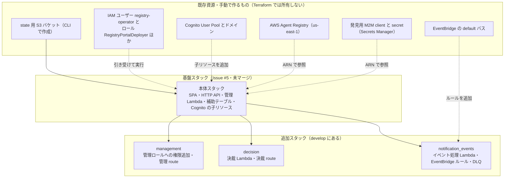

# Registry ポータルの Terraform ガイド（全体設計・既存資源の流用・初期設定・実行コマンド）

Registry ポータル（MVP1）を dev 環境に配信するための Terraform について、全体の構成、既存の AWS 資源の扱い、初回の準備、日常の実行コマンドをまとめます。設計の根拠は [MVP1 設計書](../../plan/aws-agent-registry-mvp1-design-ja.md)、[ADR-0003](../adr/0003-public-https-without-waf-and-single-registry.md)、[ADR-0004](../adr/0004-no-aws-deployment-from-ci.md) です。

**対象環境は、IAM Identity Center のない個人 AWS アカウント1つ**です。デプロイには、[個人アカウント向けの IAM 手順](registry-portal-iam-setup-personal-account-ja.md)で作る IAM ロール `RegistryPortalDeployer` を使います。

> [!IMPORTANT]
> **2026-11-17 時点の状態**
>
> - 基盤スタック（bootstrap、本体スタック、`scripts/deploy.sh`、plan のガード）は [Issue #5](https://github.com/JustinWangJP/sample-agentic-value-accelerator/issues/5) のブランチ `feature/5-portal-infrastructure` にだけあり、**`develop` には未マージ**です。
> - #5 の bootstrap と `deploy.sh` は IAM Identity Center を前提にしているため、**個人アカウントではそのまま使えません**。本書では、コードを直すまでの代わりの手順を示します（3.5、4.2）。
> - `develop` にあるのは、基盤スタックの資源を借りて権限と route を追加する**追加スタック**（`management`、`decision`、`notification_events`）だけです。
> - 本書の手順は、まだ AWS 上で実行・検証していません。統合前に解消が必要な点は「[7. 既知の食い違いと未解決事項](#7-既知の食い違いと未解決事項)」にまとめています。

## 目次

1. [全体設計](#1-全体設計)
2. [既存資源の流用](#2-既存資源の流用)
3. [初期設定（初回だけ行う作業）](#3-初期設定初回だけ行う作業)
4. [配信の手順](#4-配信の手順)
5. [実行コマンド一覧](#5-実行コマンド一覧)
6. [トラブルシューティング](#6-トラブルシューティング)
7. [既知の食い違いと未解決事項](#7-既知の食い違いと未解決事項)

## 1. 全体設計

### 1.1 設計方針

| 方針 | 内容 | 根拠 |
|---|---|---|
| 既存資源は所有しない | 既存の Registry と Cognito User Pool の本体は Terraform の resource にしない。ARN や ID を変数で受け取り、借りるだけにする | 設計書「デプロイと CI」、ADR-0003 |
| CI は反映しない | GitHub Actions では `terraform fmt -check` と `validate` だけを行う。AWS の認証情報と OIDC ロールは持たせない | ADR-0004 |
| 人が手元で反映する | オペレーターが MFA 付きで IAM ロール `RegistryPortalDeployer` を引き受け、その短期認証情報で反映する。長期アクセスキーで直接操作しない | 設計書「デプロイと CI」、個人アカウント向け IAM 手順 |
| plan をガードに通す | 保存した plan を JSON にして `scripts/check_plan.py` で検査し、目視で確認してから、その plan だけを apply する | Issue #5 |
| 最小権限 | Lambda の実行ロールは対象 Registry の ARN と必要な action だけに絞る。Lambda ごとに実行ロールを分ける | 設計書「最小インフラとセキュリティ」 |
| 削除事故を防ぐ | state バケットと補助テーブルには `prevent_destroy` を付け、補助テーブルには削除保護も設定する | Issue #5 |

### 1.2 IAM Identity Center を使わない理由

設計書は、Identity Center の permission set `RegistryPortalDeployer` を前提にしています。個人アカウントでは、これを同じ名前の IAM ロールで代替します。

- Identity Center の**アカウントインスタンス**は permission set に対応していないため、AWS アカウントへのアクセスには使えません（[AWS ドキュメント](https://docs.aws.amazon.com/singlesignon/latest/userguide/account-instances-identity-center.html)）。
- permission set を使うには**組織インスタンス**が必要です。そのためには AWS Organizations を作成し、個人アカウントを管理アカウントにする必要があります。MVP1 の dev のためにそこまでの手間をかけないので、本書では採用しません。

### 1.3 3つの層

構成は「既存資源」「基盤スタック」「追加スタック」の3層に分かれます。



AWS 上の構成図は [`docs/diagrams/agent-registry-mvp1-aws-architecture-ja.drawio`](../diagrams/agent-registry-mvp1-aws-architecture-ja.drawio) を参照してください。

### 1.4 スタック一覧

パスは `applications/registry_portal/` からの相対パスです。state の key は、個人アカウントでは `registry-portal/dev/` の下にそろえます。

| スタック | ディレクトリ | 主に作るもの | state の key | 状態 |
|---|---|---|---|---|
| bootstrap | `infrastructure/bootstrap/` | state 用 S3 バケット、Identity Center の permission set | — | **個人アカウントでは使わない**。state バケットは CLI で作る（3.5） |
| 本体 | `infrastructure/`（直下） | SPA 用 S3 と CloudFront（OAC、CSP、viewer request function）、HTTP API・JWT authorizer・stage、管理 Lambda と実行ロール、補助 DynamoDB、ロググループ、Cognito のリソースサーバー・人間用 client・グループ | `registry-portal/dev/terraform.tfstate` | #5 ブランチのみ |
| management | `infrastructure/management/` | 管理 Lambda のロールへの下書き用 inline policy、管理 handler の追加 route（管理レコード、接続情報、履歴、廃止依頼、通知）と呼び出し許可 | `registry-portal/dev/management.tfstate` | develop |
| decision | `infrastructure/decision/` | 決裁 Lambda、専用の実行ロール、ロググループ、決裁 route（審査、承認・却下、公開停止、廃止、回復など）と呼び出し許可 | `registry-portal/dev/decision.tfstate` | develop |
| notification_events | `infrastructure/notification_events/` | イベント処理 Lambda、専用の実行ロール、ロググループ、DLQ（SQS）、EventBridge ルールとターゲット、再試行の設定 | `registry-portal/dev/notification-events.tfstate` | develop |

どのスタックも `RegistryPortalDeployer` で実行します。

### 1.5 モジュール

| モジュール | 呼び出し元 | 内容 |
|---|---|---|
| `modules/management_drafts` | `management` | 既存の管理ロールに、Registry レコードの作成・更新・取得・一覧・申請と、補助テーブルの GetItem / PutItem / DeleteItem / Query / ConditionCheckItem を追加する（`draft-policy.json.tftpl`） |
| `modules/management_routes` | `management` | 既存の HTTP API に管理 handler の route を追加し、その path に限った `lambda:InvokeFunction` を許可する |
| `modules/decision` | `decision` | 決裁 Lambda（`registry_portal.handlers.curation.handler`）。権限は `UpdateRegistryRecordStatus` と読み取り、発見用 secret の取得、補助テーブルの操作（`decision-policy.json.tftpl`） |
| `modules/notification_events` | `notification_events` | イベント処理 Lambda（`registry_portal.handlers.events.handler`）。Registry の読み取りと、通知用のパーティションキーに限った PutItem（`events-policy.json.tftpl`） |

Lambda はどれも Python 3.13、arm64、タイムアウト30秒、メモリ256 MB です。ロググループの保存期間は365日です。

### 1.6 IAM の主体と職責

| 主体 | 作り方 | 用途と権限 |
|---|---|---|
| IAM ユーザー `registry-operator` | 手動（IAM 手順の1） | サインイン用。MFA 必須。権限は下の3ロールの `sts:AssumeRole` だけ |
| IAM ロール `RegistryPortalReadOnly` | 手動（IAM 手順の3） | Issue #2 の読み取り確認 |
| IAM ロール `RegistryPortalDeployer` | 手動（IAM 手順の4） | Terraform の実行。`AdministratorAccess` に加えて、Registry への書き込みと、保護対象の IAM 主体の変更を明示的に Deny する |
| IAM ロール `RegistryPortalBreakGlass` | 手動（IAM 手順の5） | 緊急時の Registry レコードの直接変更 |
| 管理 Lambda の実行ロール | 本体と management | 読み取り、`CreateRegistryRecord`、`UpdateRegistryRecord`、`SubmitRegistryRecordForApproval`。決裁（`UpdateRegistryRecordStatus`）は持たない |
| 決裁 Lambda の実行ロール | decision | 読み取り、`UpdateRegistryRecordStatus`。descriptor の作成・更新と申請は持たない |
| イベント処理 Lambda の実行ロール | notification_events | `GetRegistryRecord` だけ |

Lambda の実行ロールには、Registry 本体の作成・削除・設定変更、レコードの物理削除、`iam:PassRole` を付けません。

`RegistryPortalDeployer` は `AdministratorAccess` を持つため、permission set よりも権限が広くなります。権限の境界は、plan のガード（`check_plan.py`）と apply 前の目視確認で守ります（IAM 手順の4の注記）。

## 2. 既存資源の流用

### 2.1 流用する資源と渡し方

| 既存資源 | Terraform での扱い | 渡す変数 | 確認方法 |
|---|---|---|---|
| AWS Agent Registry | 所有しない。ARN を参照する。`check_plan.py` が create / update / delete / 置換を検出したら中止する | `registry_arn` | [既存 Registry の確認手順](registry-portal-existing-registry-check-ja.md) の1・2 |
| Cognito User Pool | 本体とドメインは所有しない。子リソース（リソースサーバー `registry-portal`、人間用 client、グループ）だけを本体スタックで追加する | `cognito_user_pool_id`、`cognito_domain`、`identity_providers` | 同上の4・7 |
| 発見用 M2M client | 所有しない。client ID とトークンエンドポイントを Lambda の環境変数に渡す | `discovery_client_id`、`discovery_token_url`、`discovery_scope` | 同上の4・7 |
| 発見用 M2M の secret | 所有しない。完全な ARN だけを渡し、secret の値は Terraform に渡さない | `discovery_client_secret_arn` | 同上の4「secret の保管先」 |
| secret の KMS キー | 顧客管理キーの場合だけ ARN を渡す。Secrets Manager 経由で、対象 secret の暗号化コンテキストに限った `kms:Decrypt` を付ける | `discovery_kms_key_arn`（AWS 管理キーなら `null`） | 同上の4・7 |
| IAM ユーザーと3つのロール | 所有しない。手動で作る | なし | [個人アカウント向けの IAM 手順](registry-portal-iam-setup-personal-account-ja.md) |
| state 用 S3 バケット | 所有しない。CLI で作る（3.5） | `backend.hcl` の `bucket` | 3.5 |
| EventBridge の default バス | 所有しない。ルールを1本追加する | なし（`event_bus_name = "default"` で固定） | — |
| CloudTrail | Terraform では扱わない。個人アカウントに組織の trail はないので、イベント履歴（90日）を使うか、必要なら trail を手動で作る | なし | — |

### 2.2 同じ名前の資源がすでにある場合

同じ資源を複数の state で管理しないでください。すでに資源がある場合は `terraform import` で取り込み、plan に作り直しがないことを確認します。

| 既存の可能性があるもの | 取り込み先のアドレス | import ID の形式 |
|---|---|---|
| Cognito グループ（`registry-publisher` など） | `aws_cognito_user_group.business["registry-publisher"]` | `<user_pool_id>/<グループ名>` |
| チームグループ（`team-*`） | `aws_cognito_user_group.team["<チーム名>"]` | `<user_pool_id>/team-<チーム名>` |
| リソースサーバー `registry-portal` | `aws_cognito_resource_server.portal` | `<user_pool_id>\|registry-portal` |

import ID の形式は AWS provider のバージョンで変わることがあります。実行前に [Terraform Registry の各 resource の Import 節](https://registry.terraform.io/providers/hashicorp/aws/6.71.0/docs) で確認してください。

```bash
# 例: 本体スタックに既存のグループを取り込む
AWS_PROFILE=registry-deploy-tf terraform -chdir=infrastructure import -var-file=dev.tfvars \
  -var="lambda_zip_path=$PWD/build/management.zip" \
  'aws_cognito_user_group.business["registry-publisher"]' 'us-east-1_XXXXXXXXX/registry-publisher'
```

### 2.3 作らないもの

- ポータル利用者、発見用 M2M、CI 用の IAM ユーザーとロール。認証には Cognito を使います。
- GitHub Actions から AWS に反映するためのロール（ADR-0004）。
- IAM Identity Center、AWS Organizations。
- VPC、NAT Gateway、ALB、ECS、WAF、独自ドメイン、Route 53（ADR-0003）。
- Lambda の Function URL。

## 3. 初期設定（初回だけ行う作業）

### 3.1 必要なツール

| ツール | バージョン | 備考 |
|---|---|---|
| Terraform | 1.10 以上、2.0 未満 | S3 ネイティブのロック（`use_lockfile`）に 1.10 以上が必要。CI は 1.10.5 |
| AWS provider | 本体は `= 6.71.0`、追加スタックは `~> 6.0` | `.terraform.lock.hcl` は `.gitignore` の対象 |
| Python | 3.13 と pip | Lambda の zip を作るのに使う |
| Node.js | 24 と npm | SPA のビルドに使う |
| AWS CLI | v2（`aws configure export-credentials` が使えるもの） | MFA 付きのロールを Terraform に渡すのに使う（3.4） |
| jq | 任意のバージョン | 4.2 で Terraform の出力を読むのに使う |

### 3.2 事前に確定する値

Issue #2 の読み取り確認（[既存 Registry の確認手順](registry-portal-existing-registry-check-ja.md)）で、次の値を確定しておきます。確認手順の手順 7 で、これらの値をまとめ、ポータルが作るグループ・リソースサーバー・IAM ロールと同じ名前のものがないかも確認します。

| 値 | 使う変数 | 使うスタック |
|---|---|---|
| AWS アカウント ID | `aws_account_id` | 本体 |
| Registry ARN | `registry_arn` | 本体、すべての追加スタック |
| Cognito User Pool ID | `cognito_user_pool_id` | 本体、decision |
| Cognito ドメイン（`https://...amazoncognito.com`、末尾の `/` なし） | `cognito_domain` | 本体 |
| 人間用 IdP 名（User Pool のユーザーでログインするなら `COGNITO`） | `identity_providers` | 本体 |
| 所属チーム名（`team-` は付けない） | `team_names` | 本体 |
| 発見用 M2M のトークン URL、client ID、scope | `discovery_token_url`、`discovery_client_id`、`discovery_scope` | 本体、decision |
| 発見用 M2M secret の ARN（と KMS キーの ARN） | `discovery_client_secret_arn`、`discovery_kms_key_arn` | 本体、decision |
| state 用バケット名と SPA 用バケット名（どちらもグローバルに一意） | `backend.hcl` の `bucket`、`spa_bucket_name` | すべて、本体 |

### 3.3 IAM ユーザーとロールを作る

[個人アカウント向けの IAM 手順](registry-portal-iam-setup-personal-account-ja.md)の1〜8を済ませます。9の「ローカル端末を使う」で、`registry-operator` のプロファイルと、ロールごとのプロファイル（`registry-read`、`registry-deploy`、`registry-break-glass`）を作っておきます。

### 3.4 Terraform 用のプロファイルを作る

Terraform の AWS provider は、MFA コードの入力を求めることができません。`mfa_serial` 付きのプロファイル（`registry-deploy`）を Terraform にそのまま渡すと、`AssumeRoleTokenProviderNotSetError` で失敗します（[Classmethod の解説](https://dev.classmethod.jp/articles/terraform-mfa-assumerole-export-credentials/)）。

そこで、AWS CLI が取得してキャッシュした `RegistryPortalDeployer` の短期認証情報を、`credential_process` で Terraform に渡すプロファイルを追加します。`~/.aws/config` に次を追記します。

```ini
[profile registry-deploy-tf]
credential_process = aws configure export-credentials --profile registry-deploy --format process
region = us-east-1
```

使う前に、AWS CLI で一度ロールを引き受けて MFA コードを入力し、短期認証情報をキャッシュさせます。キャッシュの有効期間は、ロールの最大セッション時間（既定は1時間）です。期限が切れたら、このコマンドをもう一度実行します。

```bash
aws sts get-caller-identity --profile registry-deploy      # MFA コードを入力する
aws sts get-caller-identity --profile registry-deploy-tf   # MFA を求められず、同じ Arn が表示されることを確認する
# Arn: arn:aws:sts::<アカウント ID>:assumed-role/RegistryPortalDeployer/...
```

`credential_process` のコマンドは MFA コードを対話的に入力できない場合があります。2行目で MFA を求められたり失敗したりする場合は、1行目を実行し直してキャッシュを作ってください。

環境変数 `AWS_ACCESS_KEY_ID`、`AWS_SECRET_ACCESS_KEY`、`AWS_SESSION_TOKEN` は設定しません。設定されているとプロファイルより優先されます。

### 3.5 state 用 S3 バケットを作る

#5 の bootstrap は、Identity Center の permission set と割り当てを作るため、個人アカウントでは `plan` の段階で失敗します。さらに、bootstrap が作る state バケットのポリシーは `AWSReservedSSO_RegistryPortalDeployer_*` 以外の主体による state の読み書きを拒否します。そのため、バケットだけを作っても IAM ロールの `RegistryPortalDeployer` は state を使えません。**bootstrap をそのまま apply しないでください。**

コードを直すまで（7の #6）は、bootstrap と同じ設定のバケットを CLI で作ります。`RegistryPortalDeployer` で実行します。

```bash
export AWS_PROFILE=registry-deploy AWS_REGION=us-east-1
ACCOUNT_ID=$(aws sts get-caller-identity --query Account --output text)
STATE_BUCKET=registry-portal-state-$ACCOUNT_ID
DEPLOYER_ROLE_ARN=arn:aws:iam::$ACCOUNT_ID:role/RegistryPortalDeployer

# us-east-1 では LocationConstraint を指定しない
aws s3api create-bucket --bucket "$STATE_BUCKET"
aws s3api put-public-access-block --bucket "$STATE_BUCKET" \
  --public-access-block-configuration BlockPublicAcls=true,IgnorePublicAcls=true,BlockPublicPolicy=true,RestrictPublicBuckets=true
aws s3api put-bucket-ownership-controls --bucket "$STATE_BUCKET" \
  --ownership-controls 'Rules=[{ObjectOwnership=BucketOwnerEnforced}]'
aws s3api put-bucket-versioning --bucket "$STATE_BUCKET" --versioning-configuration Status=Enabled
aws s3api put-bucket-encryption --bucket "$STATE_BUCKET" \
  --server-side-encryption-configuration '{"Rules":[{"ApplyServerSideEncryptionByDefault":{"SSEAlgorithm":"AES256"}}]}'

cat > "$TMPDIR/state-bucket-policy.json" <<EOF
{
  "Version": "2012-10-17",
  "Statement": [
    {
      "Sid": "RequireTLS",
      "Effect": "Deny",
      "Principal": "*",
      "Action": "s3:*",
      "Resource": ["arn:aws:s3:::$STATE_BUCKET", "arn:aws:s3:::$STATE_BUCKET/*"],
      "Condition": {"Bool": {"aws:SecureTransport": "false"}}
    },
    {
      "Sid": "StateOnlyForDeployer",
      "Effect": "Deny",
      "Principal": "*",
      "Action": ["s3:GetObject*", "s3:PutObject*", "s3:DeleteObject*", "s3:ListBucket*"],
      "Resource": ["arn:aws:s3:::$STATE_BUCKET", "arn:aws:s3:::$STATE_BUCKET/*"],
      "Condition": {"ArnNotLike": {"aws:PrincipalArn": "$DEPLOYER_ROLE_ARN"}}
    }
  ]
}
EOF
aws s3api put-bucket-policy --bucket "$STATE_BUCKET" --policy "file://$TMPDIR/state-bucket-policy.json"
```

- `aws:PrincipalArn` には、引き受けたロールのセッションではなく、ロールの ARN が入ります。そのため、条件にはロール ARN を指定します。
- このポリシーを適用すると、`RegistryPortalDeployer` 以外の主体（`RegistryPortalReadOnly` を含む）は state を読めなくなります。誤って Deployer 自身を締め出した場合は、ルートユーザーでサインインしてバケットポリシーを削除できます。
- bootstrap と違い、このバケットは Terraform の管理対象ではないので、`prevent_destroy` による保護はありません。バケットを削除しないでください。

### 3.6 本体スタックの設定ファイルを作る

```bash
cd applications/registry_portal
cp infrastructure/backend.hcl.example infrastructure/backend.hcl
cp infrastructure/terraform.tfvars.example infrastructure/dev.tfvars
```

- `backend.hcl` の `bucket` には、3.5 で作ったバケット名を設定します。key は `registry-portal/dev/terraform.tfstate` のままにします。
- `dev.tfvars` には、アカウント ID、SPA バケット名、`name_prefix`（既定は `registry-portal-dev`）などを設定します。secret の値は書きません。

`dev.tfvars` は `.gitignore`（`**/*.tfvars`）の対象ですが、`backend.hcl` は対象外です。コミットしないよう `git status` で確認してください。

## 4. 配信の手順

### 4.1 適用の順序

| 順序 | 作業 | プロファイル |
|---|---|---|
| 0 | Issue #2 の読み取り確認で、既存資源の値を確定する | `registry-read` |
| 1 | IAM ユーザーとロールを作る（3.3） | ルートユーザーまたは管理者 |
| 2 | state 用バケットを作る（3.5） | `registry-deploy` |
| 3 | 本体スタックを配信する（4.2） | `registry-deploy-tf` と `registry-deploy` |
| 4 | `management`（下書き権限と管理 route） | `registry-deploy-tf` |
| 5 | `decision`（決裁 Lambda と route） | `registry-deploy-tf` |
| 6 | `notification_events`（通知） | `registry-deploy-tf` |
| 7 | Cognito でユーザーを作り、グループに割り当てる | コンソール（`registry-deploy`） |
| 8 | dev で受入確認を行う（Issue #5 の README のチェックリスト） | — |

4〜6の順序に依存関係はありませんが、本体スタックの資源を借りるため、3の後に実行します。3の前に、7の #1〜#3（TTL 属性名、環境変数、CORS）を #5 のブランチで直しておいてください。直さないと配信後に API が動きません。

### 4.2 本体スタックを配信する

`deploy.sh` は SSO のプロファイルと `AWSReservedSSO_RegistryPortalDeployer_*` のロールを確認し、どちらにも当てはまらなければ止まります。そのため、個人アカウントでは使えません（7の #6）。コードを直すまでは、`deploy.sh` と同じ処理を次の手順で手作業で行います。途中でエラーになったら、それ以降の手順に進まないでください。

```bash
cd applications/registry_portal
unset AWS_ACCESS_KEY_ID AWS_SECRET_ACCESS_KEY AWS_SESSION_TOKEN
aws sts get-caller-identity --profile registry-deploy          # MFA を入力し、キャッシュを作る
export AWS_PROFILE=registry-deploy-tf
WORK=$(mktemp -d "${TMPDIR:-/tmp}/registry-portal-deploy.XXXXXX")

# 1. 固定版の SDK を同梱した Lambda の zip を作る
python3 scripts/build_lambda.py --output "$WORK/management.zip"

# 2. 初期化と検証（暗号化とロックを強制する）
terraform -chdir=infrastructure init -input=false -reconfigure \
  -backend-config="$PWD/infrastructure/backend.hcl" \
  -backend-config=encrypt=true -backend-config=use_lockfile=true
terraform -chdir=infrastructure validate

# 3. plan を保存してガードに通す
terraform -chdir=infrastructure plan -input=false \
  -var-file="$PWD/infrastructure/dev.tfvars" \
  -var="lambda_zip_path=$WORK/management.zip" \
  -out="$WORK/approved.tfplan"
terraform -chdir=infrastructure show -json "$WORK/approved.tfplan" > "$WORK/plan.json"
python3 scripts/check_plan.py "$WORK/plan.json"

# 4. plan を目視で確認する（既存 Registry の変更・削除がなく、IAM が意図した ARN と action に限られていること）
terraform -chdir=infrastructure show -no-color "$WORK/approved.tfplan" | less

# 5. 確認できたら、保存した plan だけを apply する
terraform -chdir=infrastructure apply -input=false "$WORK/approved.tfplan"

# 6. 出力を環境変数にして SPA をビルドする
eval "$(terraform -chdir=infrastructure output -json frontend_config \
  | jq -r 'to_entries[] | "export \(.key)=\(.value | @sh)"')"
SPA_BUCKET=$(terraform -chdir=infrastructure output -raw spa_bucket_name)
DIST_ID=$(terraform -chdir=infrastructure output -raw cloudfront_distribution_id)
(cd frontend && npm ci && npm run build)

# 7. アセットを同期し、index.html はキャッシュなしで最後に置く
aws s3 sync frontend/dist/ "s3://$SPA_BUCKET/" --delete --exclude index.html \
  --cache-control 'public,max-age=31536000,immutable'
aws s3 cp frontend/dist/index.html "s3://$SPA_BUCKET/index.html" \
  --cache-control 'no-cache,no-store,must-revalidate' --content-type 'text/html'

# 8. CloudFront のキャッシュを無効化し、作業ディレクトリを消す
aws cloudfront create-invalidation --distribution-id "$DIST_ID" --paths '/*'
rm -rf "$WORK"
```

`frontend_config` には、`VITE_COGNITO_DOMAIN`、`VITE_COGNITO_CLIENT_ID`、`VITE_REDIRECT_URI`、`VITE_API_BASE_URL`、`VITE_COGNITO_SCOPES` が入ります。secret は含みません。

### 4.3 追加スタックに渡す値を集める

追加スタックの `terraform.tfvars.example` の名前（`registry-portal-management`、`registry-auxiliary` など）は例です。本体スタックが実際に作った名前に置き換えてください。`name_prefix` が既定の `registry-portal-dev` の場合、名前は次のようになります。

| 変数 | 値 | 使うスタック |
|---|---|---|
| `region` | `us-east-1` | すべて |
| `registry_arn` | `dev.tfvars` と同じ値 | すべて |
| `supplement_table_name` | `registry-portal-dev-auxiliary` | decision、notification_events |
| `supplement_table_arn` | `arn:aws:dynamodb:us-east-1:<アカウント ID>:table/registry-portal-dev-auxiliary` | すべて |
| `management_role_name` | `registry-portal-dev-management` | management |
| `management_function_name` | `registry-portal-dev-management` | management |
| `http_api_id` | 下のコマンドで調べる | management、decision |
| `jwt_authorizer_id` | 下のコマンドで調べる（名前は `human-access-token`） | management、decision |
| `management_integration_id` | 下のコマンドで調べる | management |
| `cognito_user_pool_id` | `dev.tfvars` と同じ値 | decision |
| `human_client_id` | 下のコマンドで調べる（名前は `registry-portal-dev-human`） | decision |
| `discovery_*` | `dev.tfvars` と同じ値 | decision |
| `lambda_zip_path` | 4.4 で作った zip のパス | decision、notification_events |

```bash
export AWS_PROFILE=registry-deploy AWS_REGION=us-east-1
API_ID=$(aws apigatewayv2 get-apis --query "Items[?Name=='registry-portal-dev'].ApiId" --output text)
echo "http_api_id = $API_ID"
aws apigatewayv2 get-authorizers --api-id "$API_ID" \
  --query "Items[?Name=='human-access-token'].AuthorizerId" --output text
aws apigatewayv2 get-integrations --api-id "$API_ID" \
  --query "Items[?contains(IntegrationUri, 'registry-portal-dev-management')].IntegrationId" --output text
USER_POOL_ID='dev.tfvars の cognito_user_pool_id'
aws cognito-idp list-user-pool-clients --user-pool-id "$USER_POOL_ID" \
  --query "UserPoolClients[?ClientName=='registry-portal-dev-human'].ClientId" --output text
```

### 4.4 Lambda の zip を作る

`decision` と `notification_events` の例では、`lambda_zip_path = "../../backend/build/lambda.zip"` を想定しています。`develop` には zip を作るスクリプトがありません。#5 の `scripts/build_lambda.py` は `backend/src/registry_portal` パッケージ全体と固定版の依存パッケージを同梱するので、同じ zip を決裁とイベント処理の Lambda にも使える見込みです（handler が違うだけです）。

```bash
cd applications/registry_portal
python3 scripts/build_lambda.py --output backend/build/lambda.zip
```

現状、`backend/build/` は `.gitignore` の対象外です。zip をコミットしないよう注意し、統合時に `.gitignore` に追加してください。

### 4.5 追加スタックを適用する

3つの追加スタックの手順は同じです。最初の `STACK` と `STATE_KEY` だけを、スタックごとに 1.4 の表の値に変えて実行します。backend は部分設定（`backend "s3" {}`）なので、`init` のときに指定します。リポジトリのルートで実行します。

| `STACK` | `STATE_KEY` |
|---|---|
| `management` | `management.tfstate` |
| `decision` | `decision.tfstate` |
| `notification_events` | `notification-events.tfstate` |

```bash
STACK=management
STATE_KEY=management.tfstate
export AWS_PROFILE=registry-deploy-tf
STATE_BUCKET=registry-portal-state-$(aws sts get-caller-identity --query Account --output text)   # 3.5 で作ったバケット
cd "applications/registry_portal/infrastructure/$STACK"
cp terraform.tfvars.example terraform.tfvars    # 4.3 の値を設定する。コミットしない
terraform init \
  -backend-config="bucket=$STATE_BUCKET" \
  -backend-config="key=registry-portal/dev/$STATE_KEY" \
  -backend-config="region=us-east-1" \
  -backend-config="encrypt=true" \
  -backend-config="use_lockfile=true"
terraform plan -out=tfplan
terraform show tfplan            # 既存 Registry・既存 HTTP API の変更や削除がないことを確認する
terraform apply tfplan
rm tfplan
cd -    # リポジトリのルートに戻る
```

README には `registry-portal/decision.tfstate` のような key の例がありますが、個人アカウントでは1.4の表の key にそろえます。

## 5. 実行コマンド一覧

### 5.1 ローカルの検査（AWS の認証情報は不要）

```bash
cd applications/registry_portal

# 整形（全スタック）
terraform -chdir=infrastructure fmt -check -recursive

# 追加スタックの検証（develop の CI と同じ。CI は notification_events をまだ検証していない）
for d in management decision notification_events; do
  terraform -chdir=infrastructure/$d init -backend=false
  terraform -chdir=infrastructure/$d validate
done

# IAM ポリシーのテンプレートのテスト
(cd backend && pytest tests/test_decision_permissions.py)

# 以下は #5 の統合後に実行できる
terraform -chdir=infrastructure init -backend=false
terraform -chdir=infrastructure validate
terraform -chdir=infrastructure test                  # mock provider を使う
python3 -m unittest discover -s infrastructure/tests -v
node --test infrastructure/tests/spa_rewrite.test.mjs
bash -n scripts/deploy.sh
```

### 5.2 AWS に反映するコマンド

| 目的 | コマンド |
|---|---|
| MFA を入力して短期認証情報をキャッシュする | `aws sts get-caller-identity --profile registry-deploy` |
| Terraform 用のプロファイルを確認する | `aws sts get-caller-identity --profile registry-deploy-tf` |
| state 用バケットを作る（初回だけ） | 3.5 のコマンド |
| 本体スタックを配信する | 4.2 のコマンド |
| 追加スタックを適用する | 各ディレクトリで `terraform init -backend-config=...`、`plan -out=tfplan`、`apply tfplan` |
| plan だけを手で検査する | `terraform show -json tfplan > plan.json && python3 scripts/check_plan.py plan.json` |

### 5.3 state の操作

`AWS_PROFILE=registry-deploy-tf` を設定して、各スタックのディレクトリで実行します。

| 目的 | コマンド |
|---|---|
| 管理対象の一覧 | `terraform state list` |
| 既存資源を取り込む | `terraform import -var-file=<tfvars> '<アドレス>' '<ID>'` |
| 管理対象から外す（AWS 上の資源は消さない） | `terraform state rm '<アドレス>'` |
| ロックが残ったとき | `terraform force-unlock <LOCK_ID>`（ほかに実行中の作業がないことを確認してから） |

`management_routes` を本体スタックに移すときは、本体スタックで import してから `management` の state で `terraform state rm` を実行し、二重に管理しないようにします（README「公開停止・廃止・廃止依頼」）。

### 5.4 削除について

補助テーブルには `prevent_destroy` と削除保護があるため、本体スタックの `terraform destroy` は失敗します。dev 環境を作り直す手順はまだ決めていません。既存の Registry と User Pool、3.5 の state バケット、手動で作った IAM の主体は Terraform で管理していないので、destroy の対象にはなりません。

## 6. トラブルシューティング

| 症状 | 主な原因と対処 |
|---|---|
| Terraform が `AssumeRoleTokenProviderNotSetError` で止まる | `mfa_serial` 付きのプロファイル（`registry-deploy`）を Terraform に渡している。`registry-deploy-tf` を使う（3.4） |
| `registry-deploy-tf` で `ExpiredToken`、または MFA を求められる | キャッシュの期限切れ。`aws sts get-caller-identity --profile registry-deploy` をもう一度実行する |
| `terraform init` で state バケットの 403 | `RegistryPortalDeployer` 以外で実行しているか、環境変数の認証情報がプロファイルより優先されている。`aws sts get-caller-identity` の Arn を確認する |
| `deploy.sh` が「IAM Identity Center の SSO profile が必要です」で止まる | 個人アカウントでは `deploy.sh` を使えない。4.2 の手順で配信する |
| `check_plan.py` が中止する | plan に既存 Registry の変更・削除・置換、禁止 action の Allow、managed policy の付与、Function URL、`NotAction` や全権限のワイルドカードが含まれている。plan を見直す |
| provider が `allowed_account_ids` でエラーになる | `aws_account_id` とログイン先のアカウントが違う |
| `apply` でグループやリソースサーバーの重複エラー | 同じ名前のものが既にある。2.2 の手順で import する |
| `iam:PutRolePolicy` などが `explicitDeny` になる | `RegistryPortalDeployer` は、自分自身・ほかの2ロール・`registry-operator` の IAM を変更できない（IAM 手順の4）。Terraform の対象にそれらを含めない |
| 決裁 Lambda が起動直後に設定エラーになる | 環境変数の `SUPPLEMENT_TABLE_NAME` や `DISCOVERY_*` が未設定か、形式が誤っている |

## 7. 既知の食い違いと未解決事項

#5 のブランチは、追加スタックができる前に分岐しています。また、Identity Center を前提に作られています。統合する Issue で次の点を解消してください。

| # | 内容 | 影響 | 対応案 |
|---|---|---|---|
| 1 | 補助テーブルの TTL 属性名が、#5 では `expires_at`、アプリ（`backend/src/registry_portal/services/dynamodb.py`）と README では `expiresAt` | 通知と既読位置が90日後に削除されない | #5 の `aws_dynamodb_table.auxiliary` の `ttl.attribute_name` を `expiresAt` にする |
| 2 | #5 の管理 Lambda に環境変数 `SUPPLEMENT_TABLE_NAME` がない | 下書き、履歴、通知の API が 503 になる | 本体スタックの環境変数に補助テーブル名を追加する |
| 3 | #5 の HTTP API の CORS が `GET` と `OPTIONS` だけ | `POST`（申請、決裁など）と `Idempotency-Key` ヘッダーがブラウザで拒否される | `allow_methods` に `POST`、`allow_headers` に `idempotency-key` を追加する |
| 4 | `check_plan.py` が `CreateRegistryRecord`、`UpdateRegistryRecord`、`UpdateRegistryRecordStatus`、`SubmitRegistryRecordForApproval` の Allow を禁止している | 追加スタックの IAM を本体の plan に含めるとガードが中止する | 管理ロールと決裁ロールに限って、それぞれに必要な action を許可するようガードと fixture を更新する（#5 の README で予告済み） |
| 5 | bootstrap が Identity Center の permission set と割り当てを必須で作る | 個人アカウントでは bootstrap を使えない | Identity Center の資源を `count` で任意にする。または個人アカウント用に、state バケットだけを作る構成に分ける |
| 6 | state バケットのポリシーと `deploy.sh` が、SSO ロール（`AWSReservedSSO_RegistryPortalDeployer_*`）と SSO プロファイルだけを許可している | 個人アカウントの IAM ロールでは state を使えず、`deploy.sh` も使えない | state バケットのポリシーで許可する主体の ARN を変数（例: `deployer_principal_arn`）にする。`deploy.sh` は、`role_arn` 付きのプロファイルと `assumed-role/RegistryPortalDeployer/*` も受け付けるようにし、MFA を求めない Terraform 用のプロファイル（3.4）を前提にする |
| 7 | 追加スタックの provider の固定方法が本体と揃っていない（`~> 6.0`） | provider のバージョンがスタックごとにずれる | `= 6.71.0` に固定する |
| 8 | CI が `notification_events` の `validate` をまだ実行していない | 構文エラーに気づくのが遅れる | `.github/workflows/registry-portal-ci.yml` に追加する |
| 9 | 決裁と管理の route が本体スタックの外にある | HTTP API の資源が3つの state に分散する | README の方針どおり、統合時に `management_routes` と `decision` の route を本体スタックから呼び出し、元の state から `state rm` する |
| 10 | `RegistryPortalDeployer` が `AdministratorAccess` を持つ | permission set より権限が広く、Registry に書き込めるロールを新しく作ることも防げない | plan のガードと目視で確認する。デプロイ対象が固まったら、必要なサービスだけのポリシーにするか、作成するロールに permissions boundary を必須にする（IAM 手順の4の注記） |

## 関連文書

- [MVP1 設計書](../../plan/aws-agent-registry-mvp1-design-ja.md)
- [Registry ポータルの README](../../applications/registry_portal/README.md)
- [既存の AWS Agent Registry の確認手順](registry-portal-existing-registry-check-ja.md)
- [Issue #2 の作業記録テンプレートと再確認の手順](registry-portal-issue2-record-template-ja.md)
- [個人 AWS アカウントでの IAM ユーザーとロールの作成手順](registry-portal-iam-setup-personal-account-ja.md)
- [ADR-0003 公開 HTTPS と単一 Registry](../adr/0003-public-https-without-waf-and-single-registry.md)
- [ADR-0004 CI から AWS に反映しない](../adr/0004-no-aws-deployment-from-ci.md)
