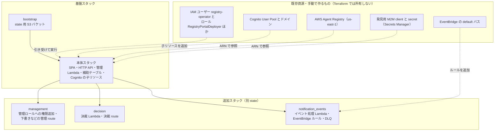

# Registry ポータルの Terraform ガイド（全体設計・既存資源の流用・初期設定・実行コマンド）

Registry ポータル（MVP1）を dev 環境に配信するための Terraform について、全体の構成、既存の AWS 資源の扱い、初回の準備、日常の実行コマンドをまとめます。設計の根拠は [MVP1 設計書](../../plan/aws-agent-registry-mvp1-design-ja.md)、[ADR-0003](../adr/0003-public-https-without-waf-and-single-registry.md)、[ADR-0004](../adr/0004-no-aws-deployment-from-ci.md) です。

**対象環境は、IAM Identity Center のない個人 AWS アカウント 1 つ**です。デプロイには、[個人アカウント向けの IAM 手順](registry-portal-iam-setup-personal-account-ja.md)で作る IAM ロール `RegistryPortalDeployer` を使います。

> [!IMPORTANT]
> **Issue #5・#49 の統合実装の状態**
>
> - bootstrap と `scripts/deploy.sh` は、MFA 付き IAM ロール `RegistryPortalDeployer` を使う個人アカウントに対応しています。Terraform には `credential_process` のプロファイルを渡します（3.4、4.2）。
> - 本体と追加スタック（`management`、`decision`、`notification_events`）は別 state で運用します。本体の output を各追加スタックの tfvars に手動で転記します（[ADR-0013](../adr/0013-separate-portal-addon-states.md)）。
> - dev への AWS apply と手動受入は未実施です。実装で解消した点と運用時の確認事項は「[7. 統合実装の状態と確認事項](#7-統合実装の状態と確認事項)」にまとめています。

## 目次

1. [全体設計](#1-全体設計)
2. [既存資源の流用](#2-既存資源の流用)
3. [初期設定（初回だけ行う作業）](#3-初期設定初回だけ行う作業)
4. [配信の手順](#4-配信の手順)
5. [実行コマンド一覧](#5-実行コマンド一覧)
6. [トラブルシューティング](#6-トラブルシューティング)
7. [統合実装の状態と確認事項](#7-統合実装の状態と確認事項)

## 1. 全体設計

### 1.1 設計方針

| 方針 | 内容 | 根拠 |
| --- | --- | --- |
| 既存資源は所有しない | 既存の Registry と Cognito User Pool の本体は Terraform の resource にしない。ARN や ID を変数で受け取り、借りるだけにする | 設計書「デプロイと CI」、ADR-0003 |
| CI は反映しない | GitHub Actions では `terraform fmt -check` と `validate` だけを行う。AWS の認証情報と OIDC ロールは持たせない | ADR-0004 |
| 人が手元で反映する | オペレーターが MFA 付きで IAM ロール `RegistryPortalDeployer` を引き受け、その短期認証情報で反映する。長期アクセスキーで直接操作しない | 設計書「デプロイと CI」、個人アカウント向け IAM 手順 |
| plan をガードに通す | 保存した plan を JSON にして `scripts/check_plan.py` で検査し、目視で確認してから、その plan だけを apply する | Issue #5 |
| 最小権限 | Lambda の実行ロールは対象 Registry の ARN と必要な action だけに絞る。Lambda ごとに実行ロールを分ける | 設計書「最小インフラとセキュリティ」 |
| 削除事故を防ぐ | state バケットと補助テーブルには `prevent_destroy` を付け、補助テーブルには削除保護も設定する | Issue #5 |

### 1.2 IAM Identity Center を使わない理由

設計書は、Identity Center の permission set `RegistryPortalDeployer` を前提にしています。個人アカウントでは、これを同じ名前の IAM ロールで代替します。

- Identity Center の**アカウントインスタンス**は permission set に対応していないため、AWS アカウントへのアクセスには使えません（[AWS ドキュメント](https://docs.aws.amazon.com/singlesignon/latest/userguide/account-instances-identity-center.html)）。
- permission set を使うには**組織インスタンス**が必要です。そのためには AWS Organizations を作成し、個人アカウントを管理アカウントにする必要があります。MVP1 の dev のためにそこまでの手間をかけないので、本書では採用しません。

### 1.3 3 つの層

構成は「既存資源」「基盤スタック」「追加スタック」の 3 層に分かれます。



AWS 上の構成図は [`docs/diagrams/agent-registry-mvp1-aws-architecture-ja.drawio`](../diagrams/agent-registry-mvp1-aws-architecture-ja.drawio) を参照してください。

### 1.4 スタック一覧

パスは `applications/registry_portal/` からの相対パスです。state の key は、個人アカウントでは `registry-portal/dev/` の下にそろえます。

| スタック | ディレクトリ | 主に作るもの | state の key | 状態 |
| --- | --- | --- | --- | --- |
| bootstrap | `infrastructure/bootstrap/` | state 用 S3 バケット。Identity Center の permission set と割り当ては任意 | ローカルの `terraform.tfstate` | 個人アカウント対応済み。state は暗号化した場所で別途保管する（3.5） |
| 本体 | `infrastructure/`（直下） | SPA 用 S3 と CloudFront（OAC、CSP、viewer request function）、HTTP API・JWT authorizer・stage、管理 Lambda と実行ロール、補助 DynamoDB、ロググループ、Cognito のリソースサーバー・人間用 client・グループ | `registry-portal/dev/terraform.tfstate` | 統合実装済み。追加スタック向け output を提供する |
| management | `infrastructure/management/` | 管理 Lambda のロールへの下書き用 inline policy、管理 handler の追加 route（下書き・申請・操作照会、管理レコード、接続情報、履歴、廃止依頼、通知）と呼び出し許可 | `registry-portal/dev/management.tfstate` | 別 state で運用。本体の output を転記する |
| decision | `infrastructure/decision/` | 決裁 Lambda、専用の実行ロール、ロググループ、決裁 route（審査、承認・却下、公開停止、廃止、回復など）と呼び出し許可 | `registry-portal/dev/decision.tfstate` | 別 state で運用。顧客管理 KMS キーに対応済み（#49） |
| notification_events | `infrastructure/notification_events/` | イベント処理 Lambda、専用の実行ロール、ロググループ、DLQ（SQS）、EventBridge ルールとターゲット、再試行の設定 | `registry-portal/dev/notification-events.tfstate` | 別 state で運用。CI の検証対象に追加済み |

どのスタックも `RegistryPortalDeployer` で実行します。

### 1.5 モジュール

| モジュール | 呼び出し元 | 内容 |
| --- | --- | --- |
| `modules/management_drafts` | `management` | 既存の管理ロールに、Registry レコードの作成・更新・取得・一覧・申請と、補助テーブルの GetItem / PutItem / DeleteItem / Query / ConditionCheckItem を追加する（`draft-policy.json.tftpl`） |
| `modules/management_routes` | `management` | 既存の HTTP API に管理 handler の route を追加し、その path に限った `lambda:InvokeFunction` を許可する |
| `modules/decision` | `decision` | 決裁 Lambda（`registry_portal.handlers.curation.handler`）。権限は `UpdateRegistryRecordStatus` と読み取り、発見用 secret の取得、補助テーブルの操作（`decision-policy.json.tftpl`） |
| `modules/notification_events` | `notification_events` | イベント処理 Lambda（`registry_portal.handlers.events.handler`）。Registry の読み取りと、通知用のパーティションキーに限った PutItem（`events-policy.json.tftpl`） |

Lambda はどれも Python 3.13、arm64、タイムアウト 30 秒、メモリ 256 MB です。ロググループの保存期間は 365 日です。

### 1.6 IAM の主体と職責

| 主体 | 作り方 | 用途と権限 |
| --- | --- | --- |
| IAM ユーザー `registry-operator` | 手動（IAM 手順の 1） | サインイン用。MFA 必須。権限は下の 3ロールの `sts:AssumeRole` だけ |
| IAM ロール `RegistryPortalReadOnly` | 手動（IAM 手順の 3） | Issue #2 の読み取り確認 |
| IAM ロール `RegistryPortalDeployer` | 手動（IAM 手順の 4） | Terraform の実行。`AdministratorAccess` に加えて、Registry への書き込みと、保護対象の IAM 主体の変更を明示的に Deny する |
| IAM ロール `RegistryPortalBreakGlass` | 手動（IAM 手順の 5） | 緊急時の Registry レコードの直接変更 |
| 管理 Lambda の実行ロール | 本体と management | 読み取り、`CreateRegistryRecord`、`UpdateRegistryRecord`、`SubmitRegistryRecordForApproval`。決裁（`UpdateRegistryRecordStatus`）は持たない |
| 決裁 Lambda の実行ロール | decision | 読み取り、`UpdateRegistryRecordStatus`。descriptor の作成・更新と申請は持たない |
| イベント処理 Lambda の実行ロール | notification_events | `GetRegistryRecord` だけ |

Lambda の実行ロールには、Registry 本体の作成・削除・設定変更、レコードの物理削除、`iam:PassRole` を付けません。

`RegistryPortalDeployer` は `AdministratorAccess` を持つため、permission set よりも権限が広くなります。権限の境界は、plan のガード（`check_plan.py`）と apply 前の目視確認で守ります（IAM 手順の 4の注記）。

## 2. 既存資源の流用

### 2.1 流用する資源と渡し方

| 既存資源 | Terraform での扱い | 渡す変数 | 確認方法 |
| --- | --- | --- | --- |
| AWS Agent Registry | 所有しない。ARN を参照する。`check_plan.py` が create / update / delete / 置換を検出したら中止する | `registry_arn` | [既存 Registry の確認手順](registry-portal-existing-registry-check-ja.md) の 1・2 |
| Cognito User Pool | 本体とドメインは所有しない。子リソース（リソースサーバー `registry-portal`、人間用 client、グループ）だけを本体スタックで追加する | `cognito_user_pool_id`、`cognito_domain`、`identity_providers` | 同上の 4・7 |
| 発見用 M2M client | 所有しない。client ID とトークンエンドポイントを Lambda の環境変数に渡す | `discovery_client_id`、`discovery_token_url`、`discovery_scope` | 同上の 4・7 |
| 発見用 M2M の secret | 所有しない。完全な ARN だけを渡し、secret の値は Terraform に渡さない | `discovery_client_secret_arn` | 同上の 4「secret の保管先」 |
| secret の KMS キー | 顧客管理キーの場合だけ ARN を渡す。本体スタックの管理 Lambda と decision スタックの決裁 Lambda に、Secrets Manager 経由で、対象 secret の暗号化コンテキストに限った `kms:Decrypt` を付ける。両方のスタックに同じ値を渡す | `discovery_kms_key_arn`（AWS 管理キーなら `null`） | 同上の 4・7 |
| IAM ユーザーと 3 つのロール | 所有しない。手動で作る | なし | [個人アカウント向けの IAM 手順](registry-portal-iam-setup-personal-account-ja.md) |
| state 用 S3 バケット | bootstrap が所有する。本体と追加スタックは backend として借りる（3.5） | `backend.hcl` の `bucket` | 3.5 |
| EventBridge の default バス | 所有しない。ルールを 1 本追加する | なし（`event_bus_name = "default"` で固定） | — |
| CloudTrail | Terraform では扱わない。個人アカウントに組織の trail はないので、イベント履歴（90 日）を使うか、必要なら trail を手動で作る | なし | — |

### 2.2 同じ名前の資源がすでにある場合

同じ資源を複数の state で管理しないでください。すでに資源がある場合は `terraform import` で取り込み、plan に作り直しがないことを確認します。

| 既存の可能性があるもの | 取り込み先のアドレス | import ID の形式 |
| --- | --- | --- |
| Cognito グループ（`registry-publisher` など） | `aws_cognito_user_group.business["registry-publisher"]` | `<user_pool_id>/<グループ名>` |
| チームグループ（`team-*`） | `aws_cognito_user_group.team["<チーム名>"]` | `<user_pool_id>/team-<チーム名>` |
| リソースサーバー `registry-portal` | `aws_cognito_resource_server.portal` | `<user_pool_id>\|registry-portal` |

import ID の形式は AWS provider のバージョンで変わることがあります。実行前に [Terraform Registry の各 resource の Import 節](https://registry.terraform.io/providers/hashicorp/aws/6.71.0/docs) で確認してください。

本体スタックは `lambda_zip_path` の zip のハッシュを読むため、import の前にも zip が必要です。4.2 の `init` を済ませてから、`applications/registry_portal` で実行します。

```bash
# 例: 本体スタックに既存のグループを取り込む
cd applications/registry_portal
python3 scripts/build_lambda.py --output "$PWD/build/management.zip"
USER_POOL_ID='dev.tfvars の cognito_user_pool_id'
AWS_PROFILE=registry-deploy-tf terraform -chdir=infrastructure import -var-file=dev.tfvars \
  -var="lambda_zip_path=$PWD/build/management.zip" \
  'aws_cognito_user_group.business["registry-publisher"]' "$USER_POOL_ID/registry-publisher"
rm "$PWD/build/management.zip"
```

### 2.3 作らないもの

- ポータル利用者、発見用 M2M、CI 用の IAM ユーザーとロール。認証には Cognito を使います。
- GitHub Actions から AWS に反映するためのロール（ADR-0004）。
- IAM Identity Center、AWS Organizations。
- VPC、NAT Gateway、ALB、ECS、WAF、独自ドメイン、Route 53（ADR-0003）。
- Lambda の Function URL。

## 3. 初期設定（初回だけ行う作業）

### 3.1 必要なツール

| ツール | バージョン | 備考 |
| --- | --- | --- |
| Terraform | 1.10 以上、2.0 未満 | S3 ネイティブのロック（`use_lockfile`）に 1.10 以上が必要。CI は 1.10.5 |
| AWS provider | すべてのルートスタックで `= 6.71.0` | `.terraform.lock.hcl` は `.gitignore` の対象 |
| Python | 3.13 と pip | Lambda の zip を作るのに使う |
| Node.js | 24 と npm | SPA のビルドに使う |
| AWS CLI | v2（`aws configure export-credentials` が使えるもの） | MFA 付きのロールを Terraform に渡すのに使う（3.4） |

### 3.2 事前に確定する値

Issue #2 の読み取り確認（[既存 Registry の確認手順](registry-portal-existing-registry-check-ja.md)）で、次の値を確定しておきます。確認手順の手順 7 で、これらの値をまとめ、ポータルが作るグループ・リソースサーバー・IAM ロールと同じ名前のものがないかも確認します。

| 値 | 使う変数 | 使うスタック |
| --- | --- | --- |
| AWS アカウント ID | `aws_account_id` | 本体 |
| Registry ARN | `registry_arn` | 本体、すべての追加スタック |
| Cognito User Pool ID | `cognito_user_pool_id` | 本体、decision |
| Cognito ドメイン（`https://...amazoncognito.com`、末尾の `/` なし） | `cognito_domain` | 本体 |
| 人間用 IdP 名（User Pool のユーザーでログインするなら `COGNITO`） | `identity_providers` | 本体 |
| 所属チーム名（`team-` は付けない） | `team_names` | 本体 |
| 発見用 M2M のトークン URL、client ID、scope | `discovery_token_url`、`discovery_client_id`、`discovery_scope` | 本体、decision |
| 発見用 M2M secret の ARN | `discovery_client_secret_arn` | 本体、decision |
| 発見用 M2M secret の KMS キーの ARN（顧客管理キーの場合だけ） | `discovery_kms_key_arn` | 本体、decision |
| state 用バケット名と SPA 用バケット名（どちらもグローバルに一意） | `backend.hcl` の `bucket`、`spa_bucket_name` | すべて、本体 |

### 3.3 IAM ユーザーとロールを作る

[個人アカウント向けの IAM 手順](registry-portal-iam-setup-personal-account-ja.md)の 1〜8を済ませます。9の「ローカル端末を使う」で、`registry-operator` のプロファイルと、ロールごとのプロファイル（`registry-read`、`registry-deploy`、`registry-break-glass`）を作っておきます。

### 3.4 Terraform 用のプロファイルを作る

Terraform の AWS provider は、MFA コードの入力を求めることができません。`mfa_serial` 付きのプロファイル（`registry-deploy`）を Terraform にそのまま渡すと、`AssumeRoleTokenProviderNotSetError` で失敗します（[Classmethod の解説](https://dev.classmethod.jp/articles/terraform-mfa-assumerole-export-credentials/)）。

そこで、AWS CLI が取得してキャッシュした `RegistryPortalDeployer` の短期認証情報を、`credential_process` で Terraform に渡すプロファイルを追加します。`~/.aws/config` に次を追記します。

```ini
[profile registry-deploy-tf]
credential_process = aws configure export-credentials --profile registry-deploy --format process
region = us-east-1
```

使う前に、AWS CLI で一度ロールを引き受けて MFA コードを入力し、短期認証情報をキャッシュさせます。キャッシュの有効期間は、ロールの最大セッション時間（既定は 1 時間）です。期限が切れたら、このコマンドをもう一度実行します。

```bash
aws sts get-caller-identity --profile registry-deploy      # MFA コードを入力する
aws sts get-caller-identity --profile registry-deploy-tf   # MFA を求められず、同じ Arn が表示されることを確認する
# Arn: arn:aws:sts::<アカウント ID>:assumed-role/RegistryPortalDeployer/...
```

`credential_process` のコマンドは MFA コードを対話的に入力できない場合があります。2 行目で MFA を求められたり失敗したりする場合は、1 行目を実行し直してキャッシュを作ってください。

環境変数 `AWS_ACCESS_KEY_ID`、`AWS_SECRET_ACCESS_KEY`、`AWS_SESSION_TOKEN` は設定しません。設定されているとプロファイルより優先されます。

### 3.5 state 用 S3 バケットを作る

bootstrap を使って state 用バケットを作ります。3.4 の MFA キャッシュと Terraform 用プロファイルを先に用意してください。

```bash
cd applications/registry_portal
unset AWS_ACCESS_KEY_ID AWS_SECRET_ACCESS_KEY AWS_SESSION_TOKEN
aws sts get-caller-identity --profile registry-deploy
export AWS_PROFILE=registry-deploy-tf
cp infrastructure/bootstrap/terraform.tfvars.example infrastructure/bootstrap/terraform.tfvars
```

`terraform.tfvars` にアカウント ID、state バケット名、SPA バケット名、既存 User Pool ID を設定します。`name_prefix` は本体とそろえます。個人アカウントでは次の値を設定し、`identity_center_instance_arn` と `deployer_group_id` は既定の `null` のままにします。

```hcl
deployer_principal_arn   = "arn:aws:iam::<アカウント ID>:role/RegistryPortalDeployer"
bootstrap_admin_role_arn = "arn:aws:iam::<アカウント ID>:role/RegistryPortalDeployer"
```

`deployer_principal_arn` は state とロックの内容を読み書きできる主体です。`aws:PrincipalArn` と照合する IAM ロール ARN を渡し、STS セッション ARN は使いません。`bootstrap_admin_role_arn` は bootstrap を実行する既存 IAM ロールです。この変数は `HeadBucket` に必要なバケット一覧の拒否だけを免除し、state とロックの内容へのアクセス権は追加しません。個人アカウントで Deployer 自身が bootstrap を実行する場合は、上記のように両方を同じ ARN にします。

設定後、保存した plan を確認して反映します。

```bash
terraform -chdir=infrastructure/bootstrap init
terraform -chdir=infrastructure/bootstrap validate
terraform -chdir=infrastructure/bootstrap plan -out=bootstrap.tfplan
terraform -chdir=infrastructure/bootstrap show bootstrap.tfplan
terraform -chdir=infrastructure/bootstrap apply bootstrap.tfplan
rm infrastructure/bootstrap/bootstrap.tfplan
```

bootstrap はバージョニング、AES256 暗号化、公開アクセス禁止、TLS 必須のバケットポリシーを設定します。バケットには `prevent_destroy` を付けています。bootstrap 自身の state はローカルに作るため、初回管理者が暗号化した場所で保管してください。本体や追加スタックの state と混ぜません。

Identity Center を使う環境では、`identity_center_instance_arn` と `deployer_group_id` を両方指定すると permission set と割り当ても作ります。`deployer_principal_arn` には既存の SSO ロール ARN パターンを指定します。既存 permission set の import を含む手順は [README の手動配信](../../applications/registry_portal/README.md#dev-に手動配信する)を参照してください。

### 3.6 本体スタックの設定ファイルを作る

```bash
cd applications/registry_portal
cp infrastructure/backend.hcl.example infrastructure/backend.hcl
cp infrastructure/terraform.tfvars.example infrastructure/dev.tfvars
```

- `backend.hcl` の `bucket` には、3.5 で作ったバケット名を設定します。key は `registry-portal/dev/terraform.tfstate` のままにします。
- `dev.tfvars` には、アカウント ID、SPA バケット名、`name_prefix`（既定は `registry-portal-dev`）などを設定します。secret の値は書きません。

`dev.tfvars` と `backend.hcl` は `.gitignore` の対象です。コミット前に `git status` でも確認してください。

## 4. 配信の手順

### 4.1 適用の順序

| 順序 | 作業 | プロファイル |
| --- | --- | --- |
| 0 | Issue #2 の読み取り確認で、既存資源の値を確定する | `registry-read` |
| 1 | IAM ユーザーとロールを作る（3.3） | ルートユーザーまたは管理者 |
| 2 | bootstrap で state 用バケットを作る（3.5） | `registry-deploy-tf` |
| 3 | 本体スタックを配信する（4.2） | `registry-deploy-tf` と `registry-deploy` |
| 4 | `management`（下書き権限と管理 route） | `registry-deploy-tf` |
| 5 | `decision`（決裁 Lambda と route） | `registry-deploy-tf` |
| 6 | `notification_events`（通知） | `registry-deploy-tf` |
| 7 | Cognito でユーザーを作り、グループに割り当てる | コンソール（`registry-deploy`） |
| 8 | dev で受入確認を行う（Issue #5 の README のチェックリスト） | — |

4〜6の順序に依存関係はありませんが、本体スタックの資源を借りるため、3の後に実行します。本体の output を各スタックの tfvars に転記してください。

### 4.2 本体スタックを配信する

個人アカウントでは、`role_arn` と `mfa_serial` を設定した `registry-deploy` を `AWS_PROFILE` に指定します。3.4 の `registry-deploy-tf` は `credential_process` で同じセッションを Terraform に渡します。Terraform 用の名前は既定で `<AWS_PROFILE>-tf` です。別名の場合は `TERRAFORM_AWS_PROFILE` を指定してください。

```bash
cd applications/registry_portal
unset AWS_ACCESS_KEY_ID AWS_SECRET_ACCESS_KEY AWS_SESSION_TOKEN
aws sts get-caller-identity --profile registry-deploy
AWS_PROFILE=registry-deploy scripts/deploy.sh infrastructure/backend.hcl infrastructure/dev.tfvars
```

スクリプトは `assumed-role/RegistryPortalDeployer/*` の主体と、Terraform 用プロファイルが同じセッションを返すことを確認します。SDK 同梱 ZIP を生成し、backend の暗号化と `use_lockfile=true` を強制して初期化します。保存した plan を `check_plan.py` に通した後、目視確認のために表示します。

既存 Registry の作成・変更・削除がなく、IAM の対象 ARN と action が意図どおりであることを確認してください。反映する場合は `apply` と入力します。スクリプトは保存した同じ plan だけを apply します。ガード違反やコマンド失敗、中止があれば、後続の操作は実行しません。

apply 後は `frontend_config` で SPA をビルドし、アセット、非キャッシュの `index.html` の順に S3 に配置して CloudFront のキャッシュを無効化します。一時 ZIP と plan は終了時に削除します。CI 内からの実行と環境変数のアクセスキーは拒否します。

`frontend_config` には、`VITE_COGNITO_DOMAIN`、`VITE_COGNITO_CLIENT_ID`、`VITE_REDIRECT_URI`、`VITE_API_BASE_URL`、`VITE_COGNITO_SCOPES` が入ります。secret は含みません。

Identity Center を使う場合も、本体スタックには同じスクリプトを使います。SSO プロファイルでログインし、`AWSReservedSSO_RegistryPortalDeployer_*` の主体で実行してください（[README](../../applications/registry_portal/README.md#dev-に手動配信する)）。bootstrap の permission set は本体の state key と管理 Lambda 向けの権限に限ります。追加 3 スタックの state key や決裁・イベント処理の資源には対応していないため、SSO 経路で追加スタックを配信するには別途権限整備が必要です。個人アカウントの MFA 付き IAM ロール経路は全スタックを対象とします。

### 4.3 追加スタックに渡す値を集める

本体と追加スタックは別 state を維持します（[ADR-0013](../adr/0013-separate-portal-addon-states.md)）。各 `terraform.tfvars.example` を同ディレクトリの `terraform.tfvars` にコピーし、本体の output を手動で転記してください。例の名前や ID をそのまま使わないでください。

```bash
cd applications/registry_portal
AWS_PROFILE=registry-deploy-tf terraform -chdir=infrastructure output
```

| 変数 | 転記元 | 使うスタック |
| --- | --- | --- |
| `region` | `us-east-1` | すべて |
| `registry_arn` | 本体の `dev.tfvars` と同じ値 | すべて |
| `supplement_table_name` | 同名の本体 output | decision、notification_events |
| `supplement_table_arn` | 同名の本体 output | すべて |
| `management_role_name` | 同名の本体 output | management |
| `management_function_name` | 同名の本体 output | management |
| `http_api_id` | 同名の本体 output | management、decision |
| `jwt_authorizer_id` | 同名の本体 output | management、decision |
| `management_integration_id` | 同名の本体 output | management |
| `cognito_user_pool_id` | 本体の `dev.tfvars` と同じ値 | decision |
| `human_client_id` | 同名の本体 output | decision |
| `discovery_token_url`、`discovery_client_id`、`discovery_client_secret_arn`、`discovery_scope` | 本体の `dev.tfvars` と同じ値 | decision |
| `discovery_kms_key_arn` | 本体の `dev.tfvars` と同じ値。顧客管理キーの場合だけ ARN を指定し、AWS 管理キーなら省略または `null` | decision |
| `lambda_zip_path` | 4.4 で作った共通 ZIP のパス | decision、notification_events |

`cognito_issuer` の output は確認用です。decision のルートスタックは `region` と `cognito_user_pool_id` から issuer を組み立てるため、tfvars に `cognito_issuer` を追加しません。

`management_role_name` が本体の管理 Lambda の実行ロールであることを、output と plan で確認してください。ガードは policy の資源アドレスで役割を判定するため、別のロール名を誤って転記しても検出できません。

#49 の対応により、顧客管理キーの ARN を指定した場合だけ、決裁 Lambda に `kms:Decrypt` を付けます。権限は Secrets Manager 経由で対象 secret の暗号化コンテキストに限定します。本体と decision の両方に同じ ARN を渡してください。AWS 管理キーを使う場合は、両方で省略または `null` にします。

### 4.4 Lambda の zip を作る

`build_lambda.py` は `backend/src/registry_portal` 全体と固定版の依存パッケージを同梱します。決裁とイベント処理の Lambda は同じ ZIP を使い、handler だけを切り替えます。各スタックの例は `lambda_zip_path = "../../backend/build/lambda.zip"` を参照します。

```bash
cd applications/registry_portal
python3 scripts/build_lambda.py
```

出力先は既定で `backend/build/lambda.zip` です。`--output` で変更した場合は tfvars のパスも合わせてください。`backend/build/`、`infrastructure/backend.hcl` と追加スタックの `backend.hcl` は `.gitignore` の対象です。本体の `deploy.sh` は同じビルドスクリプトで一時 ZIP を生成します。

### 4.5 追加スタックを適用する

3 つの追加スタックの手順は同じです。`STACK` をスタックごとに変えて実行します。4.3 で各 tfvars の設定を済ませてから進みます。各スタックの `backend.hcl.example` を `backend.hcl` にコピーし、`bucket` には本体の `infrastructure/backend.hcl` と同じ実際のバケット名を設定してください。key は次の表の値にします。リポジトリのルートで実行します。

| `STACK` | `key` |
| --- | --- |
| `management` | `registry-portal/dev/management.tfstate` |
| `decision` | `registry-portal/dev/decision.tfstate` |
| `notification_events` | `registry-portal/dev/notification-events.tfstate` |

```bash
(
  set -e
  STACK=management
  export AWS_PROFILE=registry-deploy-tf
  cd "applications/registry_portal/infrastructure/$STACK"
  terraform init -backend-config=backend.hcl -backend-config=encrypt=true -backend-config=use_lockfile=true
  terraform validate
  terraform plan -out=tfplan
  terraform show -json tfplan > plan.json
  python3 ../../scripts/check_plan.py plan.json
  terraform show tfplan
  printf '既存資源と IAM の変更を確認し、反映する場合は apply と入力してください: '
  read -r confirmation
  if [ "$confirmation" != apply ]; then
    printf '反映を中止しました。\n' >&2
    exit 1
  fi
  terraform apply tfplan
  rm tfplan plan.json
)
```

`backend.hcl.example` を使う場合も、1.4 の表と同じ key を設定してください。`decision` と `notification_events` の IAM policy はロググループと DLQ の ARN を名前・アカウント ID・リージョンから組み立てるため、初回 plan でも確定してガードに通せます。

## 5. 実行コマンド一覧

### 5.1 ローカルの検査（AWS の認証情報は不要）

```bash
cd applications/registry_portal

# 整形（全スタック）
terraform -chdir=infrastructure fmt -check -recursive

# 全スタックの検証（CI は notification_events も対象）
for d in . bootstrap management decision notification_events; do
  terraform -chdir=infrastructure/$d init -backend=false
  terraform -chdir=infrastructure/$d validate
done

# IAM ポリシーのテンプレートのテスト
(cd backend && pytest tests/test_decision_permissions.py)

# mock provider のテスト
terraform -chdir=infrastructure test
terraform -chdir=infrastructure/bootstrap test
python3 -m unittest discover -s infrastructure/tests -v
node --test infrastructure/tests/spa_rewrite.test.mjs
bash -n scripts/deploy.sh
```

### 5.2 AWS に反映するコマンド

| 目的 | コマンド |
| --- | --- |
| MFA を入力して短期認証情報をキャッシュする | `aws sts get-caller-identity --profile registry-deploy` |
| Terraform 用のプロファイルを確認する | `aws sts get-caller-identity --profile registry-deploy-tf` |
| state 用バケットを作る（初回だけ） | 3.5 のコマンド |
| 本体スタックを配信する | 4.2 のコマンド |
| 追加スタックを適用する | 各ディレクトリで `terraform init -backend-config=...`、`plan -out=tfplan`、`apply tfplan` |
| plan の JSON を手で検査する（`applications/registry_portal` から） | `python3 scripts/check_plan.py <plan.json>` |

### 5.3 state の操作

`AWS_PROFILE=registry-deploy-tf` を設定して、各スタックのディレクトリで実行します。

| 目的 | コマンド |
| --- | --- |
| 管理対象の一覧 | `terraform state list` |
| 既存資源を取り込む | `terraform import -var-file=<tfvars> '<アドレス>' '<ID>'` |
| 管理対象から外す（AWS 上の資源は消さない） | `terraform state rm '<アドレス>'` |
| ロックが残ったとき | `terraform force-unlock <LOCK_ID>`（ほかに実行中の作業がないことを確認してから） |

現在は追加スタックの state を移動しません。後続 Issue で統合を決めた場合だけ、対象資源を移行先に import し、移行元で `terraform state rm` を実行します。移行中は apply を止め、同じ資源を複数の state から操作しないでください（[ADR-0013](../adr/0013-separate-portal-addon-states.md)）。

### 5.4 削除について

補助テーブルには `prevent_destroy` と削除保護があるため、本体スタックの `terraform destroy` は失敗します。dev 環境を作り直す手順はまだ決めていません。既存 Registry、User Pool 本体、手動で作った IAM の主体は destroy の対象になりません。state バケットは bootstrap が所有し、`prevent_destroy` で保護します。

## 6. トラブルシューティング

| 症状 | 主な原因と対処 |
| --- | --- |
| Terraform が `AssumeRoleTokenProviderNotSetError` で止まる | `mfa_serial` 付きのプロファイル（`registry-deploy`）を Terraform に渡している。`registry-deploy-tf` を使う（3.4） |
| `registry-deploy-tf` で `ExpiredToken`、または MFA を求められる | キャッシュの期限切れ。`aws sts get-caller-identity --profile registry-deploy` をもう一度実行する |
| `terraform init` で state バケットの 403 | `RegistryPortalDeployer` 以外で実行しているか、環境変数の認証情報がプロファイルより優先されている。`aws sts get-caller-identity` の Arn を確認する |
| `deploy.sh` がプロファイルの検査で止まる | `AWS_PROFILE` に `role_arn` と `mfa_serial` 付きの `registry-deploy` を指定する。Terraform 用プロファイルの `credential_process` が同じプロファイルを参照することと、MFA キャッシュの有効期限を確認する（3.4、4.2） |
| `check_plan.py` が中止する | plan に既存 Registry の変更・削除・置換、禁止 action の Allow、managed policy の付与、Function URL、`NotAction` や全権限のワイルドカードが含まれている。plan を見直す |
| provider が `allowed_account_ids` でエラーになる | `aws_account_id` とログイン先のアカウントが違う |
| `apply` でグループやリソースサーバーの重複エラー | 同じ名前のものが既にある。2.2 の手順で import する |
| `iam:PutRolePolicy` などが `explicitDeny` になる | `RegistryPortalDeployer` は、自分自身・ほかの 2 ロール・`registry-operator` の IAM を変更できない（IAM 手順の 4）。Terraform の対象にそれらを含めない |
| 決裁 Lambda が起動直後に設定エラーになる | 環境変数の `SUPPLEMENT_TABLE_NAME` や `DISCOVERY_*` が未設定か、形式が誤っている |
| Admin の取り込みが「公開版を取得できなかったため取り込めません」で失敗し続ける | 発見用 M2M の secret が顧客管理キーで暗号化されているのに、decision スタックに `discovery_kms_key_arn` を渡していない（または本体と違うキーを渡している）。決裁 Lambda のログに「発見用 secret の取得に失敗しました」が出ていれば該当する。decision の `terraform.tfvars` に本体と同じ `discovery_kms_key_arn` を指定して apply する（4.3） |

## 7. 統合実装の状態と確認事項

過去の食い違い 11 項目を、Issue #5・#49 の統合実装に合わせて整理しました。以下の実装はローカル検査の対象です。dev への AWS apply と手動受入は未実施で、AWS 上のアクセス制御、M2M の疎通、TTL による削除、EventBridge の受信は配信後に確認します。

| 項目 | 状態 | 統合実装と運用時の確認事項 |
| --- | --- | --- |
| 1 | 解消済み | 本体の補助テーブルの TTL 属性はアプリと同じ `expiresAt`。AWS による期限切れ項目の削除は配信後に確認する |
| 2 | 解消済み | 管理 Lambda に `SUPPLEMENT_TABLE_NAME`、`REGISTRY_ARN`、`DISCOVERY_*` を設定する。A2A 検索は未設定時に有効なため、`A2A_SEARCH_ENABLED` は設定しない |
| 3 | 解消済み | CORS は SPA の origin だけを許可し、`GET`・`POST`・`PATCH`・`OPTIONS` と `Authorization`・`Content-Type`・`Idempotency-Key` を許可する。各 route は `registry-portal/catalog.read` の scope を検証する |
| 4 | 解消済み。対象ロールは目視確認 | ガードは `module.management_drafts.aws_iam_role_policy.management_drafts` に作成・更新・申請を、`module.decision.aws_iam_role_policy.decision` に決裁だけを許可する。policy の資源アドレスで役割を判定するため、`management_role_name` の取り違えは検出できない。本体の output と plan を照合する。決裁・イベント処理のロググループと DLQ の ARN は初回 plan でも確定する |
| 5 | 解消済み | bootstrap の Identity Center 資源は任意。個人アカウントでは `identity_center_instance_arn` と `deployer_group_id` を省略し、state バケットだけを作る |
| 6 | 個人アカウント対応済み | state バケットは `deployer_principal_arn` を照合する。`deploy.sh` は MFA 付きのロールプロファイルと `credential_process` の Terraform 用プロファイルに対応する。SSO permission set は本体向けで、追加スタックの配信には別途権限整備が必要（4.2） |
| 7 | 解消済み | 本体・bootstrap・追加 3 スタックの AWS provider を `= 6.71.0` に固定した。共通 ZIP の出力先 `backend/build/` と各 `backend.hcl` は ignore 対象 |
| 8 | 解消済み | CI は `notification_events` を含む全ルートスタックの init と validate を行う。AWS の認証情報は持たず、apply は行わない |
| 9 | 別 state を維持する決定 | 本体は HTTP API と管理 Lambda の統合を持ち、下書き・申請・操作照会を含む管理の追加 route と決裁 route は追加スタックが持つ。本体の output を各 tfvars に手動転記する。現在は state を移動しない。後続 Issue で統合する場合だけ import と `state rm` を行う（[ADR-0013](../adr/0013-separate-portal-addon-states.md)） |
| 10 | 運用上の制約として継続 | 個人アカウントの `RegistryPortalDeployer` は `AdministratorAccess` を持ち、新しいロール経由の Registry 書き込みまで IAM では防げない。全スタックの plan をガードに通し、IAM の対象ロール・ARN・action を目視確認する。権限の絞り込みや permissions boundary は後続の検討対象 |
| 11 | #49 で解消済み | decision の `discovery_kms_key_arn` は任意で既定は `null`。顧客管理キーの場合だけ本体と同じ ARN を渡すと、別の inline policy が Secrets Manager 経由・対象 secret の暗号化コンテキストに限った `kms:Decrypt` を付ける。AWS 管理キーの場合は両方で省略または `null` にする。顧客管理キーでの Admin の取り込みと、`null` の場合に復号権限を追加しないことを配信後に確認する |

## 関連文書

- [MVP1 設計書](../../plan/aws-agent-registry-mvp1-design-ja.md)
- [Registry ポータルの README](../../applications/registry_portal/README.md)
- [既存の AWS Agent Registry の確認手順](registry-portal-existing-registry-check-ja.md)
- [Issue #2 の作業記録テンプレートと再確認の手順](registry-portal-issue2-record-template-ja.md)
- [個人 AWS アカウントで Registry ポータル用の IAM ユーザーとロールを作成する](registry-portal-iam-setup-personal-account-ja.md)
- [ADR-0003 公開 HTTPS と単一 Registry](../adr/0003-public-https-without-waf-and-single-registry.md)
- [ADR-0004 CI から AWS に反映しない](../adr/0004-no-aws-deployment-from-ci.md)
- [ADR-0013 本体と追加スタックの state を分けて運用する](../adr/0013-separate-portal-addon-states.md)
