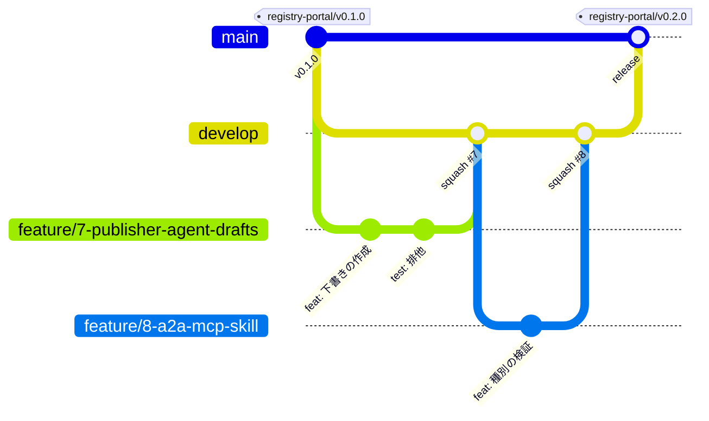

# ブランチ戦略

このリポジトリ（`JustinWangJP/sample-agentic-value-accelerator`）は、`aws-samples/sample-agentic-value-accelerator`（以下「本家」）の fork である。Registry ポータルや日本語文書などの独自の成果は fork 上で育て、本家の変更は定期的に取り込む。本家への還元は、汎用的な修正だけを個別に行う（ADR-0005）。

ブランチは Git Flow 型とし、`main` と `develop` の2本を常設する。

## ブランチの種類

| ブランチ | 分岐元 | マージ先 | 寿命 | 役割 |
|---|---|---|---|---|
| `main` | ― | ― | 常設 | リリース済みの状態。オペレーターが `scripts/deploy.sh` で AWS に反映するのはこのブランチ（ADR-0004） |
| `develop` | `main` | `main` | 常設 | 統合ブランチ。次のリリースに入る変更が集まる。作業ブランチの PR はここに出す |
| `feature/<issue番号>-<概要>` | `develop` | `develop` | 短命 | 機能追加。1 Issue に 1 ブランチ |
| `fix/<issue番号>-<概要>` | `develop` | `develop` | 短命 | リリース前のバグ修正 |
| `docs/<概要>`、`chore/<概要>` | `develop` | `develop` | 短命 | 文書だけ、または保守作業だけの変更 |
| `release/<アプリ>-v<版>` | `develop` | `main` | 短命・任意 | リリース前の安定化が必要なときだけ作る |
| `hotfix/<概要>` | `main` | `main` と `develop` | 短命 | リリース済みの不具合の緊急修正 |
| `sync/upstream-<YYYYMMDD>` | `develop` | `develop` | 短命 | 本家 `main` の取り込み |
| `upstream/<概要>` | 本家の `main` | 本家の `main` | 短命 | 本家への還元 PR（fork 独自の変更を含めない） |

ブランチ名は英小文字とハイフンで書く。`<概要>` は2〜5語程度にする。

- 例: `feature/7-publisher-agent-drafts`、`fix/12-recovery-retry`、`docs/branch-strategy`、`hotfix/forbidden-message`

## 通常の開発の流れ



1. 着手前に Issue を作り（または既存の Issue を使い）、`develop` の最新から作業ブランチを作る。

   ```bash
   git switch develop && git pull
   git switch -c feature/7-publisher-agent-drafts
   ```

2. Conventional Commits 形式でコミットする（AGENTS.md）。コミットの本文には `Refs #<issue番号>` を付ける。
3. `develop` を対象に PR を作る。`.github/pull_request_template.md` を使い、本文に `Closes #<issue番号>` を書く。
4. CI（`registry-portal-ci.yml` など）がすべて成功してからマージする。
5. マージ後に作業ブランチを削除する。

作業中に `develop` が進んだら、作業ブランチを `develop` に rebase して追従する。ほかの人と共有している作業ブランチでは rebase せず、`develop` をマージする。

## マージ方式

| PR | 方式 | 理由 |
|---|---|---|
| 作業ブランチ → `develop` | Squash merge | 1 Issue を 1 コミットにまとめ、`develop` の履歴を Issue 単位で読めるようにする。コミットのタイトルは PR タイトル（Conventional Commits 形式）にする |
| `develop` / `release/*` → `main` | Merge commit | `main` と `develop` の履歴を同じに保つ。squash すると両者が分岐し、次のリリースで衝突する |
| `hotfix/*` → `main`、`main` → `develop` | Merge commit | 同上 |
| `sync/upstream-*` → `develop` | Merge commit | 本家のコミットをそのまま残し、次回の取り込みで差分が最小になるようにする |

## リリース

デプロイは CI ではなく、オペレーターの手動実行で行う（ADR-0004）。`main` へのマージは「リリースした」ことではなく「リリースできる状態になった」ことを表す。

1. `develop` を `main` にマージする PR（タイトル例: `release(registry-portal): v0.2.0`）を作る。本文には、含まれる Issue と動作確認の結果を書く。
2. マージ後、`main` にタグを付けて push する。

   ```bash
   git switch main && git pull
   git tag -a registry-portal/v0.2.0 -m "Registry ポータル v0.2.0"
   git push origin registry-portal/v0.2.0
   ```

3. オペレーターがタグの付いたコミットを checkout し、`scripts/deploy.sh` で反映する。

タグはアプリ単位で `<アプリ>/v<MAJOR>.<MINOR>.<PATCH>` とする。本家のリリース番号（`RELEASE_NOTES.md` の v5.0 など）と混同しないよう、`v` から始まるタグは使わない。

安定化に時間がかかる場合だけ `release/<アプリ>-v<版>` を作る。このブランチにはバグ修正だけを入れ、`main` へのマージ後に `main` を `develop` にマージし戻す。

## 緊急修正（hotfix）

1. `main` から `hotfix/<概要>` を作り、修正する。
2. `main` を対象に PR を作り、merge commit でマージする。
3. パッチ版のタグ（例: `registry-portal/v0.2.1`）を付ける。
4. 直後に `main` を `develop` にマージする PR を作り、修正を `develop` に戻す。

## 本家との関係

### 本家の変更を取り込む

本家の `main` を月に1回程度、または必要な修正が入ったときに取り込む。

```bash
git remote add upstream https://github.com/aws-samples/sample-agentic-value-accelerator.git  # 初回だけ
git fetch upstream
git switch develop && git pull
git switch -c sync/upstream-20261104
git merge upstream/main
# 衝突を解消し、テストを実行する
git push -u origin sync/upstream-20261104
```

`develop` を対象に PR を作り、merge commit でマージする。共有済みのブランチを `upstream/main` に rebase してはいけない（`.github/CONTRIBUTING.md` の rebase 手順は、本家へ PR を出す場合の手順である）。

### 本家へ還元する

本家にとっても有用で、fork 独自の内容（Registry ポータル、日本語専用の文書など）を含まない修正だけを還元する。

1. `upstream/main` から `upstream/<概要>` を作る。
2. 必要なコミットを cherry-pick するか、書き直す。
3. 本家の `main` を対象に PR を作る。手順・レビュー・承認要件は `.github/CONTRIBUTING.md` に従う。

## ブランチの削除

ブランチを削除する前に、その内容がマージ先（通常は `develop`）に取り込まれていることを必ず確認する。PR 経由でマージしたかどうかではなく、コミットの実体で確かめる。

```bash
git fetch origin --prune
git log --oneline origin/develop..origin/<ブランチ名>   # 何も表示されなければ取り込み済み
```

Squash merge したブランチは、元のコミットが `develop` に残らないので、上のコマンドでは取り込み済みと判定されない。この場合は、「そのブランチを `develop` にマージしても内容が変わらないこと」で確認する（Git 2.38 以降）。

```bash
test "$(git merge-tree --write-tree origin/develop origin/<ブランチ名>)" = "$(git rev-parse 'origin/develop^{tree}')" \
  && echo 取り込み済み || echo 未取り込みの変更あり
```

取り込まれていないコミットがあれば削除しない。そのブランチを含む別のブランチ経由で取り込む予定の場合も、取り込みが終わってから削除する。

## ブランチの保護（GitHub の設定）

fork 側で次を設定する。

| 対象 | 設定 |
|---|---|
| `main` | 直接 push を禁止し、PR を必須にする。必須の status check に CI を指定する。force push と削除を禁止する |
| `develop` | 直接 push を禁止し、PR を必須にする。必須の status check に CI を指定する。force push と削除を禁止する |
| 既定ブランチ | `develop` にする。PR の既定の対象が `develop` になり、`Closes #n` で Issue が自動で閉じるようになる |
| マージ方式 | squash と merge commit を許可し、rebase merge は無効にする。マージ後にブランチを自動で削除する |

`.github/CODEOWNERS` は本家の管理者を指しており、fork では承認者として機能しない。fork でレビューを必須にする場合は、fork 用の承認者を別に決める。

## 既存ブランチの移行

| ブランチ | 扱い |
|---|---|
| `feature/aws-agents-registry` | Registry ポータル MVP1 の作業ブランチ。`feature/on-boarding` の内容も含んでいる。`develop` を対象に PR を作ってマージする。以降の Issue（#4 以降）は、`develop` から Issue ごとのブランチを作って進める |
| `feature/on-boarding` | `feature/aws-agents-registry` に含まれている。上記のマージ後、「ブランチの削除」の手順で `develop` に取り込まれたことを確認してから削除する |
| `develop` | 現在は `main` と同じ位置にある。このまま統合ブランチとして使う |
