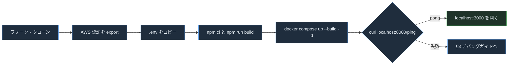

# AVA ゼロからはじめるコントリビューターガイド

> **対象読者**：AVA に初めてコードを書く人。手順どおりに進めれば、ローカルで動かして最初の PR を出せるようにしています。
> **解析基準**：2026-11-01、コミット `2b8849c`（main）。コマンドの「期待される出力」はコードと設定から導いたものです。この資料を作る際には実行していません。
> **根拠の書き方**：`(パス:行番号)` はリポジトリルートからの相対パスです。

関連資料：[プリンシパル向けガイド](principal-guide-ja.md) ／ [オンボーディング入門（HTML）](../onboarding-ja.html) ／ [技術設計・保守ガイド（HTML）](../technical-guide-ja.html)

---

## 1. このプロジェクトは何をするのか

AVA は、AWS 上で AI エージェントを **計画・構築・保護・運用・統制** するためのアクセラレーターです。管理画面とデプロイを担う **Control Plane**（React + FastAPI + Terraform）と、すぐに使える金融業界向けのエージェント群 **FSI Foundry**（35ユースケース、Strands／LangGraph）が中心です（`README.md:3`, `README.md:179`）。

---

## 2. 前提条件

| ツール | バージョン | 根拠 |
|---|---|---|
| Python | 3.11 以上 | `README.md:791` |
| Node.js | 22 以上 | `README.md:792` |
| AWS CLI | 2.28.9 以上 | `README.md:789` |
| Terraform | 1.0 以上 | `README.md:790` |
| Docker（buildx 対応）または Finch | Compose v2 | `README.md:793`, `platform/control_plane/docker-compose.yaml:2` |
| AWS アカウント | Bedrock で Claude のモデルアクセスを有効にしておく | `README.md:788` |
| GitHub アカウント | フォークして PR を出すため | `.github/CONTRIBUTING.md` |

確認コマンド：

```bash
python3 --version && node --version && aws --version && terraform version && docker compose version
```

期待される出力（例）：`Python 3.11.x` 以上、`v22.x.x` 以上、`aws-cli/2.28.9` 以上、`Terraform v1.x`、`Docker Compose version v2.x`

---

## 3. 環境構築

### 3.1 フォークしてクローンする

```bash
# GitHub で aws-samples/sample-agentic-value-accelerator をフォークしてから
git clone https://github.com/YOUR_USERNAME/sample-agentic-value-accelerator.git
cd sample-agentic-value-accelerator
git remote add upstream https://github.com/aws-samples/sample-agentic-value-accelerator.git
git remote -v
```

期待される出力：`origin`（自分のフォーク）と `upstream`（aws-samples）がそれぞれ fetch と push の2行ずつ表示されます。

### 3.2 AWS の認証情報を用意する

```bash
aws sso login --profile YOUR_PROFILE        # SSO を使う場合。使わない場合は環境に合わせて読み替える
eval "$(aws configure export-credentials --profile YOUR_PROFILE --format env)"
aws sts get-caller-identity
```

期待される出力：`"Account": "123456789012"` を含む JSON。

> **なぜ export が必要か**：LiteLLM と backend のコンテナには `AWS_ACCESS_KEY_ID`、`AWS_SECRET_ACCESS_KEY`、`AWS_SESSION_TOKEN` を環境変数で渡します（`platform/control_plane/docker-compose.yaml:52-55`, `:176-178`）。ホストの `credential_process` はコンテナ内では動きません。

### 3.3 Control Plane をローカルで起動する（Docker Compose）

```bash
cd platform/control_plane
cp .env.example .env              # 必要に応じて AWS_REGION などを編集する
cd frontend
npm ci
npm run build                     # prebuild で offerings.json が public/ にコピーされる
cd ..
docker compose up --build -d      # Finch の場合: finch compose up --build -d
docker compose ps
```

期待される出力：`redis`、`postgres`、`gateway`、`backend`、`frontend` の5サービスがすべて `running`（`Up`）になります（`platform/control_plane/docker-compose.yaml:18-24`）。

### 3.4 動作を確認する

```bash
curl -s http://localhost:8000/ping
curl -s http://localhost:8000/
```

期待される出力：

```json
{"ping":"pong","timestamp":"2026-11-01T..."}
{"name":"Control Plane API","version":"1.0.0","status":"running"}
```

根拠：`platform/control_plane/backend/src/api/routes/health.py:68-77`, `platform/control_plane/backend/src/main.py:161-172`

ブラウザで http://localhost:3000 を開くと管理画面が表示されます。ローカルでは `USE_DEV_AUTH=true` なので、ログインしなくても Admin として扱われます（`platform/control_plane/docker-compose.yaml:122`, `platform/control_plane/backend/src/core/rbac.py:309-322`）。

### 3.5（任意）コンテナを使わずにバックエンドを動かす

```bash
cd platform/control_plane/backend
./run_dev.sh                       # venv の作成 → pip install → uvicorn --reload :8000
```

根拠：`platform/control_plane/backend/run_dev.sh:12-41`。フロントエンドを開発モードで動かす場合は `cd ../frontend && npm run dev`（Vite、http://localhost:5173）を使います。



---

## 4. プロジェクト構成

```text
sample-agentic-value-accelerator/
├── README.md                    # 全体像とドキュメントの索引（最初に読む）
├── RELEASE_NOTES.md             # v2.5〜v5.0 の変更内容
├── .env.example                 # FSI Foundry 用の環境変数の例（DEPLOYMENT_MODE, AGENT_NAME）
├── .github/                     # CONTRIBUTING、PR テンプレート、CODEOWNERS（CI はない）
├── plan/                        # Plan の柱：ガイダンス文書
├── docs/                        # 日本語の開発者ドキュメント（この資料もここ）
├── platform/
│   ├── docs/                    # アーキテクチャ、Well-Architected
│   └── control_plane/           # ★ 共通基盤
│       ├── docker-compose.yaml  # ローカルで5サービスを起動
│       ├── backend/
│       │   ├── src/main.py      # FastAPI の組み立て（全ルーターをここで登録）
│       │   ├── src/api/routes/  # HTTP 層（約94ファイル）
│       │   ├── src/services/    # ビジネスロジックと AWS 連携（約105ファイル）
│       │   ├── src/models/      # Pydantic モデル（govern_* が多い）
│       │   ├── src/core/        # 設定、認証・RBAC、safe_fetch、region
│       │   ├── tests/           # pytest（55ファイル）
│       │   └── pytest.ini       # 既知の失敗はここに記録されている
│       ├── frontend/
│       │   ├── src/App.tsx      # ルーティング（約155ルート）
│       │   ├── src/api/client.ts# axios。Bearer トークンを付ける
│       │   └── src/components/  # 画面
│       ├── gateway/             # LiteLLM の設定
│       └── infrastructure/      # Terraform（25モジュール）と deploy-full.sh
└── applications/
    ├── fsi_foundry/             # ★ 金融業界向けエージェント
    │   ├── data/registry/offerings.json  # ユースケースのカタログ（正となる情報源）
    │   ├── data/samples/        # ユースケースごとのサンプルデータ
    │   ├── foundations/src/     # 共通ランタイム（registry、adapters、base）
    │   ├── foundations/iac/     # agentcore / cognito / vpc / shared
    │   ├── use_cases/<名前>/src/{strands,langchain_langgraph}/
    │   └── ui/<名前>/           # ユースケースごとの UI（任意）
    ├── reference_implementations/  # 独立した参照実装（それぞれの README に従う）
    └── app_factory/             # アプリの生成と UI テンプレート
```

---

## 5. 最初のタスク：Control Plane に読み取り専用 API を1本追加する

例として、Foundry のカタログに載っているユースケースの数を返す `GET /api/v1/foundry-stats` を追加します。既存のパターン（`maturity.py`）をそのまま真似します。

**Step 1 — テストを先に書く**：`platform/control_plane/backend/tests/test_foundry_stats.py`

```python
from fastapi import FastAPI
from fastapi.testclient import TestClient

from api.routes.foundry_stats import router


def _client() -> TestClient:
    app = FastAPI()
    app.include_router(router, prefix="/api/v1")
    return TestClient(app)


def test_stats_returns_counts(monkeypatch):
    monkeypatch.setattr(
        "api.routes.foundry_stats._load_offerings",
        lambda: {"use_cases": [{"id": "B01"}, {"id": "B02"}]},
    )
    # ローカルのテスト環境では dev auth が有効で、トークンなしでも Admin になる
    res = _client().get("/api/v1/foundry-stats")
    assert res.status_code == 200
    assert res.json() == {"use_case_count": 2}
```

**Step 2 — ルーターを書く**：`platform/control_plane/backend/src/api/routes/foundry_stats.py`

```python
"""Foundry カタログの統計情報（読み取り専用）"""
import json
from fastapi import APIRouter, Depends, HTTPException

from core.config import settings
from core.rbac import Role, require_role

router = APIRouter(prefix="/foundry-stats", tags=["foundry"])


def _load_offerings() -> dict:
    with open(settings.FOUNDRY_OFFERINGS_PATH, encoding="utf-8") as f:
        return json.load(f)


@router.get("")
async def get_stats(_=Depends(require_role(Role.VIEWER))):
    try:
        data = _load_offerings()
    except FileNotFoundError:
        raise HTTPException(status_code=503, detail="Foundry catalog not configured")
    return {"use_case_count": len(data.get("use_cases", []))}
```

ポイント：

- 認可は必ず `Depends(require_role(...))` でかけます（`platform/control_plane/backend/src/api/routes/maturity.py:42`）。
- 設定は `settings` から読みます（`FOUNDRY_OFFERINGS_PATH`：`platform/control_plane/backend/src/core/config.py:302`）。
- エラー応答に例外の文字列をそのまま入れないでください（§11 の落とし穴 5）。

**Step 3 — 登録する（3か所）**

1. `platform/control_plane/backend/src/api/routes/__init__.py`：`from api.routes.foundry_stats import router as foundry_stats_router` を追加し、`__all__` にも追加する（既存の書き方：`:7`, `:101`）。
2. `platform/control_plane/backend/src/main.py:235` の import 行に `foundry_stats_router` を追加し、`:238` 付近に `app.include_router(foundry_stats_router, prefix=settings.API_PREFIX)` を追加する。
3. 同じファイルの `ROOT_PATH` のブロック（`:426` 付近）にも `prefix=f"{settings.ROOT_PATH}{settings.API_PREFIX}"` で登録する。**これを忘れると、API Gateway のステージ経由で 404 になります。**

**Step 4 — テストして動作を確認する**

```bash
cd platform/control_plane/backend
python -m pytest tests/test_foundry_stats.py -q -p no:randomly
```

期待される出力：`1 passed`

```bash
cd ..   # platform/control_plane
docker compose build backend && docker compose up -d --force-recreate backend
curl -s http://localhost:8000/api/v1/foundry-stats
```

期待される出力：`{"use_case_count":35}`。`FOUNDRY_OFFERINGS_PATH` は未指定でも、環境変数 → コンテナ内パス → リポジトリ内パスの順に自動で解決されます（`platform/control_plane/backend/src/core/config.py:440-452`）。どれも見つからなければ `503` が返ります。

**Step 5 — UI から呼ぶ（任意）**：`platform/control_plane/frontend/src/api/client.ts` の axios クライアント（`:27-40`）を使い、`client.get("/api/v1/foundry-stats")` で呼び出します。

---

## 6. 開発ワークフロー


| ルール | 内容 | 根拠 |
|---|---|---|
| ブランチ | `feature/<名前>`。main への直接 push は禁止 | `.github/CONTRIBUTING.md` |
| 同期 | `git fetch upstream && git rebase upstream/main` | 同上 |
| コミットメッセージ | Conventional Commits 形式（`feat:`, `fix(deploy):`, `docs(fsi):` など） | `git log` の実例（`7f3bdbc fix(AWSTagKeys): ...`, `85ff2f9 feat(fsi): ...`） |
| PR | テンプレートのすべての欄を埋める（変更の種類、テスト、チェックリスト、UI 変更ならスクリーンショット） | `.github/pull_request_template.md` |
| 承認 | すべてのファイルで CODEOWNERS の承認が必要 | `.github/CODEOWNERS` |
| CI | **ありません。** PR を出す前に §7 のコマンドを自分で実行し、結果を PR に書いてください | `.github/` に workflows がない |

---

## 7. テストの実行

### バックエンド

```bash
cd platform/control_plane/backend
python3 -m venv .venv && source .venv/bin/activate
pip install -r requirements.txt
python -m pytest                                   # 全件（既知の失敗を含む）
python -m pytest tests/test_deployment_status_transitions.py -q
```

- `pytest.ini` で `testpaths=tests` と `pythonpath=src` を設定しているので、`PYTHONPATH` を手で指定する必要はありません。
- **全件を実行すると終了コードは 0 になりません。** 記録されている値は「409 passed / 1 skipped / 25 failed / 4 errors」で、失敗はテンプレート関連の8モジュールです（`platform/control_plane/backend/pytest.ini`）。自分の変更で**増えた**失敗だけを確認してください。
- テストの実行順はランダムです（pytest-randomly）。順序に依存する失敗を再現したいときは `-p no:randomly` を付けます。

### フロントエンド

```bash
cd platform/control_plane/frontend
npm ci
npm run typecheck && npm run lint && npm test && npm run build
```

各コマンドの中身は `package.json` の `scripts` に定義されています（`tsc --noEmit`、`eslint .`、`vitest --run`、`vite build`）。

### テストの追加方針

| 変更の内容 | 書くテスト | 参考にするテスト |
|---|---|---|
| ルーターやサービス | moto で AWS をモックするか、`monkeypatch` で I/O を差し替える | `tests/test_govern_marketplace.py` |
| 状態やデータ変換 | hypothesis のプロパティテスト | `tests/test_deployment_status_transitions.py` |
| 外部への HTTP 呼び出し | `safe_fetch` を経由していることを確認する | `tests/test_safe_fetch.py` |
| フロントエンドのロジック | Vitest | `frontend/src/tests/test_pipeline_progress.test.ts` |

---

## 8. デバッグガイド

| 症状 | 原因 | 対処 |
|---|---|---|
| Python を直したのに反映されない | backend はソースをマウントしていない | `docker compose build backend && docker compose up -d --force-recreate backend`（`platform/control_plane/docker-compose.yaml:7-10`） |
| UI が古いまま | frontend の Docker イメージはホストで作った `dist/` をコピーするだけ | `npm run build` → `docker compose build frontend` → `up -d --force-recreate frontend`（同 `:11-12`） |
| モデル呼び出しで認証エラーになる | 一時認証情報の期限切れ | §3.2 をやり直してから `docker compose up -d --force-recreate gateway backend` |
| Govern の画面の資産数が0件 | `GOVERN_AWS_REGION` が間違っている。AWS はエラーを返さず空の一覧を返す | backend 起動時のログに出るリージョンを確認する（`platform/control_plane/backend/src/main.py:66-71`） |
| 本番相当の環境で 401 になる | `ENVIRONMENT` が開発系でないため、dev auth が拒否されている | ログの `AUTH-GATE:` 行を確認する（`platform/control_plane/backend/src/core/config.py:401-420`） |
| 403 `Requires operator role or higher` | ロールが足りない | Cognito の `operator` / `admin` グループに入る。ローカルなら `x-user-role` ヘッダーで指定する（`platform/control_plane/backend/src/core/rbac.py:334-338`） |
| Foundry のデプロイが 400 になる | 対応していない framework や pattern を指定している。pattern は現状 `agentcore` のみ | `offerings.json` の `supported_frameworks` / `supported_patterns` を確認する（`platform/control_plane/backend/src/api/routes/applications.py:121-125`） |
| デプロイが `failed` のまま止まる | CodeBuild や Terraform の失敗 | UI のデプロイ詳細でビルドログを見る（`PipelineService.get_build_logs`：`platform/control_plane/backend/src/services/pipeline_service.py:158`）。CloudWatch では `/aws/codebuild/<project>` |
| Foundry をローカルで実行すると `No module named 'adapters.fastapi_adapter'` | このアダプターはリポジトリにない | `DEPLOYMENT_MODE=agentcore` を使う（`applications/fsi_foundry/foundations/src/main.py:72-76`, `:114-120`） |
| `cd backend && pytest` で `bedrock_agentcore` がないというエラーになる | 古い手順で、テスト対象外のディレクトリまで収集している | `pytest.ini` があるディレクトリ（backend/）で実行する |

---

## 9. 主要な概念

| 用語 | 意味 | コード上の場所 |
|---|---|---|
| **Control Plane** | AVA の管理基盤（UI、API、デプロイパイプライン） | `platform/control_plane/` |
| **柱（Pillar）** | Plan / Build / Secure / Operate / Govern。UI のナビゲーションとルーター名の接頭辞（`govern_*`）に対応する | `README.md:122-508` |
| **Foundry ユースケース** | `offerings.json` に登録された業務エージェント（例：`kyc_banking`、ID `B01`） | `applications/fsi_foundry/data/registry/offerings.json` |
| **Framework** | `strands` または `langchain_langgraph`。ユースケースごとに実装を2つ持つ | `use_cases/<名前>/src/<framework>/` |
| **Deployment pattern** | ランタイムの形態。実際に動くのは `agentcore` のみ | `applications/fsi_foundry/foundations/iac/agentcore/` |
| **foundation-stack** | Foundry の共通基盤（VPC、Langfuse など）。その出力をユースケースのデプロイに引き継ぐ | `platform/control_plane/backend/src/services/deployment_service.py:369` |
| **Role** | `viewer` / `operator` / `admin`（Cognito のグループ） | `platform/control_plane/backend/src/core/rbac.py:32-37` |
| **LLM Gateway** | LiteLLM のプロキシ。仮想キーでユースケースごとのコストを管理する | `platform/control_plane/gateway/`, `applications/fsi_foundry/foundations/src/utils/llm_gateway.py` |

ユースケースを登録するコードの例（Strands 版）：

```python
# applications/fsi_foundry/use_cases/kyc_banking/src/strands/__init__.py:14-24
from base.registry import register_agent, RegisteredAgent

register_agent(
    name="kyc_banking",
    config=RegisteredAgent(
        entry_point=run_kyc_assessment,      # async (AssessmentRequest) -> AssessmentResponse
        request_model=AssessmentRequest,
        response_model=AssessmentResponse,
    ),
)
```

---

## 10. コードパターン集

### 10.1 Control Plane に API を追加する

→ §5 の手順どおりです。要点は **ルーター + `require_role` + `get_service()` による遅延シングルトン + 3か所への登録** です。

### 10.2 DynamoDB を使うサービスを追加する

```python
# platform/control_plane/backend/src/services/foo_service.py
import boto3

class FooService:
    def __init__(self, table_name: str, region: str):
        self.table = boto3.resource("dynamodb", region_name=region).Table(table_name)

    def get(self, foo_id: str) -> dict | None:
        return self.table.get_item(Key={"id": foo_id}).get("Item")
```

テーブル名は `Settings` にフィールドを追加して受け取ります（例：`MATURITY_TABLE_NAME`：`platform/control_plane/backend/src/core/config.py:119`）。テーブル本体は `infrastructure/modules/dynamodb/` に追加し、ECS の環境変数にも渡します。

### 10.3 Foundry にユースケースを追加する

1. `applications/fsi_foundry/use_cases/<new_case>/src/strands/` と `.../langchain_langgraph/` を作る。既存のユースケース（例：`kyc_banking`）をコピーするのが早道です。
2. `models.py`（Request / Response の Pydantic モデル）、`agents/`、`orchestrator.py`（`async def run_xxx(request)`）を実装する。
3. それぞれのフレームワークの `__init__.py` で `register_agent("<new_case>", RegisteredAgent(...))` を呼ぶ。
4. `offerings.json` の `use_cases` に `id`、`use_case_name`、`supported_frameworks`、`supported_patterns: ["agentcore"]`、`agents`、`test_entities`、`id_field` を追加する（既存の要素を参考にする）。
5. `applications/fsi_foundry/data/samples/<new_case>/` にサンプルデータを置く（**架空のデータに限ります**）。
6. 必要なら `applications/fsi_foundry/ui/<new_case>/` に UI を置く。存在すれば自動で ZIP に含まれます（`platform/control_plane/backend/src/api/routes/applications.py:282-290`）。
7. フロントエンドを `npm run build` し直す（`offerings.json` のコピーはビルド時に行われるため）。

### 10.4 変更系 API に承認ポリシーを適用する

新しい種類のリソースを「登録」する API は、既存の MCP 登録と同じ形にそろえます（`platform/control_plane/backend/src/api/routes/mcp.py:182-241`）。

```python
from fastapi import Header, HTTPException, Depends as RBACDepends
from core.rbac import Role, require_role
from services import approval_policy_engine as policy
from services import agent_registry_client as reg


@router.post("", status_code=201)
async def register_foo(
    req: FooCreate,
    x_user_email: str | None = Header(default=None, alias="x-user-email"),
    _=RBACDepends(require_role(Role.VIEWER)),   # 申請は Viewer から可能。可否はポリシーで決める
):
    verdict = policy.evaluate(kind="foo", resource_id=req.name.strip(), action="register")
    if verdict.mode == policy.MODE_DENY:
        raise HTTPException(status_code=403, detail="Approval Policy denies this registration")

    status = "APPROVED" if verdict.mode == policy.MODE_AUTO_APPROVE else "PENDING_APPROVAL"
    record = create_foo(req, final_status=status)

    if verdict.mode == policy.MODE_REQUIRE_APPROVAL:
        reg.enqueue_approval(
            record=record, kind="foo",
            requested_by=x_user_email or "unknown",
            justification=f"Register foo '{req.name.strip()}'",
            verdict=verdict,
        )
    return record
```

チェックリスト：

1. **ロールの下限**：申請を誰でも出せるようにするなら `VIEWER`、そうでなければ `OPERATOR` にします。削除や更新は現状ポリシーを評価しないので、ロールだけで守られることを意識してください。
2. **既定ポリシー**：新しい種類を承認対象にするなら、`services/approval_policy_bootstrap.py` に既定ポリシーを追加します（名前は一意にする。既存の行は上書きされません）。
3. **UI から作成できるようにする**：`api/routes/approval_policies.py` の `RESOURCE_KINDS`（`:53`）にも追加します。追加しないと、ポリシー画面で 400 になります。
4. **承認後の状態の切り替え**：Registry 以外（DynamoDB など）に保存するリソースなら、`approval_requests.py` の `_record_decision`（`:196-221`）に分岐を追加します。
5. **fail-open に注意**：評価エンジンは、テーブルの読み込みに失敗すると `auto_approve` を返します（`services/approval_policy_engine.py:98-107`）。重要な操作では、呼び出し側でも確認を加えることを検討してください。
6. **テスト**：`policy.evaluate` を monkeypatch して、`deny` / `require_approval` / `auto_approve` の3通りをテストします。

### 10.5 外部 URL を取得する

`requests` や `urllib` を直接使わず、`core/safe_fetch.py` を経由してください。SSRF 対策とリダイレクト時の Authorization の扱いを、まとめてここで処理しています（`tests/test_safe_fetch.py`, `tests/test_remaining_fetch_sites.py`）。

---

## 11. よくある落とし穴

1. **`ROOT_PATH` 側へのルーター登録を忘れる** → ローカルでは動くのに、API Gateway 経由では 404 になる（`platform/control_plane/backend/src/main.py:426-438`）。
2. **`npm run build` をせずに frontend を再ビルドする** → 古い UI のまま。`offerings.json` のコピーもビルド時に行われる（`frontend/package.json` の `prebuild`）。
3. **`AWS_REGION` と `GOVERN_AWS_REGION` を取り違える** → エラーにならず、0件と表示される。
4. **全件テストが赤いのを見て、自分の変更で壊したと思い込む（または、その逆）** → `pytest.ini` に書かれた既知の失敗と比べる。
5. **`HTTPException(detail=f"...{e}")` で例外の文字列をそのまま返す** → 内部情報が漏れる。既存コードにもこの書き方が残っていますが、真似しないでください（`platform/control_plane/backend/src/api/routes/applications.py:306`）。
6. **片方のフレームワークだけを直す** → Strands 版と LangGraph 版で動作がずれる。
7. **`x-user-email` を本人確認に使う** → このヘッダーはクライアントが自由に偽装できます。
8. **`docker compose down -v` を気軽に実行する** → LiteLLM のキーや利用額のデータ（PostgreSQL のボリューム）が消える。
9. **`docker-compose.yml` を指定する** → 実際のファイル名は `.yaml` です（`platform/control_plane/docker-compose.yaml:4-5`）。
10. **`data/samples` に実在する顧客のデータを置く** → デプロイ用の ZIP に含まれ、S3 にアップロードされます。
11. **ローカルで承認フローを試して「全部自動承認される」と驚く** → Compose では `APPROVAL_POLICIES_TABLE_NAME` が空のため、評価エンジンは常に `auto_approve` を返します。承認フローを確かめるには、AWS 上のテーブルを指定してください。
12. **Operator の承認が必要なポリシーなのに、Operator が承認できない** → 承認と却下の API は一律で Admin が必要です（`approval_requests.py:253-275`）。不具合ではなく v1 の仕様です。
13. **新しいコードで `core.auth.get_current_user` を使う** → 古い系統です。`require_role` を使ってください（プリンシパル向けガイド §9.3）。

---

## 12. 困ったときの相談先

| 窓口 | 内容 |
|---|---|
| GitHub Issues | バグ報告と機能要望（`.github/ISSUE_TEMPLATE/bug_report.md`, `feature_request.md`） |
| 大きな変更 | 実装の前に Issue を立てて相談する（`.github/CONTRIBUTING.md`） |
| メンテナー | CODEOWNERS：`vivibui`、`bikashkbeheraaws`（`.github/CODEOWNERS`） |
| 連絡先の一覧 | `README.md:1107`（Contacts） |
| セキュリティ | 公開 Issue にせず、`SECURITY.md` の手順で報告する |
| ドキュメント | `README.md:960` 以降の索引。日本語の資料は `docs/README.md` |

---

## 13. 用語集

| 用語 | 説明 |
|---|---|
| AgentCore | Amazon Bedrock AgentCore。エージェントのマネージドランタイム |
| AaaS | Agent-as-a-Service（`platform/control_plane/aaas/`） |
| A2A | Agent-to-Agent プロトコル（`a2a_router`、`govern_a2a_trust`） |
| MCP | Model Context Protocol のサーバー（`backend/mcp_servers/`、`mcp_router`） |
| Harness | エージェントを実行する環境の管理（`harness_router`、`harness_killswitch.py`） |
| Path jail | ファイルパスを許可されたディレクトリの中に制限する仕組み（`core/path_jail.py`） |
| Langfuse | LLM の実行をトレースする OSS。基盤スタックが提供する |
| LiteLLM | OpenAI 互換の LLM プロキシ。AVA の LLM Gateway の実体 |
| SR 26 | Govern の柱に含まれる規制対応のワークスペース（`govern_sr26`） |
| foundation-stack | Foundry のユースケースが依存する共通インフラのデプロイ |
| `DEPLOYMENT_MODE` | Foundry の起動モード。動くのは `agentcore` のみ |
| Stamp | ECS モジュールで作られる本番相当の環境（`USE_DEV_AUTH=false` に固定） |
| Approval Policy | 「どの操作に誰の承認が必要か」を定めるルール（Secure の柱） |
| Approval Queue / Request | 承認待ちの申請と、その一覧（Operate の柱）。状態は pending / approved / denied / expired / cancelled |
| Verdict | 承認ポリシーの評価結果。`deny` / `require_approval` / `auto_approve` のいずれか |
| Service Approval | AWS サービスの採用審査を自動化するエージェント。人による承認フローとは**別物** |
| Kill switch | Harness の操作を緊急停止する仕組み（`core/harness_killswitch.py`） |

---

## 14. クイックリファレンス

```bash
# ── ローカル起動（platform/control_plane/） ──
(cd frontend && npm ci && npm run build)
docker compose up --build -d
docker compose ps
curl -s localhost:8000/ping                         # {"ping":"pong",...}
docker compose logs -f backend

# ── 変更を反映する ──
docker compose build backend && docker compose up -d --force-recreate backend
(cd frontend && npm run build) && docker compose build frontend && docker compose up -d --force-recreate frontend

# ── テスト ──
(cd backend && python -m pytest tests/<file>.py -q)
(cd frontend && npm run typecheck && npm run lint && npm test)

# ── 停止 ──
docker compose down        # ボリュームは残る
# docker compose down -v   # ⚠ LiteLLM のデータも消える

# ── AWS へのフルデプロイ ──
./infrastructure/scripts/deploy-full.sh   # 先に infrastructure/scripts/README.md を読む

# ── Git ──
git fetch upstream && git rebase upstream/main
git commit -m "feat(scope): 変更内容"
```

| やりたいこと | 見る場所 |
|---|---|
| API を追加する | `backend/src/api/routes/` + `routes/__init__.py` + `main.py`（3か所） |
| 設定を追加する | `backend/src/core/config.py` の `Settings` |
| 認可をかける | `Depends(require_role(Role.X))` |
| 画面を追加する | `frontend/src/components/` + `frontend/src/App.tsx` の `<Route>` |
| ユースケースを追加する | `applications/fsi_foundry/use_cases/` + `offerings.json` |
| AWS 資源を追加する | `infrastructure/modules/` + `infrastructure/main.tf` |
| デプロイの状態を追加する | `backend/src/models/deployment.py` と `modules/step_functions/main.tf` の**両方** |
