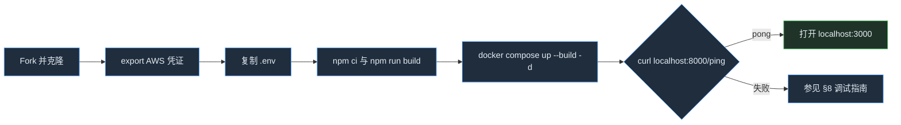
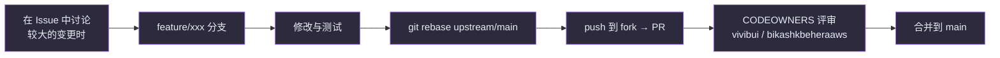

# AVA 从零开始的贡献者指南

> **目标读者**：第一次为 AVA 编写代码的人。按步骤操作，即可在本地运行项目并提交第一个 PR。
> **分析基准**：2026-11-01，提交 `2b8849c`（main）。命令的“预期输出”是根据代码和配置推导的，编写本文时并未实际执行。
> **引用方式**：`(路径:行号)` 中的路径相对于仓库根目录。

相关文档：[资深工程师指南](principal-guide-zh.md) ／ [日文版](contributor-guide-ja.md) ／ [入门导览（HTML，日文）](../onboarding-ja.html) ／ [技术设计与维护指南（HTML，日文）](../technical-guide-ja.html)

---

## 1. 这个项目做什么

AVA 是一个在 AWS 上对 AI 智能体进行**规划、构建、保护、运营和治理**的加速器。核心包括负责管理界面与部署的 **Control Plane**（React + FastAPI + Terraform），以及开箱即用的金融行业智能体集合 **FSI Foundry**（35 个用例，Strands／LangGraph）（`README.md:3`, `README.md:179`）。

---

## 2. 前提条件

| 工具 | 版本 | 依据 |
|---|---|---|
| Python | 3.11 及以上 | `README.md:791` |
| Node.js | 22 及以上 | `README.md:792` |
| AWS CLI | 2.28.9 及以上 | `README.md:789` |
| Terraform | 1.0 及以上 | `README.md:790` |
| Docker（支持 buildx）或 Finch | Compose v2 | `README.md:793`, `platform/control_plane/docker-compose.yaml:2` |
| AWS 账号 | 已在 Bedrock 中开通 Claude 模型访问 | `README.md:788` |
| GitHub 账号 | 用于 fork 和提交 PR | `.github/CONTRIBUTING.md` |

确认命令：

```bash
python3 --version && node --version && aws --version && terraform version && docker compose version
```

预期输出（示例）：`Python 3.11.x` 及以上、`v22.x.x` 及以上、`aws-cli/2.28.9` 及以上、`Terraform v1.x`、`Docker Compose version v2.x`

---

## 3. 环境搭建

### 3.1 Fork 并克隆

```bash
# 先在 GitHub 上 fork aws-samples/sample-agentic-value-accelerator
git clone https://github.com/YOUR_USERNAME/sample-agentic-value-accelerator.git
cd sample-agentic-value-accelerator
git remote add upstream https://github.com/aws-samples/sample-agentic-value-accelerator.git
git remote -v
```

预期输出：`origin`（你的 fork）和 `upstream`（aws-samples）各显示 fetch 和 push 两行。

### 3.2 准备 AWS 凭证

```bash
aws sso login --profile YOUR_PROFILE        # 使用 SSO 时。不使用时请按自己的环境替换
eval "$(aws configure export-credentials --profile YOUR_PROFILE --format env)"
aws sts get-caller-identity
```

预期输出：包含 `"Account": "123456789012"` 的 JSON。

> **为什么需要 export**：LiteLLM 和 backend 容器通过环境变量接收 `AWS_ACCESS_KEY_ID`、`AWS_SECRET_ACCESS_KEY`、`AWS_SESSION_TOKEN`（`platform/control_plane/docker-compose.yaml:52-55`, `:176-178`）。宿主机上的 `credential_process` 在容器内无法运行。

### 3.3 在本地启动 Control Plane（Docker Compose）

```bash
cd platform/control_plane
cp .env.example .env              # 按需修改 AWS_REGION 等
cd frontend
npm ci
npm run build                     # prebuild 会把 offerings.json 复制到 public/
cd ..
docker compose up --build -d      # 使用 Finch 时：finch compose up --build -d
docker compose ps
```

预期输出：`redis`、`postgres`、`gateway`、`backend`、`frontend` 五个服务全部为 `running`（`Up`）（`platform/control_plane/docker-compose.yaml:18-24`）。

### 3.4 确认运行状态

```bash
curl -s http://localhost:8000/ping
curl -s http://localhost:8000/
```

预期输出：

```json
{"ping":"pong","timestamp":"2026-11-01T..."}
{"name":"Control Plane API","version":"1.0.0","status":"running"}
```

依据：`platform/control_plane/backend/src/api/routes/health.py:68-77`, `platform/control_plane/backend/src/main.py:161-172`

在浏览器中打开 http://localhost:3000 即可看到管理界面。本地环境中 `USE_DEV_AUTH=true`，因此无需登录也会被视为 Admin（`platform/control_plane/docker-compose.yaml:122`, `platform/control_plane/backend/src/core/rbac.py:309-322`）。

### 3.5（可选）不使用容器运行后端

```bash
cd platform/control_plane/backend
./run_dev.sh                       # 创建 venv → pip install → uvicorn --reload :8000
```

依据：`platform/control_plane/backend/run_dev.sh:12-41`。若要以开发模式运行前端，使用 `cd ../frontend && npm run dev`（Vite，http://localhost:5173）。



---

## 4. 项目结构

```text
sample-agentic-value-accelerator/
├── README.md                    # 整体概览与文档索引（最先阅读）
├── RELEASE_NOTES.md             # v2.5～v5.0 的变更内容
├── .env.example                 # FSI Foundry 用的环境变量示例（DEPLOYMENT_MODE, AGENT_NAME）
├── .github/                     # CONTRIBUTING、PR 模板、CODEOWNERS（没有 CI）
├── plan/                        # Plan 支柱：指导文档
├── docs/                        # 开发者文档（本文也在这里）
├── platform/
│   ├── docs/                    # 架构、Well-Architected
│   └── control_plane/           # ★ 公共平台
│       ├── docker-compose.yaml  # 在本地启动 5 个服务
│       ├── backend/
│       │   ├── src/main.py      # 组装 FastAPI（所有路由在此注册）
│       │   ├── src/api/routes/  # HTTP 层（约 94 个文件）
│       │   ├── src/services/    # 业务逻辑与 AWS 集成（约 105 个文件）
│       │   ├── src/models/      # Pydantic 模型（govern_* 较多）
│       │   ├── src/core/        # 配置、认证与 RBAC、safe_fetch、region
│       │   ├── tests/           # pytest（55 个文件）
│       │   └── pytest.ini       # 已知失败记录在此
│       ├── frontend/
│       │   ├── src/App.tsx      # 路由（约 155 个）
│       │   ├── src/api/client.ts# axios，附加 Bearer 令牌
│       │   └── src/components/  # 页面
│       ├── gateway/             # LiteLLM 配置
│       └── infrastructure/      # Terraform（25 个模块）与 deploy-full.sh
└── applications/
    ├── fsi_foundry/             # ★ 金融行业智能体
    │   ├── data/registry/offerings.json  # 用例目录（唯一可信来源）
    │   ├── data/samples/        # 各用例的示例数据
    │   ├── foundations/src/     # 公共运行时（registry、adapters、base）
    │   ├── foundations/iac/     # agentcore / cognito / vpc / shared
    │   ├── use_cases/<名称>/src/{strands,langchain_langgraph}/
    │   └── ui/<名称>/           # 各用例的 UI（可选）
    ├── reference_implementations/  # 独立的参考实现（按各自的 README 操作）
    └── app_factory/             # 应用生成与 UI 模板
```

---

## 5. 第一个任务：为 Control Plane 新增一个只读 API

作为示例，新增 `GET /api/v1/foundry-stats`，返回 Foundry 目录中的用例数量。直接模仿已有模式（`maturity.py`）。

**Step 1 — 先写测试**：`platform/control_plane/backend/tests/test_foundry_stats.py`

```python
from fastapi import FastAPI
from fastapi.testclient import TestClient

from api.routes.foundry_stats import router


def _client() -> TestClient:
    app = FastAPI()
    app.include_router(router, prefix="/api/v1")
    return TestClient(app)


def test_stats_returns_counts(monkeypatch):
    monkeypatch.setattr(
        "api.routes.foundry_stats._load_offerings",
        lambda: {"use_cases": [{"id": "B01"}, {"id": "B02"}]},
    )
    # 本地测试环境中 dev auth 生效，没有令牌也会成为 Admin
    res = _client().get("/api/v1/foundry-stats")
    assert res.status_code == 200
    assert res.json() == {"use_case_count": 2}
```

**Step 2 — 编写路由**：`platform/control_plane/backend/src/api/routes/foundry_stats.py`

```python
"""Foundry 目录的统计信息（只读）"""
import json
from fastapi import APIRouter, Depends, HTTPException

from core.config import settings
from core.rbac import Role, require_role

router = APIRouter(prefix="/foundry-stats", tags=["foundry"])


def _load_offerings() -> dict:
    with open(settings.FOUNDRY_OFFERINGS_PATH, encoding="utf-8") as f:
        return json.load(f)


@router.get("")
async def get_stats(_=Depends(require_role(Role.VIEWER))):
    try:
        data = _load_offerings()
    except FileNotFoundError:
        raise HTTPException(status_code=503, detail="Foundry catalog not configured")
    return {"use_case_count": len(data.get("use_cases", []))}
```

要点：

- 授权必须通过 `Depends(require_role(...))` 实施（`platform/control_plane/backend/src/api/routes/maturity.py:42`）。
- 配置从 `settings` 读取（`FOUNDRY_OFFERINGS_PATH`：`platform/control_plane/backend/src/core/config.py:302`）。
- 不要把异常字符串直接放进错误响应（§11 常见陷阱第 5 条）。

**Step 3 — 注册（3 处）**

1. `platform/control_plane/backend/src/api/routes/__init__.py`：添加 `from api.routes.foundry_stats import router as foundry_stats_router`，并加入 `__all__`（现有写法：`:7`, `:101`）。
2. 在 `platform/control_plane/backend/src/main.py:235` 的 import 行中加入 `foundry_stats_router`，并在 `:238` 附近添加 `app.include_router(foundry_stats_router, prefix=settings.API_PREFIX)`。
3. 在同一文件的 `ROOT_PATH` 代码块（`:426` 附近）中，也以 `prefix=f"{settings.ROOT_PATH}{settings.API_PREFIX}"` 注册。**忘记这一步，经由 API Gateway stage 访问时会返回 404。**

**Step 4 — 测试并确认运行**

```bash
cd platform/control_plane/backend
python -m pytest tests/test_foundry_stats.py -q -p no:randomly
```

预期输出：`1 passed`

```bash
cd ..   # platform/control_plane
docker compose build backend && docker compose up -d --force-recreate backend
curl -s http://localhost:8000/api/v1/foundry-stats
```

预期输出：`{"use_case_count":35}`。即使未指定 `FOUNDRY_OFFERINGS_PATH`，也会按 环境变量 → 容器内路径 → 仓库内路径 的顺序自动解析（`platform/control_plane/backend/src/core/config.py:440-452`）。都找不到时返回 `503`。

**Step 5 — 从 UI 调用（可选）**：使用 `platform/control_plane/frontend/src/api/client.ts` 中的 axios 客户端（`:27-40`），通过 `client.get("/api/v1/foundry-stats")` 调用。

---

## 6. 开发工作流



| 规则 | 内容 | 依据 |
|---|---|---|
| 分支 | `feature/<名称>`，禁止直接 push 到 main | `.github/CONTRIBUTING.md` |
| 同步 | `git fetch upstream && git rebase upstream/main` | 同上 |
| 提交信息 | Conventional Commits 格式（`feat:`、`fix(deploy):`、`docs(fsi):` 等） | `git log` 中的实例（`7f3bdbc fix(AWSTagKeys): ...`, `85ff2f9 feat(fsi): ...`） |
| PR | 填写模板的所有栏目（变更类型、测试、检查清单，UI 变更需附截图） | `.github/pull_request_template.md` |
| 审批 | 所有文件都需要 CODEOWNERS 批准 | `.github/CODEOWNERS` |
| CI | **没有。** 提交 PR 前请自行执行 §7 的命令，并把结果写进 PR | `.github/` 下没有 workflows |

---

## 7. 运行测试

### 后端

```bash
cd platform/control_plane/backend
python3 -m venv .venv && source .venv/bin/activate
pip install -r requirements.txt
python -m pytest                                   # 全部（包含已知失败）
python -m pytest tests/test_deployment_status_transitions.py -q
```

- `pytest.ini` 中已设置 `testpaths=tests` 和 `pythonpath=src`，无需手动指定 `PYTHONPATH`。
- **运行全部测试时退出码不会是 0。** 记录的结果为“409 passed / 1 skipped / 25 failed / 4 errors”，失败集中在模板相关的 8 个模块（`platform/control_plane/backend/pytest.ini`）。只需确认因自己的修改而**新增**的失败。
- 测试执行顺序是随机的（pytest-randomly）。要复现依赖顺序的失败时，加上 `-p no:randomly`。

### 前端

```bash
cd platform/control_plane/frontend
npm ci
npm run typecheck && npm run lint && npm test && npm run build
```

各命令的内容定义在 `package.json` 的 `scripts` 中（`tsc --noEmit`、`eslint .`、`vitest --run`、`vite build`）。

### 新增测试的方针

| 修改内容 | 编写的测试 | 参考的测试 |
|---|---|---|
| 路由或服务 | 用 moto 模拟 AWS，或用 `monkeypatch` 替换 I/O | `tests/test_govern_marketplace.py` |
| 状态或数据转换 | hypothesis 属性测试 | `tests/test_deployment_status_transitions.py` |
| 对外 HTTP 调用 | 确认经由 `safe_fetch` | `tests/test_safe_fetch.py` |
| 前端逻辑 | Vitest | `frontend/src/tests/test_pipeline_progress.test.ts` |

---

## 8. 调试指南

| 症状 | 原因 | 处理方法 |
|---|---|---|
| 修改了 Python 代码却没有生效 | backend 没有挂载源代码 | `docker compose build backend && docker compose up -d --force-recreate backend`（`platform/control_plane/docker-compose.yaml:7-10`） |
| UI 仍是旧版本 | frontend 的 Docker 镜像只是复制宿主机上构建好的 `dist/` | `npm run build` → `docker compose build frontend` → `up -d --force-recreate frontend`（同 `:11-12`） |
| 调用模型时出现认证错误 | 临时凭证已过期 | 重新执行 §3.2 后运行 `docker compose up -d --force-recreate gateway backend` |
| Govern 页面的资产数为 0 | `GOVERN_AWS_REGION` 设置错误。AWS 不报错，而是返回空列表 | 确认 backend 启动日志中输出的区域（`platform/control_plane/backend/src/main.py:66-71`） |
| 在生产级环境中返回 401 | `ENVIRONMENT` 不是开发类环境，dev auth 被拒绝 | 查看日志中的 `AUTH-GATE:` 行（`platform/control_plane/backend/src/core/config.py:401-420`） |
| 403 `Requires operator role or higher` | 角色不足 | 加入 Cognito 的 `operator` / `admin` 组。本地可用 `x-user-role` 请求头指定（`platform/control_plane/backend/src/core/rbac.py:334-338`） |
| Foundry 部署返回 400 | 指定了不支持的 framework 或 pattern。目前 pattern 只有 `agentcore` | 确认 `offerings.json` 中的 `supported_frameworks` / `supported_patterns`（`platform/control_plane/backend/src/api/routes/applications.py:121-125`） |
| 部署一直停留在 `failed` | CodeBuild 或 Terraform 失败 | 在 UI 的部署详情中查看构建日志（`PipelineService.get_build_logs`：`platform/control_plane/backend/src/services/pipeline_service.py:158`）。CloudWatch 中为 `/aws/codebuild/<project>` |
| 本地运行 Foundry 时出现 `No module named 'adapters.fastapi_adapter'` | 仓库中没有这个适配器 | 使用 `DEPLOYMENT_MODE=agentcore`（`applications/fsi_foundry/foundations/src/main.py:72-76`, `:114-120`） |
| `cd backend && pytest` 报缺少 `bedrock_agentcore` | 旧步骤会收集到测试范围以外的目录 | 在 `pytest.ini` 所在目录（backend/）中运行 |

---

## 9. 关键概念

| 术语 | 含义 | 代码位置 |
|---|---|---|
| **Control Plane** | AVA 的管理平台（UI、API、部署流水线） | `platform/control_plane/` |
| **支柱（Pillar）** | Plan / Build / Secure / Operate / Govern，对应 UI 导航和路由名前缀（`govern_*`） | `README.md:122-508` |
| **Foundry 用例** | 在 `offerings.json` 中登记的业务智能体（例：`kyc_banking`，ID `B01`） | `applications/fsi_foundry/data/registry/offerings.json` |
| **Framework** | `strands` 或 `langchain_langgraph`，每个用例有两套实现 | `use_cases/<名称>/src/<framework>/` |
| **Deployment pattern** | 运行时形态，实际可用的只有 `agentcore` | `applications/fsi_foundry/foundations/iac/agentcore/` |
| **foundation-stack** | Foundry 的公共基础设施（VPC、Langfuse 等），其输出会传递给用例的部署 | `platform/control_plane/backend/src/services/deployment_service.py:369` |
| **Role** | `viewer` / `operator` / `admin`（Cognito 用户组） | `platform/control_plane/backend/src/core/rbac.py:32-37` |
| **LLM Gateway** | LiteLLM 代理，用虚拟密钥管理每个用例的成本 | `platform/control_plane/gateway/`, `applications/fsi_foundry/foundations/src/utils/llm_gateway.py` |

注册用例的代码示例（Strands 版）：

```python
# applications/fsi_foundry/use_cases/kyc_banking/src/strands/__init__.py:14-24
from base.registry import register_agent, RegisteredAgent

register_agent(
    name="kyc_banking",
    config=RegisteredAgent(
        entry_point=run_kyc_assessment,      # async (AssessmentRequest) -> AssessmentResponse
        request_model=AssessmentRequest,
        response_model=AssessmentResponse,
    ),
)
```

---

## 10. 代码模式

### 10.1 为 Control Plane 新增 API

→ 按 §5 的步骤即可。要点是 **路由 + `require_role` + 用 `get_service()` 实现的延迟单例 + 在 3 处注册**。

### 10.2 新增使用 DynamoDB 的服务

```python
# platform/control_plane/backend/src/services/foo_service.py
import boto3

class FooService:
    def __init__(self, table_name: str, region: str):
        self.table = boto3.resource("dynamodb", region_name=region).Table(table_name)

    def get(self, foo_id: str) -> dict | None:
        return self.table.get_item(Key={"id": foo_id}).get("Item")
```

表名通过在 `Settings` 中新增字段来获取（例：`MATURITY_TABLE_NAME`：`platform/control_plane/backend/src/core/config.py:119`）。表本身加到 `infrastructure/modules/dynamodb/` 中，并通过 ECS 环境变量传入。

### 10.3 为 Foundry 新增用例

1. 创建 `applications/fsi_foundry/use_cases/<new_case>/src/strands/` 和 `.../langchain_langgraph/`。复制已有用例（如 `kyc_banking`）是最快的办法。
2. 实现 `models.py`（Request / Response 的 Pydantic 模型）、`agents/`、`orchestrator.py`（`async def run_xxx(request)`）。
3. 在每个框架的 `__init__.py` 中调用 `register_agent("<new_case>", RegisteredAgent(...))`。
4. 在 `offerings.json` 的 `use_cases` 中添加 `id`、`use_case_name`、`supported_frameworks`、`supported_patterns: ["agentcore"]`、`agents`、`test_entities`、`id_field`（参考已有条目）。
5. 在 `applications/fsi_foundry/data/samples/<new_case>/` 中放置示例数据（**只能是虚构数据**）。
6. 如有需要，在 `applications/fsi_foundry/ui/<new_case>/` 中放置 UI。存在时会自动打包进 ZIP（`platform/control_plane/backend/src/api/routes/applications.py:282-290`）。
7. 重新对前端执行 `npm run build`（`offerings.json` 是在构建时复制的）。

### 10.4 为变更类 API 应用审批策略

“注册”新类型资源的 API，与已有的 MCP 注册保持相同结构（`platform/control_plane/backend/src/api/routes/mcp.py:182-241`）。

```python
from fastapi import Header, HTTPException, Depends as RBACDepends
from core.rbac import Role, require_role
from services import approval_policy_engine as policy
from services import agent_registry_client as reg


@router.post("", status_code=201)
async def register_foo(
    req: FooCreate,
    x_user_email: str | None = Header(default=None, alias="x-user-email"),
    _=RBACDepends(require_role(Role.VIEWER)),   # Viewer 即可提交申请，是否允许由策略决定
):
    verdict = policy.evaluate(kind="foo", resource_id=req.name.strip(), action="register")
    if verdict.mode == policy.MODE_DENY:
        raise HTTPException(status_code=403, detail="Approval Policy denies this registration")

    status = "APPROVED" if verdict.mode == policy.MODE_AUTO_APPROVE else "PENDING_APPROVAL"
    record = create_foo(req, final_status=status)

    if verdict.mode == policy.MODE_REQUIRE_APPROVAL:
        reg.enqueue_approval(
            record=record, kind="foo",
            requested_by=x_user_email or "unknown",
            justification=f"Register foo '{req.name.strip()}'",
            verdict=verdict,
        )
    return record
```

检查清单：

1. **最低角色**：若允许任何人提交申请，设为 `VIEWER`；否则设为 `OPERATOR`。删除和更新目前不评估策略，要意识到它们只受角色保护。
2. **默认策略**：若要把新类型纳入审批，在 `services/approval_policy_bootstrap.py` 中添加默认策略（名称须唯一，已有记录不会被覆盖）。
3. **让 UI 可以创建**：也要加入 `api/routes/approval_policies.py` 的 `RESOURCE_KINDS`（`:53`）。不加的话，策略页面会返回 400。
4. **批准后的状态切换**：若资源保存在 Registry 以外（如 DynamoDB），需要在 `approval_requests.py` 的 `_record_decision`（`:196-221`）中添加分支。
5. **注意 fail-open**：评估引擎读取表失败时会返回 `auto_approve`（`services/approval_policy_engine.py:98-107`）。对重要操作，请考虑在调用方也加入确认。
6. **测试**：monkeypatch `policy.evaluate`，分别测试 `deny` / `require_approval` / `auto_approve` 三种情况。

### 10.5 获取外部 URL

不要直接使用 `requests` 或 `urllib`，请经由 `core/safe_fetch.py`。SSRF 防护以及重定向时 Authorization 的处理都集中在这里（`tests/test_safe_fetch.py`, `tests/test_remaining_fetch_sites.py`）。

---

## 11. 常见陷阱

1. **忘记在 `ROOT_PATH` 一侧注册路由** → 本地正常，经由 API Gateway 却返回 404（`platform/control_plane/backend/src/main.py:426-438`）。
2. **不执行 `npm run build` 就重新构建 frontend** → UI 仍是旧版本。`offerings.json` 的复制也在构建时进行（`frontend/package.json` 的 `prebuild`）。
3. **把 `AWS_REGION` 和 `GOVERN_AWS_REGION` 弄混** → 不会报错，只显示 0 条。
4. **看到全部测试为红就以为是自己改坏的（或者反过来）** → 与 `pytest.ini` 中记录的已知失败对比。
5. **用 `HTTPException(detail=f"...{e}")` 直接返回异常字符串** → 会泄露内部信息。已有代码中仍残留这种写法，请不要模仿（`platform/control_plane/backend/src/api/routes/applications.py:306`）。
6. **只修改一个框架的实现** → Strands 版与 LangGraph 版的行为会不一致。
7. **用 `x-user-email` 做身份确认** → 这个请求头可由客户端随意伪造。
8. **随手执行 `docker compose down -v`** → LiteLLM 的密钥和用量数据（PostgreSQL 卷）会被删除。
9. **指定 `docker-compose.yml`** → 实际文件名是 `.yaml`（`platform/control_plane/docker-compose.yaml:4-5`）。
10. **把真实客户数据放进 `data/samples`** → 会被打包进部署 ZIP 并上传到 S3。
11. **在本地测试审批流程时，惊讶于“全部被自动批准”** → Compose 中 `APPROVAL_POLICIES_TABLE_NAME` 为空，评估引擎始终返回 `auto_approve`。要验证审批流程，请指定 AWS 上的表。
12. **策略要求 Operator 审批，Operator 却无法批准** → 批准和拒绝 API 一律要求 Admin（`approval_requests.py:253-275`）。这不是缺陷，而是 v1 的规格。
13. **在新代码中使用 `core.auth.get_current_user`** → 这是旧的实现，请使用 `require_role`（资深工程师指南 §9.3）。

---

## 12. 求助渠道

| 渠道 | 内容 |
|---|---|
| GitHub Issues | 缺陷报告和功能请求（`.github/ISSUE_TEMPLATE/bug_report.md`, `feature_request.md`） |
| 较大的变更 | 实现之前先创建 Issue 讨论（`.github/CONTRIBUTING.md`） |
| 维护者 | CODEOWNERS：`vivibui`、`bikashkbeheraaws`（`.github/CODEOWNERS`） |
| 联系人列表 | `README.md:1107`（Contacts） |
| 安全问题 | 不要公开提 Issue，按 `SECURITY.md` 的流程报告 |
| 文档 | `README.md:960` 之后的索引；中日文资料见 `docs/README.md` |

---

## 13. 术语表

| 术语 | 说明 |
|---|---|
| AgentCore | Amazon Bedrock AgentCore，智能体的托管运行时 |
| AaaS | Agent-as-a-Service（`platform/control_plane/aaas/`） |
| A2A | Agent-to-Agent 协议（`a2a_router`、`govern_a2a_trust`） |
| MCP | Model Context Protocol 服务器（`backend/mcp_servers/`、`mcp_router`） |
| Harness | 管理智能体的执行环境（`harness_router`、`harness_killswitch.py`） |
| Path jail | 把文件路径限制在允许目录内的机制（`core/path_jail.py`） |
| Langfuse | 追踪 LLM 执行的开源软件，由基础栈提供 |
| LiteLLM | 兼容 OpenAI 的 LLM 代理，即 AVA 的 LLM Gateway 实体 |
| SR 26 | Govern 支柱中的合规工作区（`govern_sr26`） |
| foundation-stack | Foundry 用例所依赖的公共基础设施部署 |
| `DEPLOYMENT_MODE` | Foundry 的启动模式，可用的只有 `agentcore` |
| Stamp | 由 ECS 模块创建的生产级环境（固定为 `USE_DEV_AUTH=false`） |
| Approval Policy | 规定“什么操作需要谁批准”的规则（Secure 支柱） |
| Approval Queue / Request | 待审批的申请及其列表（Operate 支柱）。状态为 pending / approved / denied / expired / cancelled |
| Verdict | 审批策略的评估结果，为 `deny` / `require_approval` / `auto_approve` 之一 |
| Service Approval | 自动化 AWS 服务采用评审的智能体，与人工审批流程**不是一回事** |
| Kill switch | 紧急停止 Harness 操作的机制（`core/harness_killswitch.py`） |

---

## 14. 速查卡

```bash
# ── 本地启动（platform/control_plane/） ──
(cd frontend && npm ci && npm run build)
docker compose up --build -d
docker compose ps
curl -s localhost:8000/ping                         # {"ping":"pong",...}
docker compose logs -f backend

# ── 让修改生效 ──
docker compose build backend && docker compose up -d --force-recreate backend
(cd frontend && npm run build) && docker compose build frontend && docker compose up -d --force-recreate frontend

# ── 测试 ──
(cd backend && python -m pytest tests/<file>.py -q)
(cd frontend && npm run typecheck && npm run lint && npm test)

# ── 停止 ──
docker compose down        # 保留卷
# docker compose down -v   # ⚠ LiteLLM 的数据也会被删除

# ── 完整部署到 AWS ──
./infrastructure/scripts/deploy-full.sh   # 先阅读 infrastructure/scripts/README.md

# ── Git ──
git fetch upstream && git rebase upstream/main
git commit -m "feat(scope): 变更内容"
```

| 想做的事 | 查看位置 |
|---|---|
| 新增 API | `backend/src/api/routes/` + `routes/__init__.py` + `main.py`（3 处） |
| 新增配置 | `backend/src/core/config.py` 的 `Settings` |
| 实施授权 | `Depends(require_role(Role.X))` |
| 新增页面 | `frontend/src/components/` + `frontend/src/App.tsx` 的 `<Route>` |
| 新增用例 | `applications/fsi_foundry/use_cases/` + `offerings.json` |
| 新增 AWS 资源 | `infrastructure/modules/` + `infrastructure/main.tf` |
| 新增部署状态 | `backend/src/models/deployment.py` 与 `modules/step_functions/main.tf` **两处都要改** |
