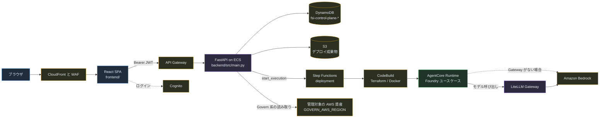
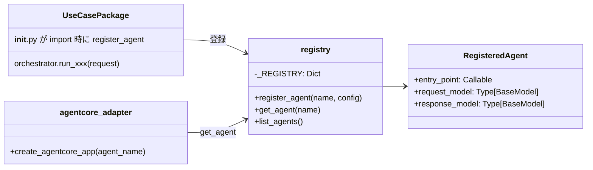
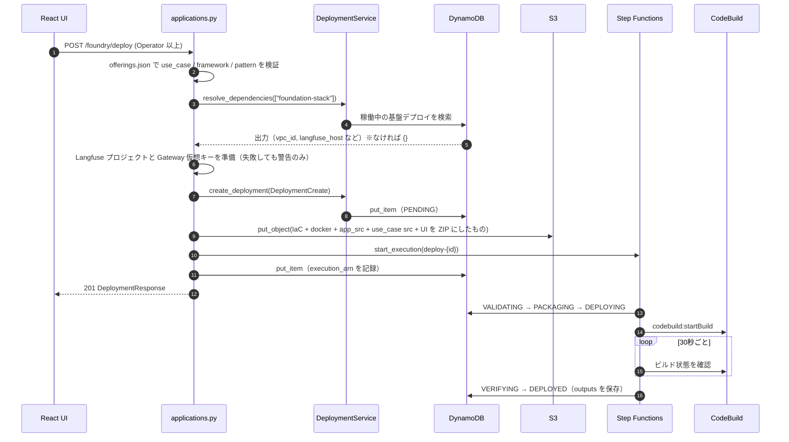
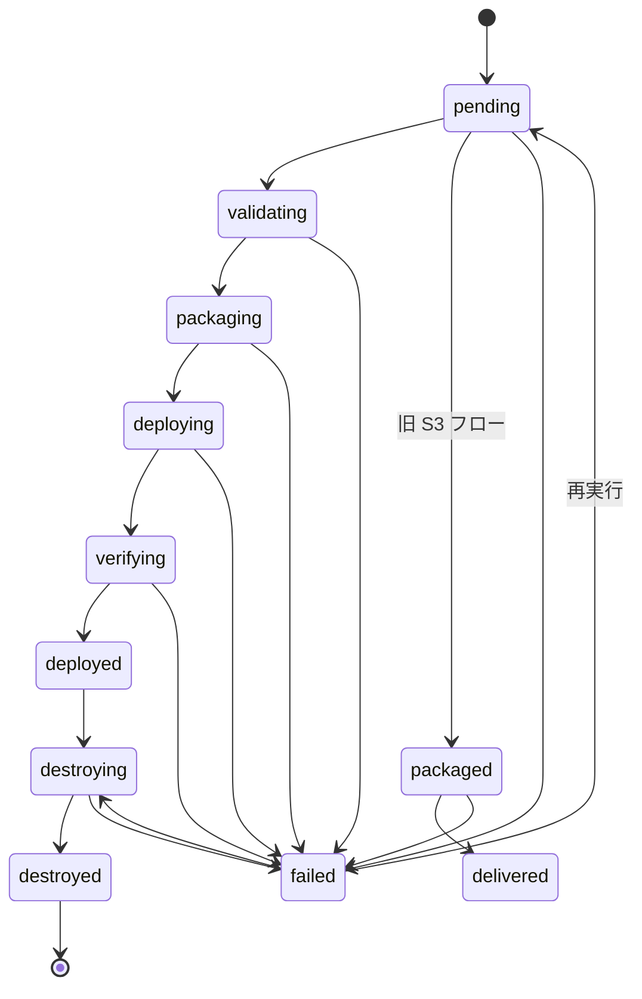
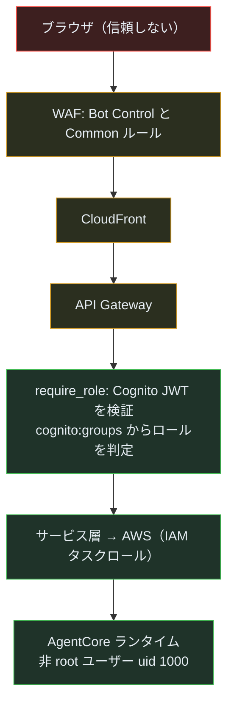
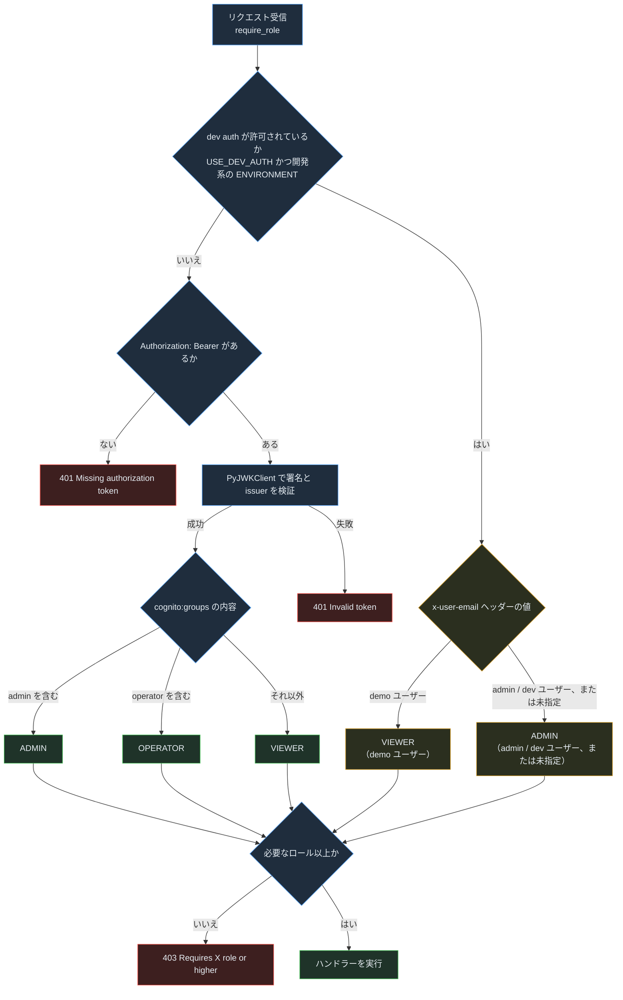
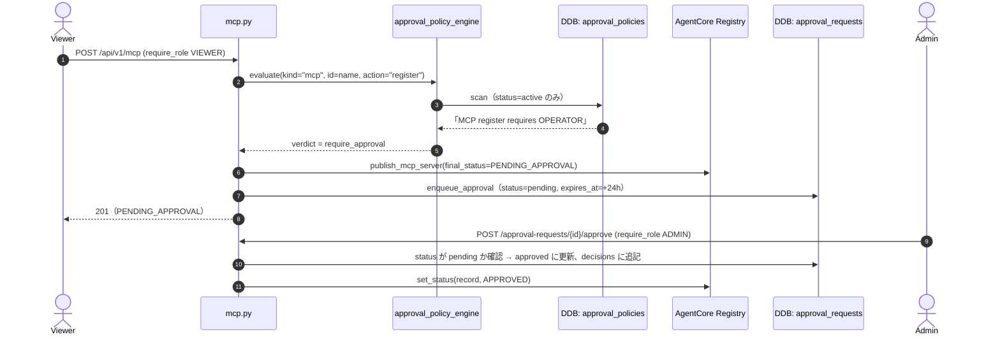
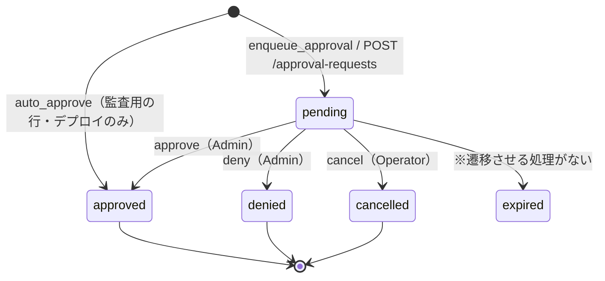
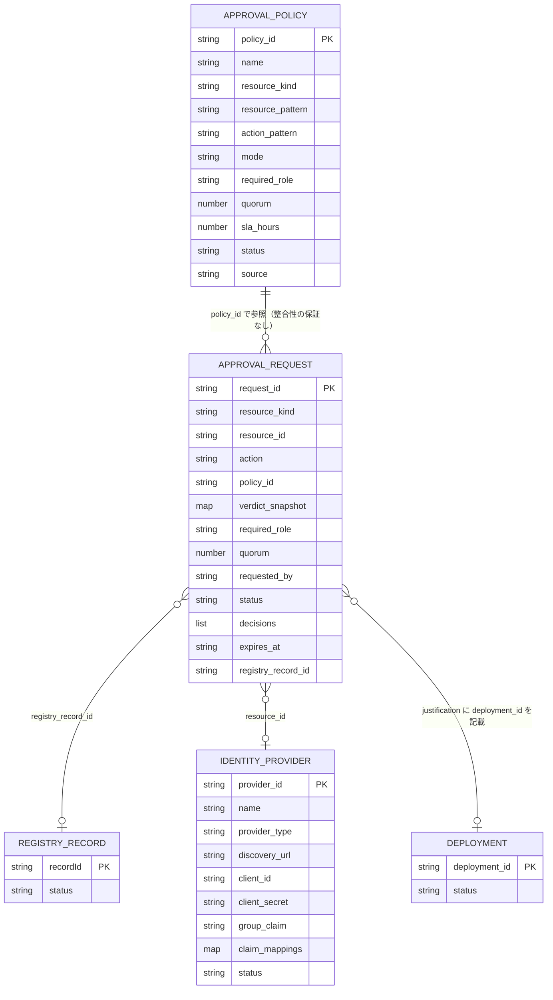

# AVA プリンシパル向けオンボーディングガイド

> **対象読者**：シニア／スタッフ以上のエンジニア。「何があるか」より「なぜこうなっているか」「どこが壊れやすいか」を知りたい人向け。
> **解析基準**：2026-11-01、コミット `2b8849c`（main）。静的なコード解析に基づく資料で、AWS への実デプロイやテスト実行の成功を示すものではありません。
> **根拠の書き方**：主張には `(パス:行番号)` を付けています。パスはリポジトリルートからの相対パスです。**［推測］** と書いた箇所は、コードの構造やコメントから推測した意図で、ADR やオーナーへの確認による裏付けはありません。

関連資料：[コントリビューター向けガイド](contributor-guide-ja.md) ／ [技術設計・保守ガイド（HTML）](../technical-guide-ja.html) ／ [AWS 構成図](../diagrams/README.md)

---

## 目次

1. [システムの思想と設計原則](#1-システムの思想と設計原則)
2. [アーキテクチャ概要](#2-アーキテクチャ概要)
3. [重要な抽象とインターフェース](#3-重要な抽象とインターフェース)
4. [設計判断ログ](#4-設計判断ログ)
5. [依存ライブラリの選定理由](#5-依存ライブラリの選定理由)
6. [データフローと状態](#6-データフローと状態)
7. [障害モードとエラー処理](#7-障害モードとエラー処理)
8. [性能特性](#8-性能特性)
9. [セキュリティモデル](#9-セキュリティモデル)（認証・認可・承認フローの詳細は §9.1〜9.7、承認・権限テーブル設計は §9.8）
10. [テスト戦略](#10-テスト戦略)
11. [運用上の注意点](#11-運用上の注意点)
12. [既知の技術的負債](#12-既知の技術的負債)

---

## 1. システムの思想と設計原則

AVA（Agentic Value Accelerator）は、ひとつのアプリケーションではありません。AWS 上で AI エージェントを **Plan → Build → Secure → Operate → Govern** の流れで扱うための部品をまとめたモノレポです（`README.md:28`, `README.md:122`, `README.md:171`, `README.md:475`, `README.md:489`, `README.md:508`）。中心になるのは次の2層です。

| 層 | 場所 | 役割 |
|---|---|---|
| **Control Plane** | `platform/control_plane/` | React 管理画面と FastAPI。エージェントのデプロイ、ガバナンス、監視を行う |
| **ワークロード** | `applications/` | 実際に動くエージェント。FSI Foundry（35 ユースケース）、参照実装、App Factory |

### コードから読み取れる不変条件

| 不変条件 | 根拠 |
|---|---|
| **デプロイ状態は定義済みの遷移だけを通る。** `VALID_TRANSITIONS` にない遷移は `ValueError` になる | `platform/control_plane/backend/src/models/deployment.py:53-66`, `:123-124` |
| **本番相当の環境では開発用認証バイパスを有効にできない。** `ENVIRONMENT` が開発系でなければ `USE_DEV_AUTH` は強制的に `False` になる | `platform/control_plane/backend/src/core/config.py:16`, `:396-399` |
| **ロールは Viewer < Operator < Admin の順に並ぶ。** API は「最低限必要なロール」で守る | `platform/control_plane/backend/src/core/rbac.py:32-35`, `:363-382` |
| **Foundry のユースケースは1コンテナ1エージェント。** `AGENT_NAME` で選んだユースケースだけを import して登録する | `applications/fsi_foundry/foundations/src/main.py:37-45` |
| **Foundry のカタログは1つの JSON（`offerings.json`）が正。** バックエンドの検証とフロントエンドの表示が同じファイルを読む | `applications/fsi_foundry/data/registry/offerings.json`, `platform/control_plane/frontend/package.json`（`prebuild`/`predev` でコピー） |
| **観測と LLM Gateway は「あれば使う」付加機能。** ないときはデプロイを止めず、直接 Bedrock を呼ぶ経路に戻る | `platform/control_plane/backend/src/api/routes/applications.py:127-133`, `:219-222` |

### 主な設計の選択

- **リージョンを2段に分けている。** `AWS_REGION` は Control Plane 自身の資源（DynamoDB 等）、`GOVERN_AWS_REGION` は管理対象のエージェント群です（`platform/control_plane/backend/src/core/config.py:38`, `:53`）。起動時に最初に両方をログへ出します。リージョンを間違えても AWS はエラーを返さず、そのリージョンの空の一覧を返すからです（`platform/control_plane/backend/src/main.py:66-71` のコメント）。
- **「測っていないものを緑と報告しない」方針。** pytest の設定は壊れたテストを `--ignore` で隠さず、あえて失敗として見せています（`platform/control_plane/backend/pytest.ini` の KNOWN BREAKAGE 節）。テスト名にも `*_honesty.py` が複数あります（`test_govern_partial_read_honesty.py` など）。

---

## 2. アーキテクチャ概要

| コンポーネント | 担当 | 根拠 |
|---|---|---|
| フロントエンド | React 19 + Vite + Tailwind。約155ルート | `platform/control_plane/frontend/package.json`, `platform/control_plane/frontend/src/App.tsx:148` |
| バックエンド | FastAPI。約94本のルーター。`API_PREFIX=/api/v1` | `platform/control_plane/backend/src/main.py:235-438`, `platform/control_plane/backend/src/core/config.py:276` |
| インフラ | Terraform のルートモジュールから 25 個のモジュール（networking, ecs, api_gateway, step_functions, codebuild, cognito, waf, cloudfront, litellm など） | `platform/control_plane/infrastructure/main.tf:51-653` |
| デプロイ実行 | Step Functions で検証 → パッケージ → CodeBuild → 30秒ごとのポーリング → 出力取得 | `platform/control_plane/infrastructure/modules/step_functions/main.tf:221-728` |
| FSI Foundry | 共通基盤（`foundations/`）と35個のユースケース。対応パターンは現状すべて `agentcore` | `applications/fsi_foundry/data/registry/offerings.json` |

**ルーター登録の二重化**：`ROOT_PATH`（API Gateway のステージ名）が設定されていると、すべてのルーターを `ROOT_PATH + API_PREFIX` の下にもう一度登録します（`platform/control_plane/backend/src/main.py:176-200`, `:426-438`）。同じ目的で ASGI ミドルウェアによるプレフィックス除去もあります（`platform/control_plane/backend/src/main.py:25-38`）。新しいルーターを足すときは**両方に登録が必要**です。

---

## 3. 重要な抽象とインターフェース

### 3.1 Control Plane 側

| 抽象 | 役割 | 根拠 |
|---|---|---|
| `Role` / `require_role(min_role)` | FastAPI の依存性として認可をかける。JWT 検証は `to_thread` に逃がしてイベントループを止めない | `platform/control_plane/backend/src/core/rbac.py:32-37`, `:363-382` |
| `Settings`（pydantic-settings） | 設定を1か所に集約。テーブル名、リージョン、Foundry のパス、認証ゲート | `platform/control_plane/backend/src/core/config.py:19-308` |
| `Deployment` と `VALID_TRANSITIONS` | デプロイの状態機械。`transition_to()` で履歴を残しながら遷移する | `platform/control_plane/backend/src/models/deployment.py:37-66`, `:92-126` |
| `DeploymentService` | DynamoDB 上のデプロイ記録の CRUD、状態更新、依存解決、成功時の自動処理 | `platform/control_plane/backend/src/services/deployment_service.py:31-387` |
| `PipelineService` | Step Functions の起動・状態取得、CodeBuild のログ取得 | `platform/control_plane/backend/src/services/pipeline_service.py:29-308` |
| ルーターごとの遅延シングルトン（`get_service()`） | 各ルーターが自分のサービスを初回呼び出し時に作る | 例：`platform/control_plane/backend/src/api/routes/maturity.py:26-37` |

### 3.2 FSI Foundry 側

- **`RegisteredAgent` と `register_agent`**：ユースケースとランタイムの間の唯一の契約です。中身は「非同期の入口関数」と「入出力の Pydantic モデル」だけです（`applications/fsi_foundry/foundations/src/base/registry.py:15-70`）。同じ名前で2回登録すると `ValueError` になります（`:41-43`）。
- **アダプター**：`create_agentcore_app()` が `get_agent()` で登録内容を取り出し、payload を `request_model` で検証して `entry_point` を呼びます（`applications/fsi_foundry/foundations/src/adapters/agentcore_adapter.py:20-91`）。
- **フレームワーク別の基底クラス**：`base/strands/` と `base/langgraph/` に `agent.py` と `orchestrator.py` があります。ユースケースはこれを継承します。例：`KYCOrchestrator(StrandsOrchestrator)`（`applications/fsi_foundry/use_cases/kyc_banking/src/strands/orchestrator.py:31`）、`CreditAnalyst(StrandsAgent)`（`applications/fsi_foundry/use_cases/kyc_banking/src/strands/agents/credit_analyst.py:13`）。
- **フレームワークの切り替えはビルド時に決まる**：Dockerfile は `use_cases/<ID>/src/<FRAMEWORK>/` だけを `use_cases/<ID>/` へコピーします（`applications/fsi_foundry/foundations/docker/Dockerfile.agentcore:29`）。そのため、コンテナ内で登録を行うのはフレームワーク別サブパッケージの `__init__.py`（例：`.../kyc_banking/src/strands/__init__.py:17-24`）です。ユースケース直下の `src/__init__.py` にある `AGENT_FRAMEWORK` での分岐（`.../kyc_banking/src/__init__.py:18-41`）はコンテナでは使われません。**［推測］** ローカル実行用に残っている古い仕組みと考えられます。

---

## 4. 設計判断ログ

コミット履歴の大半はリリース単位でまとめられており（例：`45a22c5 feat: v4.0 — ...`, `a594114 feat: v3.1 — ...`）、ADR はリポジトリにありません。以下の「理由」は、主にコード内コメントとリリースノートを根拠にしています。

| # | 判断 | 背景・根拠 | 他の選択肢 | トレードオフ |
|---|---|---|---|---|
| D1 | デプロイを **Step Functions + CodeBuild** で非同期に実行する | Terraform やイメージビルドは API のタイムアウトに収まらない。状態を DynamoDB に書き込みながら進める（`.../step_functions/main.tf:230-728`） | API 内で同期実行、ECS タスクで実行 | 実行が見やすく再試行もしやすい一方、ステートマシン定義と Python 側の状態機械の**二重管理**になる |
| D2 | デプロイ記録は **DynamoDB**、ローカル DB は SQLite／PostgreSQL | `DeploymentService` は boto3 の DynamoDB を直接使う（`.../deployment_service.py:31-35`）。`DATABASE_URL` の既定値は SQLite（`.../core/config.py:30-33`）。Compose の PostgreSQL は LiteLLM 用（`platform/control_plane/docker-compose.yaml:23-24`） | すべて RDS に置く | サーバーレスで運用は軽い。ただし**ローカルでもデプロイ系の画面は AWS に接続する** |
| D3 | 開発用認証バイパスを**環境名で制限**する | 以前は `USE_DEV_AUTH or DEBUG` という2つの入口があった。設定の誤りで本番が素通りになるのを防ぐため、1つにまとめて環境名で拒否する（`.../core/config.py:374-420` のコメント） | フラグだけで制御 | 安全側に倒れる。ただし `ENVIRONMENT` の書き間違いがあると、開発環境で認証が効いて動かなくなる |
| D4 | LLM 呼び出しを **LiteLLM Gateway** に集める（ある場合のみ） | デプロイ時に仮想キーを払い出し、ランタイムに `LLM_GATEWAY_*` を渡す。失敗したら直接 Bedrock に戻る（`.../routes/applications.py:196-222`）。v3.1 で導入（`a594114`） | 常に直接 Bedrock | コスト管理や監査を一元化できる。一方で、**フォールバックすると Gateway の管理を通らない経路ができる** |
| D5 | Foundry を「**1基盤 × N ユースケース × M フレームワーク**」で構成する | `offerings.json` に 35 ユースケースと `supported_frameworks` を定義。34件が LangGraph と Strands の両方に対応 | ユースケースごとに独立したリポジトリ | 横展開は速い。ただしフレームワーク実装が2つずつあるため、**修正も2か所に必要** |
| D6 | `ec2` / `step_functions` パターンをカタログに残す | `offerings.json:1451-1468` に定義はあるが、`foundations/iac/` には `agentcore` しかなく、全ユースケースの対応パターンも `agentcore` のみ | 削除する | **［推測］** 将来の拡張用、または移行途中。新しく入った人が誤解しやすい（§12 参照） |

---

## 5. 依存ライブラリの選定理由

| 依存 | バージョン | 用途・理由 | 根拠 |
|---|---|---|---|
| FastAPI / uvicorn | 0.109.0 / 0.27.0 | Control Plane の API | `platform/control_plane/backend/requirements.txt` |
| boto3 / botocore | `>=1.43.0` | AgentCore の policy-engine API（`create_policy_engine` など）にこの版以上が必要 | 同上（コメントあり） |
| PyJWT / python-jose | 2.8.0 / 3.3.0 | Cognito JWT の検証（JWKS を使用） | 同上, `platform/control_plane/backend/src/core/rbac.py:279-303` |
| requests | 2.32.5 | **本番用の依存として明示**。以前はテスト用ライブラリ経由で間接的に入っていただけで、外すと JWT 認証が壊れる状態だった | `requirements.txt` のコメント |
| SQLAlchemy / Alembic | 2.0.35 / 1.14.0 | ローカル DB とカタログ（`catalog_orm.py`） | 同上 |
| React / Vite / Tailwind | 19 / 8 / 4 | 管理画面 | `platform/control_plane/frontend/package.json` |
| LiteLLM | `main-latest`（**固定されていない**） | ローカルの LLM Gateway | `platform/control_plane/docker-compose.yaml:43` |
| Strands Agents / LangGraph | — | Foundry のエージェント実装。どちらもユースケースごとに用意する | `applications/fsi_foundry/foundations/src/requirements/` |
| bedrock-agentcore | — | Foundry のランタイム。バックエンドのテスト環境には**あえて入れていない** | `platform/control_plane/backend/pytest.ini` のコメント |

「何を置き換えたか」はコミット履歴から追えません（リリース単位でまとめられているため）。**不明**とします。

---

## 6. データフローと状態

### 6.1 Foundry ユースケースのデプロイ（実際のコードを追跡）

入口は `POST /api/v1/applications/foundry/deploy` です（`platform/control_plane/backend/src/api/routes/applications.py:114-337`）。

| ステップ | 根拠 |
|---|---|
| カタログによる検証（404 / 400） | `.../routes/applications.py:116-125` |
| 基盤の出力の解決（`DELIVERED` / `DEPLOYED` のうち最新） | `.../services/deployment_service.py:369-387` |
| ZIP の内容（`shared/`, `docker/`, `app_src/`, `use_cases/<id>/src`, `data/samples`, `ui/`, `ui_iac/`） | `.../routes/applications.py:243-298` |
| 成果物の S3 キー：`deployments/{deployment_id}/{use_case}.zip` | `.../routes/applications.py:300-301` |
| Step Functions への入力（`action: deploy`、`job.name: onboarding`） | `.../routes/applications.py:309-330` |
| ステートマシンの状態（`ValidateInput` ～ `RecordSuccessDeploy` / `FailState`） | `.../step_functions/main.tf:230-728` |
| `DEPLOYED` になったときに Gateway を自動で準備し、Registry へ自動登録（失敗してもデプロイは成功扱い） | `.../services/deployment_service.py:120-128` |

### 6.2 デプロイの状態機械

根拠：`platform/control_plane/backend/src/models/deployment.py:37-72`

### 6.3 ランタイムでのリクエスト（Foundry）

AgentCore の payload → `request_model(**payload)` → `await entry_point(request)` → `response.model_dump(mode="json")` の順に処理します（`applications/fsi_foundry/foundations/src/adapters/agentcore_adapter.py:79-89`）。KYC の例では、オーケストレーターが `s3_retriever_tool` で S3 から顧客のプロフィールと履歴を取得します（`applications/fsi_foundry/use_cases/kyc_banking/src/strands/orchestrator.py:185-186`）。サンプルデータは `applications/fsi_foundry/data/samples/` にあり、デプロイ時に ZIP に含まれます。

---

## 7. 障害モードとエラー処理

| 障害 | 挙動 | 根拠 | 注意点 |
|---|---|---|---|
| 基盤スタックが未デプロイ | 警告を出して続行。トレースはつながらない | `.../routes/applications.py:129-133` | 黙って品質が落ちる |
| Gateway の準備に失敗 | 警告を出し、直接 Bedrock を使う | `.../routes/applications.py:219-222` | ガバナンスを迂回する経路になる |
| パッケージ化／パイプライン起動に失敗 | `FAILED` に更新して HTTP 500。`detail` に例外の文字列をそのまま入れる | `.../routes/applications.py:303-306`, `:333-336` | 内部パスなどが外に漏れる可能性（§9, §12） |
| 想定外の例外 | 共通ハンドラーが 500 を返す。`DEBUG` のときだけ例外の文字列を返す。エラー時も CORS ヘッダーを付ける | `platform/control_plane/backend/src/main.py:205-232` | — |
| 不正な状態遷移 | `ValueError` | `.../models/deployment.py:123-124` | DynamoDB は条件付き書き込みでないため、同時更新を防げない（§12） |
| Cognito の JWKS 取得失敗 | ロックで取得を1回にまとめ、指数バックオフ。鍵が取れないことと、鍵 ID が不明なことを区別する | `.../core/rbac.py:123-276` | — |
| エージェント実行時の例外 | `{"error": str(e)}` を**正常応答として**返す | `.../adapters/agentcore_adapter.py:87-89` | 呼び出し側は HTTP ステータスでは失敗を判別できない |
| 起動時のシードの取り込みに失敗 | ログを出して起動は続ける | `platform/control_plane/backend/src/main.py:117` | — |

**復旧の基本**：`FAILED` からは `PENDING`（再実行）か `DESTROYING`（片付け）に進めます（`.../models/deployment.py:63`）。ステートマシンの各段階には `RecordFailure*` 状態があり、`record_failure_stage()` で失敗した段階を記録します（`.../services/deployment_service.py:352`）。

---

## 8. 性能特性

**計測データはリポジトリにありません。** 以下はコード構造から言えることだけです。

| 観点 | 内容 | 根拠 |
|---|---|---|
| デプロイのリードタイム | CodeBuild の状態を30秒ごとにポーリングするため、完了検知が最大30秒遅れる | `.../step_functions/main.tf:499-504` |
| イベントループを止める処理 | `deploy_foundry_use_case` は `async def` の中で同期の boto3 呼び出しと ZIP 作成を行う。重い処理の間、他のリクエストが待たされる | `.../routes/applications.py:115`, `:238-301` |
| JWT 検証 | `require_role` は `to_thread` に逃がしている。ただし `users.py`, `fsi_sso.py`, `evaluations.py` ではまだイベントループ上で実行していると、コメントで明記されている | `.../core/rbac.py:365-379` |
| 一覧の取得 | `list_deployments` は DynamoDB の `scan` を使う（`.../deployment_service.py:100`）。`resolve_dependencies` はその結果を Python 側で絞り込むため、デプロイ件数に比例して遅くなる | `.../services/deployment_service.py:85-101`, `:375-381` |
| スケール | ECS はタスク数を指定でき、CPU／メモリでオートスケールする。サービスやキャッシュはプロセスごとのメモリに持つため、タスク間で共有されない | `.../modules/ecs/main.tf:932`, `:974-1000`, `.../core/ttl_cache.py` |
| キャッシュの事前読み込み | 起動時に `cache_prewarm` と `llm_quality_producer` を開始する | `platform/control_plane/backend/src/main.py:134`, `:145` |

---

## 9. セキュリティモデル

| 項目 | 内容 | 根拠 |
|---|---|---|
| 認証 | Cognito の JWT（JWKS で署名を検証） | `.../core/rbac.py:155-161`, `:279-303` |
| 認可 | `cognito:groups` に `admin` → Admin、`operator` → Operator、それ以外 → Viewer | `.../core/rbac.py:354-361` |
| 開発用バイパス | 開発系の環境名のときだけ有効。`x-user-email` / `x-user-role` ヘッダーでロールを決められ、トークンがなければ **Admin** になる | `.../core/rbac.py:305-338`, `.../core/config.py:396-420` |
| エッジ防御 | WAF（Bot Control + Common ルールセット）を CloudFront に適用 | `README.md:78`, `.../infrastructure/main.tf:539-584` |
| 外部への HTTP 呼び出し | `safe_fetch`（SSRF 対策、リダイレクト時に Authorization を落とす）。パスの制限には `path_jail` | `.../core/safe_fetch.py`, `.../core/path_jail.py`, `tests/test_safe_fetch.py` |
| コンテナ | Foundry のランタイムは非 root ユーザー（uid 1000）で動く | `.../docker/Dockerfile.agentcore:33-34` |
| 秘密情報 | Gateway の仮想キーは Secrets Manager の ARN として渡し、実行時に解決する | `.../routes/applications.py:216-217`, `.../utils/llm_gateway.py:44-92` |

**信頼境界で注意すべき点**

1. **`x-user-email` はクライアントが自由に設定できるヘッダーです。** それを `created_by` として記録しています（`.../routes/maturity.py:56-66`）。本番でも JWT のクレームではなくヘッダーの値を使うため、**作成者は偽装できます**。監査証跡として信用しないでください。
2. `environments/dev` は `USE_DEV_AUTH=true` を設定しています（`.../environments/dev/main.tf:706`）。ECS モジュールの本番スタンプは `false` に固定しています（`.../modules/ecs/main.tf:876`）。dev 環境をインターネットに公開しないでください。
3. Foundry の ZIP にはサンプルデータが含まれます（`.../routes/applications.py:276-280`）。**実データを `data/samples` に置かないでください。**
4. 脆弱性の報告手順は `SECURITY.md` にあります。

### 9.1 ID 基盤：Cognito ユーザープールとロールの割り当て

| 項目 | 内容 | 根拠 |
|---|---|---|
| グループ | `admin` / `operator` / `viewer` の3つ（すべて単数形） | `platform/control_plane/infrastructure/modules/cognito/main.tf:110-127` |
| グループ名の一元管理 | `core/cognito_groups.py` に定数を置き、Terraform と一致することをテストで確認する。過去に `admins`（複数形）とのずれがあり、本物の管理者が 403 になる不具合があった | `platform/control_plane/backend/src/core/cognito_groups.py:1-44`, `tests/test_cognito_group_names.py` |
| セルフサインアップ | **有効**（`allow_admin_create_user_only = false`） | `.../modules/cognito/main.tf:13-17` |
| サインアップの制限 | PreSignUp Lambda が gmail.com などの**公開メールのドメインだけを拒否する**（ブロックリスト方式） | `.../modules/cognito/lambda_src/pre_signup_domain_check/index.py:12-51` |
| 初期ロール | PostConfirmation Lambda が、確認済みのユーザーを `viewer` グループに入れる | `.../modules/cognito/signup_lambdas.tf:9`, `:21-24` |
| 管理者などの作成 | `deploy-full.sh` の Step 7 で、ロールごとにユーザーを作る（空欄ならスキップ）。Terraform でもデモ用ユーザー（`admin_demo`, `demo_viewer`）を作る | `.../infrastructure/scripts/deploy-full.sh:431-470`, `.../modules/cognito/main.tf:141-180` |
| MFA | `enable_mfa` のときだけ `OPTIONAL`。既定は変数で決まる | `.../modules/cognito/main.tf:43` |

> **意味すること**：社内ドメイン以外でも、公開メール以外のドメイン（たとえば攻撃者が持つ独自ドメイン）なら誰でも登録でき、**Viewer** になれます。Viewer の権限範囲（§9.4）は、この前提で評価してください。**［推測］** 許可リスト方式でないのは、デモ環境での使いやすさを優先したためと考えられます。

### 9.2 トークンの流れとリクエストごとのロール判定

dev ユーザーのメールアドレスは `demo@example.com`（VIEWER）、`admin@example.com` と `dev@example.com`（ADMIN）です（`.../core/rbac.py:309-318`）。

根拠：`platform/control_plane/backend/src/core/rbac.py:305-361`（判定）, `:363-382`（`require_role`）。図では dev auth の分岐を簡略化しています。実際には「トークンなし → ADMIN」「Cognito 未設定なら `x-user-role` ヘッダーで決める」「JWT 検証に失敗しても ADMIN」という分岐もあります（`:320-345`）。

| 段階 | 実装 | 根拠 |
|---|---|---|
| ログイン | SPA が Cognito で認証し、**ID トークン**を `localStorage['auth_token']` に保存する | `platform/control_plane/frontend/src/auth/AuthContext.tsx:66-71` |
| 送信 | axios のインターセプターで `Authorization: Bearer` を付ける。`localStorage['dev_user_email']` があれば `x-user-email` も付ける | `platform/control_plane/frontend/src/api/client.ts:36-50` |
| 経路 | API Gateway（HTTP API）は `$default` ルートで VPC Link 経由で ALB に**そのまま転送する。オーソライザーはない** | `platform/control_plane/infrastructure/modules/api_gateway/main.tf:21`, `:42-46`, `:55-59` |
| 検証 | JWT を検証するのはバックエンドだけ。JWKS はプロセス内でキャッシュする | `.../core/rbac.py:123-303` |
| 401 のとき | SPA はトークンを消して再読み込みする（再ログイン） | `.../frontend/src/api/client.ts:55-62` |
| 画面の出し分け | `/api/v1/users/me` が返す `role` / `role_level` / `can_deploy` で UI を切り替える。**UI の非表示はセキュリティではない**。必ず API 側で `require_role` をかける | `platform/control_plane/backend/src/api/routes/users.py:26-85`, `platform/control_plane/frontend/src/contexts/UserContext.tsx:7-8` |

### 9.3 認証スタックが2系統ある

| 系統 | 使い方 | JWT ライブラリ | 使っている場所 |
|---|---|---|---|
| **`core/rbac.py`**（主流） | `Depends(require_role(Role.X))`。ロールの階層で判定 | PyJWT | ほぼすべてのルーター |
| **`core/auth.py` → `core/security.py` / `core/dev_auth.py`** | `Depends(get_current_user)` / `require_admin`。グループ名で判定 | python-jose | `langfuse.py`, `projects.py`, `govern_marketplace.py`, `multicloud.py` |

根拠：`platform/control_plane/backend/src/core/auth.py:13-17`, `.../core/security.py:240-398`。どちらも `USE_DEV_AUTH` だけを見て切り替えます。以前の「`USE_DEV_AUTH or DEBUG`」という2つ目の入口は塞がれています（`.../core/auth.py:10-12`）。**新しいコードは `require_role` を使ってください。** 2系統あるのは技術的負債です（§12 T14）。

### 9.4 権限マトリクス（代表的な操作）

| 操作 | 必要ロール | 承認ポリシーの評価 | 根拠 |
|---|---|---|---|
| 参照系（一覧・詳細） | Viewer | — | 各ルーターの GET |
| テンプレートからのデプロイ（`POST /deployments`） | Operator | 評価する（既定は `auto_approve`。監査用の行を残す） | `.../routes/deployments.py:137-180`, `:296-330` |
| Foundry のデプロイ（`POST /applications/foundry/deploy`） | Operator | **評価しない** | `.../routes/applications.py:114-337` |
| デプロイの破棄（`/destroy`） | Operator | **評価しない**（既定ポリシー「Application delete requires ADMIN」があるが、この経路には適用されない） | `.../routes/deployments.py:469-470`, `.../services/approval_policy_bootstrap.py:115-120` |
| MCP / A2A / Agent / Skill / Custom の登録 | **Viewer**（申請できる） | 評価する（既定は Operator の承認が必要） | `.../routes/mcp.py:182-241`, `.../routes/a2a.py:389`, `.../routes/agents.py:177-185`, `.../routes/skills.py:157-165`, `.../routes/custom_resources.py:117-125` |
| 上記の削除 | Operator | 評価しない | `.../routes/mcp.py:298-299`, `.../routes/agents.py:238` など |
| ID プロバイダーの登録 | **Viewer**（申請できる） | 評価する（既定は ADMIN の承認が必要） | `.../routes/identity_providers.py:376-399` |
| ID プロバイダーの更新・削除 | Operator | **評価しない** | `.../routes/identity_providers.py:468`, `:492` |
| 承認ポリシーの作成・更新・削除 | Admin | — | `.../routes/approval_policies.py:129-192` |
| 承認キューでの承認・却下（単体・一括） | **Admin** | — | `.../routes/approval_requests.py:253-275`, 一括は `:332-354` |
| 承認申請の手動作成・取り消し | Operator | — | `.../routes/approval_requests.py:119-123`, `:363-368` |
| Service Approval（AWS サービスの採用審査）の実行 | Operator | — | `.../routes/service_approval.py:73-74` |
| FSI アプリへの SSO トークン発行 | Viewer | — | `.../routes/fsi_sso.py:48-81` |

> **Service Approval は承認フローとは別物です。** 名前が似ていますが、`service_approval` は「AWS サービスを社内で使ってよいか」を評価するエージェントの実行（run）を管理する機能です（`platform/control_plane/service_approval/`, `.../routes/service_approval.py:1`）。人による承認（HITL）の仕組みは、次の §9.5 の Approval Policies / Approval Queue です。

### 9.5 承認フロー（Approval Policies → Approval Queue）

UI では、ポリシーは **Secure** の柱で作成し、承認待ちの申請（キュー）は **Operate** の柱で処理します（`.../routes/approval_policies.py:1-6`）。

**構成要素**

| 要素 | 役割 | 保存先 | 根拠 |
|---|---|---|---|
| Approval Policy | 「`resource_kind` の `resource_pattern` に `action_pattern` をするときは、`required_role` の承認を `quorum` 人分、`sla_hours` 以内に得る」というルール | DynamoDB `APPROVAL_POLICIES_TABLE_NAME`（pk=`policy_id`） | `.../routes/approval_policies.py:61-75` |
| 評価エンジン | 対象（種類・ID・操作）に一致するポリシーから判定（verdict）を返す | ステートレス（毎回 scan する） | `.../services/approval_policy_engine.py:1-27`, `:157-190` |
| Approval Request | 承認待ちの申請 1 件。一致したポリシー、申請者、対象、判定の記録を持つ | DynamoDB `APPROVAL_REQUESTS_TABLE_NAME` | `.../routes/approval_requests.py:1-10`, `:43` |
| `enqueue_approval` | 判定からキューの行を作る（ポリシーの `required_role` / `quorum` / `sla_hours` を引き継ぐ） | 同上 | `.../services/agent_registry_client.py:568-615` |
| 既定ポリシーの投入 | 起動時に名前をキーにして投入する（既存の行は上書きしない） | 同上 | `.../services/approval_policy_bootstrap.py:1-26`, `:161`, `platform/control_plane/backend/src/main.py:120-128` |

**判定（verdict）の種類と優先順位**

| mode | 呼び出し側の動作 |
|---|---|
| `deny` | 403 を返して処理しない |
| `require_approval` | 対象を `PENDING_APPROVAL` で作り、キューに申請を積む |
| `auto_approve` | 対象を `APPROVED` で作る（デプロイの場合のみ、監査用に承認済みの行を残す） |

一致するポリシーが複数あるときは、(1) mode の厳しさ（deny > require_approval > auto_approve）→ (2) `resource_pattern` の具体性 → (3) `action_pattern` の具体性 → (4) `required_role` の厳しさ（ADMIN > OPERATOR）→ (5) `policy_id` の順で1つに決めます（`.../services/approval_policy_engine.py:15-20`）。`mode` 列がないポリシーは `require_approval` として扱います（`:138-151`）。**一致するポリシーがなければ `auto_approve`** です（`:184`）。パターンは `fnmatch` によるグロブで、Cedar ではありません（`.../routes/approval_policies.py:10-11`）。

**既定ポリシー**（`.../services/approval_policy_bootstrap.py:9-21`, `:52-155`）

| 対象 | 操作 | 判定 | 承認者 / SLA |
|---|---|---|---|
| mcp / a2a / agent / custom | register | require_approval | OPERATOR / 24h |
| skill | register | require_approval | OPERATOR / 48h |
| identity | register | require_approval | ADMIN / 24h |
| application | delete | require_approval | ADMIN / 4h |
| application | deploy | **auto_approve** | — |
| harness / memory | delete | ポリシーなし（UI の確認ダイアログのみ） | — |

**例：Viewer が MCP サーバーを登録する場合**

根拠：`.../routes/mcp.py:182-241`, `.../routes/approval_requests.py:161-275`。ID プロバイダーは Registry ではなく DynamoDB にあるため、承認時に UpdateItem で `active` / `rejected` / `cancelled` に切り替えます（`.../routes/approval_requests.py:196-221`）。Registry の状態の更新に失敗しても、キュー側の決定は残ります。Operator は後から再試行できます（`:233-238`）。

**申請の状態**

根拠：`.../routes/approval_requests.py:5`, `:43`, `:179-183`（pending 以外への決定は 409）。

### 9.6 承認フローの実装上の制約（v1 の範囲）

コード内コメントで「v1 の範囲」「v2 で対応」と明記されているものと、コードを読んで確認したものを分けて示します。

| # | 制約 | 影響 | 根拠 | 種別 |
|---|---|---|---|---|
| A1 | **quorum を強制しない。** 1人が承認した時点で `approved` になる | 「2人承認」のポリシーが実際には1人で通る | `.../routes/approval_requests.py:8-10`, `:169-171` | コメントで明記 |
| A2 | **`required_role` を承認時に見ていない。** 承認・却下 API は一律で Admin が必要 | OPERATOR の承認が必要なポリシーでも、Operator は承認できない。運用上は「Admin しか承認できない」 | `.../routes/approval_requests.py:253-275`（`required_role` は保存するだけ：`:144`） | コードで確認 |
| A3 | **自分の申請を自分で承認できる。** 承認者と申請者が同じかを確認していない | Admin が自分の申請を自分で承認できる（職務分掌にならない） | `_record_decision`（`.../routes/approval_requests.py:161-250`）に確認処理がない | コードで確認 |
| A4 | **取り消しで本人確認をしない** | 他人の申請を取り消せる | `.../routes/approval_requests.py:372` | コメントで明記 |
| A5 | **SLA が切れても `expired` にならない。** `expires_at` を書くだけで、期限切れを処理するジョブがない | 期限切れの申請がずっと pending のまま残り、後からでも承認できる | `.../routes/approval_requests.py:76-77`, `:152`。`expired` に更新する処理はリポジトリ内に見つからない | コードで確認 |
| A6 | **デプロイは `require_approval` でも止まらない。** 申請を積むだけで CodeBuild は動く | デプロイ用のポリシーを厳しくしても、事後の記録にしかならない | `.../routes/deployments.py:296-302` | コメントで明記（v2 の課題） |
| A7 | **破棄・削除・更新はポリシーを評価しない** | 既定の「Application delete requires ADMIN」が効かない。Operator がそのまま破棄できる | §9.4 の表 | コードで確認 |
| A8 | **評価エンジンが fail-open。** ポリシーテーブルの scan に失敗したとき、またはテーブル名が未設定のときは空として扱い、`auto_approve` になる | DynamoDB の障害や設定漏れの間、Viewer の登録申請が**承認なしで APPROVED** になる。ローカルでテーブル名が空なら常に自動承認 | `.../services/approval_policy_engine.py:98-107`, `:184` | コードで確認 |
| A9 | **ポリシー API では `mode`（deny / auto_approve）を指定できない。** `resource_kind` にも `agent` / `skill` / `custom` がない | 既定ポリシーと同じ種類のルールを UI からは作れない。deny ルールを書けない | `.../routes/approval_policies.py:53`, `:58`, `:61-87`（既定ポリシー側は `skill` / `custom` / `agent` / `mode` を使う：`.../approval_policy_bootstrap.py:79`, `:90`, `:106`, `:142`） | コードで確認 |
| A10 | **承認者・申請者の記録を `x-user-email` ヘッダーから取る** | 本番の SPA はこのヘッダーを送らないため、`unknown` と記録される。ヘッダーを手で付ければ任意の名前にもできる | `.../routes/approval_requests.py:257-261`, `.../frontend/src/api/client.ts:43-47` | コードで確認 |
| A11 | `/approval-policies` のモジュール docstring に「NOT WIRED YET」とあるが、実際には登録系の各ルートから呼ばれている | ドキュメントが古い | `.../routes/approval_policies.py:12-13`, `:202` と `.../routes/mcp.py:198` | コードで確認 |

**改善の方向（提案）**：fail-closed にする（評価に失敗したら `require_approval` にする）、承認 API で `required_role` と「承認者が申請者と違うこと」を確認する、`decisions` を積み上げて quorum を判定する、EventBridge のスケジュールで期限切れにする、Step Functions の最初で承認状態を確認して待つ、承認者の主体を JWT の `sub` / `email` から取る。

### 9.7 その他の統制機能

| 機能 | 内容 | 根拠 |
|---|---|---|
| Harness のキルスイッチ | 環境変数 `AVA_HARNESS_DISABLED=1` → センチネルファイル → DynamoDB のフラグ、の優先順で Harness の操作を止める。API で切り替えられるのは Admin のみ | `platform/control_plane/backend/src/core/harness_killswitch.py:1-25` |
| FSI アプリへの SSO 連携 | Cognito の JWT を検証したあと、`FSI_APP_SIGNING_SECRET` で HMAC 署名したトークン（有効期限 3600 秒）を発行する。秘密鍵が未設定なら 503 | `.../routes/fsi_sso.py:19`, `:48-81`, `.../core/config.py:88` |
| AgentCore のポリシーエンジン | 実行時のツール呼び出しを制御する（Cedar ベース）。上の承認フロー（HITL）とは別のレイヤー | `.../infrastructure/main.tf:124`, `.../core/config.py:101-117`, `.../routes/policies.py:482` |
| 開発用バイパスの防止 | 環境名による制限（§1）、ECS の本番スタンプでは `USE_DEV_AUTH=false` に固定 | `.../core/config.py:396-420`, `.../modules/ecs/main.tf:876-877` |

### 9.8 承認・権限テーブル設計（現状）

承認と権限に関わるデータは、**Cognito**（誰がどのロールか）と、**DynamoDB の3テーブル**（何に承認が必要か、承認待ちの申請、外部 ID プロバイダー）に分かれています。ロールの情報は DynamoDB には持たず、毎回 JWT の `cognito:groups` から決めます（§9.2）。

#### 9.8.1 テーブル一覧

| 論理名 | 物理名 | パーティションキー | ソートキー | GSI | TTL | 課金 | PITR / 暗号化 | 根拠 |
|---|---|---|---|---|---|---|---|---|
| 承認ポリシー | `${name_prefix}-approval-policies` | `policy_id`（S） | なし | なし | なし | オンデマンド | 有効 / 有効 | `platform/control_plane/infrastructure/modules/dynamodb/main.tf:588-610` |
| 承認申請（キュー） | `${name_prefix}-approval-requests` | `request_id`（S） | なし | なし | なし | オンデマンド | 有効 / 有効 | `.../modules/dynamodb/main.tf:616-638` |
| ID プロバイダー | `${name_prefix}-identity-providers` | `provider_id`（S） | なし | なし | なし | オンデマンド | 有効 / 有効 | `.../modules/dynamodb/main.tf:560-582` |
| キルスイッチ | `fsi-control-plane-harness-killswitch`（環境変数 `GOVERN_KILLSWITCH_TABLE_NAME` で変更可） | `pk` | `sk` | — | — | — | — | `platform/control_plane/backend/src/core/harness_killswitch.py:46`, `:193`。**Terraform では作成していない**（テーブルがなければ無視する：`:154`） |
| ロール（参考） | Cognito グループ `admin` / `operator` / `viewer` | — | — | — | — | — | — | `.../modules/cognito/main.tf:110-127` |

- テーブル名は ECS タスクに環境変数で渡します（`APPROVAL_POLICIES_TABLE_NAME` など：`.../modules/ecs/main.tf:799-813`）。`Settings` 側の既定値は**空文字**です（`.../core/config.py:227-238`）。ローカルの Compose でも設定しないため、ローカルでは承認系が無効になり、評価は常に自動承認になります（§9.6 A8）。
- Terraform で定義するキー属性は PK だけです。その他の属性はスキーマを持たず、アプリケーションのコードが形を決めます。

#### 9.8.2 エンティティの関係

`REGISTRY_RECORD` は AWS Agent Registry 上のレコード（MCP / A2A / Agent / Skill / Custom）で、DynamoDB ではありません。`DEPLOYMENT` は `fsi-control-plane-deployments` テーブルです（§6.2）。どの参照も**外部キー制約のない「緩い参照」**です。たとえばポリシーを削除しても、それを参照する申請は残ります。そのため、監査では申請に残した `verdict_snapshot` を正とします（`.../services/agent_registry_client.py:622-624`）。

#### 9.8.3 属性定義：承認ポリシー（`approval-policies`）

| 属性 | 型 | 必須 | 値・制約 | 根拠 |
|---|---|---|---|---|
| `policy_id` | S（UUID v4） | ○ | PK | `.../routes/approval_policies.py:139` |
| `name` | S | ○ | 1〜100文字。**一意性は保証しない**（起動時の投入だけが名前で重複を確認する） | `:62`, `.../services/approval_policy_bootstrap.py:23-26`, `:177` |
| `description` | S | | | `:141` |
| `resource_kind` | S | ○ | API から作れる値：`application` / `harness` / `memory` / `mcp` / `a2a` / `identity` / `*`。起動時の投入では、これに加えて `agent` / `skill` / `custom` も使う | `:53`, `.../approval_policy_bootstrap.py:79`, `:90`, `:106` |
| `resource_pattern` | S | ○ | `fnmatch` のグロブ。既定は `*` | `:65-68` |
| `action_pattern` | S | ○ | `deploy` / `delete` / `invoke` / `update` / `register` / `*` のグロブ | `:58`, `:69-72` |
| `mode` | S | | `require_approval` / `auto_approve` / `deny`。**API からは設定できない**（起動時の投入だけが書く）。属性がなければ `require_approval` として扱う | `.../approval_policy_bootstrap.py:202`, `.../services/approval_policy_engine.py:138-151` |
| `required_role` | S | ○ | `ADMIN` / `OPERATOR` | `:47`, `:73` |
| `quorum` | N | ○ | 1〜5。**強制されない** | `:74` |
| `sla_hours` | N | ○ | 1〜168 | `:75` |
| `status` | S | ○ | `active` / `disabled`。評価の対象は `active` だけ | `:148`, `:168` |
| `source` | S | | 起動時に投入した行は `ava-bootstrap` | `.../approval_policy_bootstrap.py:204-206` |
| `created_at` / `updated_at` | S（ISO 8601、UTC） | ○ | | `:149-150`, `:170` |

#### 9.8.4 属性定義：承認申請（`approval-requests`）

| 属性 | 型 | 値・制約 | 根拠 |
|---|---|---|---|
| `request_id` | S（UUID v4） | PK | `.../services/agent_registry_client.py:600`, `.../routes/approval_requests.py:136` |
| `resource_kind` | S | 書き込む経路によって形式が違う：登録系の経路は `registry_record:<kind>`（例：`registry_record:mcp`）、手動作成の API はそのままの値（`application` など） | `.../agent_registry_client.py:615`, `.../routes/approval_requests.py:137` |
| `resource_id` / `resource_label` | S | 対象の ID と表示名。デプロイの監査用の行では `resource_id` が空になる | `.../agent_registry_client.py:616-617`, `.../routes/deployments.py:313-316` |
| `action` | S | `register` / `deploy` / `delete` など。デプロイ成功時の Lambda は、ポリシーの語彙にない **`publish`** を書く | `.../deployment_success_hook/lambda_src/index.py:267` |
| `justification` | S | 申請の理由。デプロイでは `deployment_id` をここに書く | `.../routes/deployments.py:319-321` |
| `policy_id` / `policy_name` | S | 一致したポリシー。手動作成や Lambda の行では空のことがある | `.../agent_registry_client.py:620-621` |
| `verdict_snapshot` | M | 評価した時点のポリシーの内容（監査用） | `:622-624` |
| `required_role` / `quorum` / `sla_hours` | S / N / N | ポリシーから引き継ぐ。**保存するだけで、承認時には使わない** | `:625-627` |
| `requested_by` | S | `x-user-email` ヘッダーの値、なければ `unknown` | `:628`, §9.6 A10 |
| `status` | S | `pending` / `approved` / `denied` / `expired` / `cancelled` | `.../routes/approval_requests.py:43` |
| `decisions` | L（M の配列） | `{by, outcome, comment, at}` を追記する | `.../routes/approval_requests.py:185-188` |
| `created_at` / `updated_at` / `expires_at` | S（ISO 8601） | `expires_at` = 作成時刻 + `sla_hours`。**DynamoDB の TTL ではない**（数値のエポック秒でなく、TTL 設定もない） | `.../agent_registry_client.py:631-633` |
| `registry_record_id` / `registry_record_arn` | S | 承認時に Registry の状態を切り替える対象 | `:636-637` |

#### 9.8.5 属性定義：ID プロバイダー（`identity-providers`）

| 属性 | 型 | 値・制約 | 根拠 |
|---|---|---|---|
| `provider_id` | S | PK | `.../routes/identity_providers.py:410` |
| `provider_type` | S | `entra_id` / `okta` / `auth0` / `generic_oidc` | `:57` |
| `discovery_url` / `client_id` | S | OIDC の設定 | `:58-59` |
| `client_secret` | S | **平文で DynamoDB に保存する**（保存時の暗号化は有効）。一覧と詳細の応答からは取り除く。コメントでも、本番では Secrets Manager に置くべきとしている | `:428-431`, `:355-357`, `:370` |
| `group_claim` / `claim_mappings` | S / M | IdP のグループ → AVA のロールの対応表。**現状、認可（`rbac.py`）はこれを読まない** | `:62-66`。`claim_mappings` を参照するのはこのファイルだけ |
| `status` | S | `active` / `pending` / `rejected` / `cancelled`。承認されると `active` になる | `:424`, `.../routes/approval_requests.py:206` |

#### 9.8.6 読み書きする主体とアクセスパターン

| 主体 | テーブル | 操作 | アクセス方法 | 根拠 |
|---|---|---|---|---|
| 承認ポリシー API | policies | CRUD | `scan` / `get_item` / `put_item` / `update_item` / `delete_item` | `.../routes/approval_policies.py:106-192` |
| 評価エンジン | policies | 読み取り（判定のたび） | `scan`。`status` での絞り込みは Python 側 | `.../services/approval_policy_engine.py:98-107` |
| 起動時の投入 | policies | 書き込み（初回のみ） | `scan` で名前を確認 → `put_item` | `.../services/approval_policy_bootstrap.py:161-223` |
| 登録系 API・デプロイ API | requests | 申請の作成 | `put_item`（`enqueue_approval`） | `.../services/agent_registry_client.py:568-647` |
| 承認キュー API | requests | 一覧・決定 | 一覧は `scan` して Python で絞り込む。決定は `get_item` → 確認 → `update_item` | `.../routes/approval_requests.py:80-104`, `:161-250` |
| デプロイ成功時の Lambda | requests | 監査用の行（`approved`）を作成 | `put_item` | `.../deployment_success_hook/lambda_src/index.py:236-290` |
| 承認キュー API | identity-providers | 承認・却下に応じて `status` を更新 | `update_item` | `.../routes/approval_requests.py:196-221` |

**IAM 権限**

| ロール | 許可されている操作 | 範囲 | 根拠 |
|---|---|---|---|
| ECS タスクロール（バックエンド） | `GetItem` / `PutItem` / `UpdateItem` / `DeleteItem` / `Query` / `Scan` / `DescribeTable` | `table/${name_prefix}-*`（**同じプレフィックスのすべてのテーブル**） | `.../modules/ecs/main.tf:90-106` |
| デプロイ成功時の Lambda | `PutItem` のみ | approval-requests テーブルだけ | `.../modules/deployment_success_hook/main.tf:110-121` |

承認テーブルの権限はテーブルごとに分かれていません。バックエンドのプロセスは、ポリシーを含むすべてのテーブルを書き換えられます。「ポリシーを変えられるのは Admin だけ」という制約は、API 層の `require_role` だけで守られています。

#### 9.8.7 テーブル設計の課題

| # | 課題 | 影響 | 根拠 | 対応案 |
|---|---|---|---|---|
| D1 | **決定の更新が条件付き書き込みでない。** `get_item` で `pending` を確認してから `update_item` するまでの間に、他の更新が入りうる | 2人の Admin が同時に操作すると、両方とも通る。一方の決定が `decisions` から消え、最終的な状態は後に書いた方になる | `.../routes/approval_requests.py:175-246` | `ConditionExpression="#st = :pending"` を付け、`decisions` は `list_append` で追記する |
| D2 | **どの `scan` もページングしない**（`LastEvaluatedKey` を処理していない） | 申請テーブルは監査用の行で増え続ける。1MB を超えると、一覧と件数の集計が**黙って途中で切れる** | 上記ファイルのいずれにも `LastEvaluatedKey` がない | `status` + `created_at` の GSI を作って Query する。ページングを実装する |
| D3 | `expires_at` を ISO 文字列で持ち、TTL も期限切れの処理もない | 期限切れの申請が `pending` のまま残る（§9.6 A5） | §9.8.4 | EventBridge のスケジュールで `expired` に更新する。古い行の削除が必要なら、別属性（エポック秒）で TTL を設定する |
| D4 | `resource_kind` / `action` の語彙が、書き込む経路ごとにそろっていない（`registry_record:*` と素の値、`publish` という動詞） | ポリシーとの突き合わせや集計がしにくい | §9.8.4 | 種類と操作を列挙型として1か所で定義し、全経路で共有する |
| D5 | ポリシー名の一意性を保証しない | 同じ名前のポリシーが並び、起動時の投入の重複確認がずれる | §9.8.3 | 名前を属性に持つ GSI と、条件付きの put で重複を防ぐ |
| D6 | ポリシーと申請の参照が緩く、削除で履歴が分断される | ポリシーを削除すると、どのルールで止まったかを `policy_id` からたどれない | §9.8.2 | ポリシーは削除せず `disabled` にする（論理削除）。`verdict_snapshot` を全経路で必ず書く |
| D7 | IdP の `client_secret` を平文で保存 | テーブルを読めるロールから秘密情報が見える | §9.8.5 | Secrets Manager に置き、ARN だけを保存する |
| D8 | `claim_mappings` が認可に使われない | 「IdP のグループで AVA のロールを決める」という UI 上の設定が効かない | §9.8.5 | フェデレーションを実装するまで、UI で「未実装」と明示する |
| D9 | キルスイッチのテーブルが IaC にない | DynamoDB による切り替えは、手動でテーブルを作るまで動かない（環境変数とセンチネルファイルだけが有効） | §9.8.1 | Terraform の `dynamodb` モジュールに追加する |
| D10 | IAM の範囲が `${name_prefix}-*` で広い | バックエンドに脆弱性があると、承認ポリシーも書き換えられる | §9.8.6 | 承認系テーブルへの書き込みを別ロールか条件付きのポリシーに分ける。CloudTrail のデータイベントで変更を監査する |

---

## 10. テスト戦略

| 対象 | 方針・ツール | 根拠 |
|---|---|---|
| バックエンド | pytest + hypothesis（プロパティベース）+ moto（AWS のモック）。`testpaths=tests`, `pythonpath=src`。テストの実行順は pytest-randomly でランダムにする | `platform/control_plane/backend/pytest.ini`, `requirements.txt` |
| Hypothesis の deadline | 無効化。マシンの負荷によって不安定に失敗していたため | `platform/control_plane/backend/tests/conftest.py:1-45` |
| 状態機械 | 遷移、履歴、失敗をプロパティテストで確認 | `tests/test_deployment_status_transitions.py`, `test_deployment_history.py`, `test_deployment_failure.py` |
| セキュリティの回帰テスト | JWKS、認証ゲート、SSRF、パスの制限、エラー情報の漏えい | `tests/test_auth_gate.py`, `test_rbac_jwks.py`, `test_safe_fetch.py`, `test_path_jail.py`, `test_deployment_error_disclosure.py` |
| フロントエンド | Vitest。テストファイルは1件だけ | `platform/control_plane/frontend/src/tests/test_pipeline_progress.test.ts` |
| Foundry | Gateway ルーティングのテストが1件だけ | `applications/fsi_foundry/foundations/src/tests/test_gateway_routing.py` |
| CI | **`.github/workflows/` は存在しません。** テストは手元でしか実行されません | `.github/` の中身, `.github/CODEOWNERS` の `/.github/workflows/` 行 |

**既知の失敗**：pytest.ini に記録された計測値は「409 passed, 1 skipped, 25 failed, 4 errors」で、失敗はすべてテンプレート関連の8モジュールに集中しています。原因は古いスキーマとフィクスチャ名の変更（`langraph-agentcore` → `agent-scaffold-langgraph`）です（`platform/control_plane/backend/pytest.ini`）。**pytest の終了コードが 0 にならないのは既知の状態**であり、すぐに退行と判断しないでください。

**テストがない領域**：35個のユースケースのエージェントのロジック、IaC（`terraform validate` や plan のテストなし）、ステートマシン定義と Python 側の状態機械の整合性、E2E テスト。

---

## 11. 運用上の注意点

| 項目 | 内容 | 根拠 |
|---|---|---|
| フルデプロイ | `deploy-full.sh` は事前チェック → Terraform → Route 53 → バックエンドのイメージ → service-approval のイメージ → ECS → シード確認 → フロントエンドのビルド・配信 → ロールごとの Cognito ユーザー作成、の順に進む | `platform/control_plane/infrastructure/scripts/deploy-full.sh:22-431` |
| 既存資源の取り込み | X-Ray Transaction Search 関連の資源は、アカウント内にすでにあることが多い。そのため apply の前に import する | 同 `:126-130` |
| 別アカウントの古い state | 検出する仕組みがある | 同 `:78` |
| 片付け | `destroy.sh`、既存資源の取り込みは `import-existing.sh` | `platform/control_plane/infrastructure/scripts/` |
| 設定 | ほとんどの設定は `Settings` の環境変数。**`AWS_REGION` と `GOVERN_AWS_REGION` を取り違えても、エラーにならず空の一覧になる** | `.../core/config.py:38-87`, `platform/control_plane/docker-compose.yaml:78-116` |
| 監視 | `observability` モジュール、AgentCore の `dashboard.tf`、Langfuse との連携 | `.../infrastructure/main.tf:585`, `applications/fsi_foundry/foundations/iac/agentcore/runtime/dashboard.tf` |
| ヘルスチェック | ALB は `/ping` を使う。`/health` は DB も確認する | `platform/control_plane/backend/src/main.py:240-252`, `.../routes/health.py:20-77` |
| 機能フラグ | 専用の仕組みはない。`TRANSFORMATION_SEED_ON_STARTUP`、`USE_DEV_AUTH`、`LOCAL_MODE` などの環境変数で切り替える | `.../core/config.py:299` |

---

## 12. 既知の技術的負債

| # | 負債 | リスク | 根拠 | 対応案 |
|---|---|---|---|---|
| T1 | **CI がない** | 壊れたテストや型エラーが main に入る | `.github/` に workflows がない | pytest（既知の失敗は明示的に除外）、`npm run typecheck/lint/test` を PR で実行する |
| T2 | テンプレート関連の8テストモジュールが失敗し続けている | テスト全体が赤いのが当たり前になり、本物の退行に気づけない | `platform/control_plane/backend/pytest.ini` | 現在の dict 形式に合わせて書き直すか、削除する |
| T3 | Foundry の `main.py` が `fastapi_adapter` と `lambda_adapter` を import するが、**どちらのファイルも存在しない** | `DEPLOYMENT_MODE=fastapi`（ルートの `.env.example` の既定値）で起動すると ImportError になる | `applications/fsi_foundry/foundations/src/main.py:75`, `:97`, `.../adapters/`（`agentcore_adapter.py` のみ）, `.env.example` | パターン定義とコードを合わせる。使わないモードは削除する |
| T4 | `ec2` / `step_functions` パターンがカタログにだけ残っている（IaC がない） | UI や人が「対応している」と誤解する | `applications/fsi_foundry/data/registry/offerings.json:1451-1468`, `applications/fsi_foundry/foundations/iac/` | カタログから外すか、未実装と明示する |
| T5 | デプロイ状態の更新が「読んでから書く」方式（条件付き書き込みでない） | Step Functions と API が同時に更新すると、遷移の検証をすり抜けて上書きされる | `.../services/deployment_service.py:103-118` | `ConditionExpression` で現在の状態を条件にする |
| T6 | 500 応答の `detail` に例外の文字列をそのまま入れる | 内部パスやバケット名が外に出る | `.../routes/applications.py:306`, `:336` | 共通ハンドラーと同じく、詳細はログにだけ出す |
| T7 | 作成者を `x-user-email` ヘッダーから取る | 監査証跡を偽装できる | `.../routes/maturity.py:56-66` | `require_role` が JWT の主体（principal）も返すようにする |
| T8 | ルーター登録が `main.py` に3回書かれている（通常／ステージ付き／インポート） | ルーターを追加するときに登録漏れが起きる | `platform/control_plane/backend/src/main.py:235-438` | ルーターを一覧で持ち、ループで登録する |
| T9 | `async def` の中で同期 I/O を行う | 負荷が高いと全体が遅くなる | §8 | `run_in_threadpool` を使うか `def` に変える |
| T10 | ドキュメントと実装のずれ：Compose のコメントは「`/api/v1/health` は 404」と書くが、現在は二重に登録されている | 新しく入った人が混乱する | `platform/control_plane/docker-compose.yaml:14-16` と `platform/control_plane/backend/src/main.py:240-252` | コメントを更新する |
| T11 | LiteLLM のイメージが `main-latest` | 再現性がなく、上流の変更で突然壊れる | `platform/control_plane/docker-compose.yaml:43` | ダイジェストやバージョンで固定する |
| T12 | フレームワークごとに実装が2つある（34ユースケース × 2） | 片方だけ直すと動作がずれる | `offerings.json` の `supported_frameworks` | 共通部分を `base/` に寄せる |
| T13 | `@app.on_event` を使っている（FastAPI では非推奨） | アップグレードのときに対応が必要 | `platform/control_plane/backend/src/main.py:60`, `:153` | `lifespan` に移す |
| T14 | 認証スタックが2系統ある（`rbac.py` / PyJWT と `security.py` / python-jose） | 修正が片方にしか入らない。グループ名のずれは実際に起きた | §9.3, `.../core/cognito_groups.py:1-31` | `require_role` に統一する |
| T15 | 承認フローが v1 のまま（quorum、`required_role`、自己承認、SLA 期限切れ、デプロイを止めない） | 「承認済み」の意味が、ポリシーに書いた内容より弱い | §9.6 A1〜A7 | §9.6 の改善の方向を参照 |
| T16 | 承認ポリシーの評価エンジンが fail-open | 障害や設定漏れの間、登録が承認なしで通る | `.../services/approval_policy_engine.py:98-107`, `:184` | 失敗時は `require_approval` にする |
| T17 | セルフサインアップがブロックリスト方式 | 公開メール以外のドメインなら誰でも Viewer になり、登録を申請できる | §9.1 | ドメインの許可リスト方式にするか、招待制にする |
| T18 | ID トークンを `localStorage` に保存 | XSS が起きるとトークンを盗まれる | `.../frontend/src/auth/AuthContext.tsx:71` | 有効期限を短くする、CSP を強化する、BFF で Cookie を使うことを検討する |
| T19 | 承認テーブルへの書き込みが条件付きでなく、`scan` もページングしない | 同時に承認すると決定が失われる。申請が増えると一覧が黙って欠ける | §9.8.7 D1, D2 | 条件付き書き込み、GSI、ページングを導入する |
| T20 | IdP の `client_secret` を DynamoDB に平文で保存 | 秘密情報が漏れる範囲が広がる | §9.8.7 D7 | Secrets Manager に移す |
