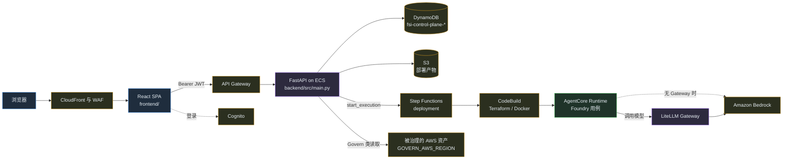
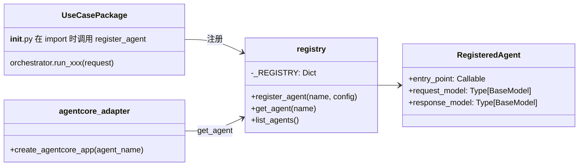
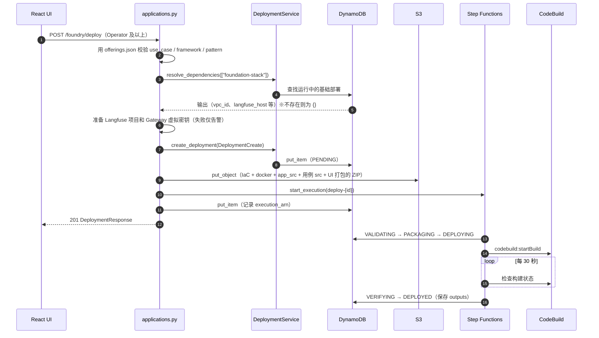
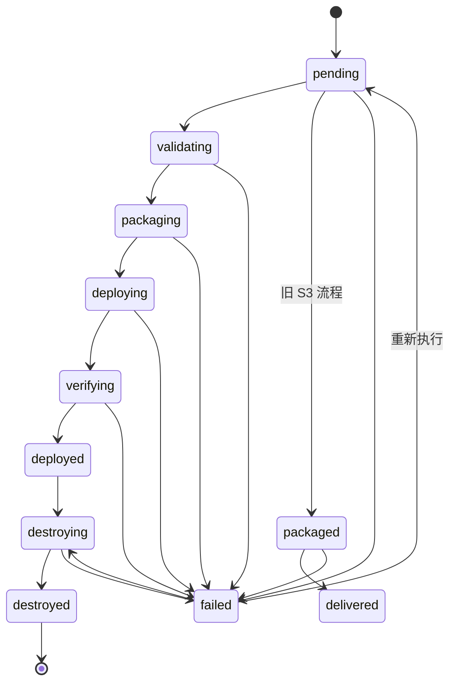
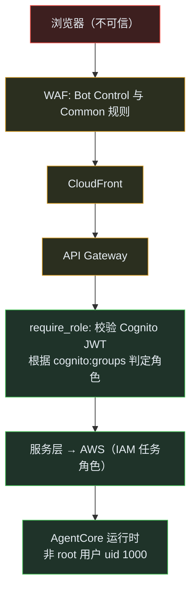
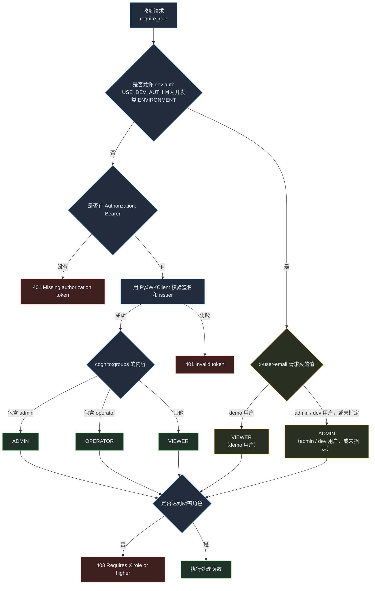
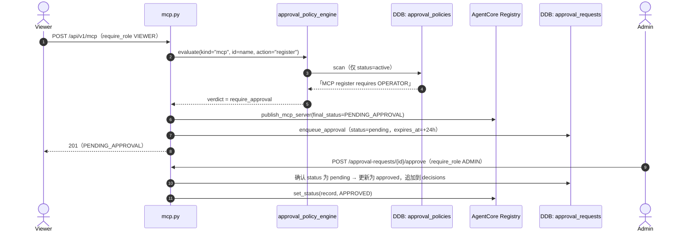
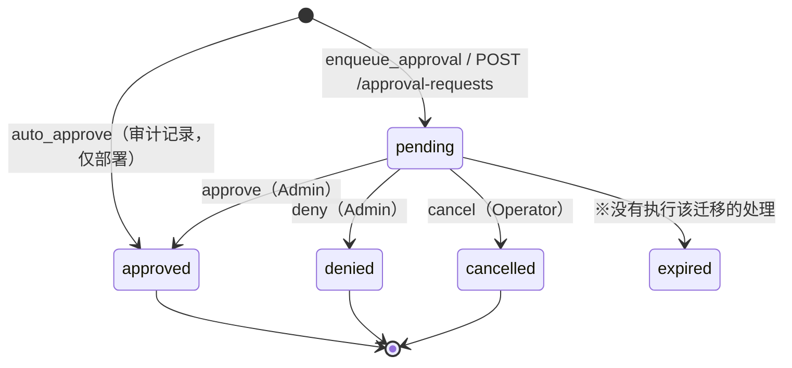
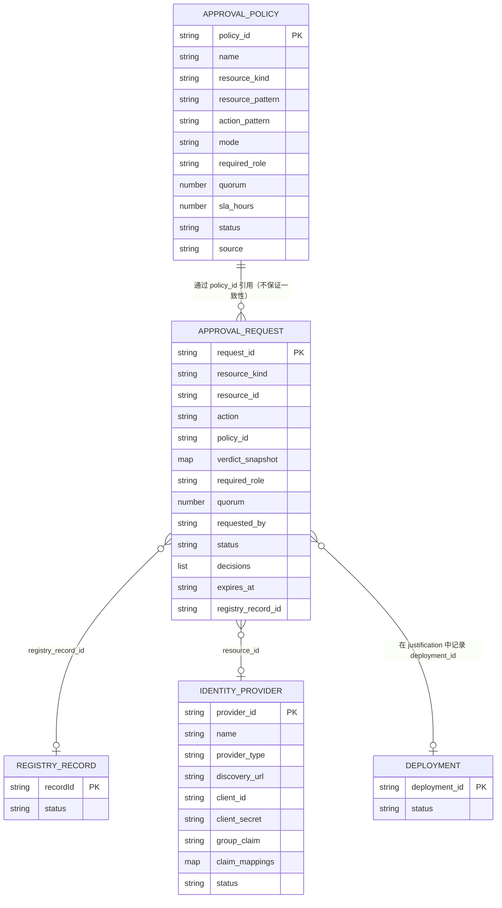

# AVA 资深工程师入职指南

> **目标读者**：高级 / Staff 及以上级别的工程师。适合想了解“为什么这样设计”“哪里容易出问题”，而不只是“有什么”的人。
> **分析基准**：2026-11-01，提交 `2b8849c`（main）。本文基于静态代码分析，不代表已在 AWS 上实际部署成功或测试已通过。
> **引用方式**：结论均附 `(路径:行号)`，路径相对于仓库根目录。标注 **［推测］** 的内容是根据代码结构或注释推断的意图，没有 ADR 或负责人确认作为依据。

相关文档：[贡献者指南](contributor-guide-zh.md) ／ [日文版](principal-guide-ja.md) ／ [技术设计与维护指南（HTML，日文）](../technical-guide-ja.html) ／ [AWS 架构图](../diagrams/README.md)

---

## 目录

1. [系统理念与设计原则](#1-系统理念与设计原则)
2. [架构概览](#2-架构概览)
3. [关键抽象与接口](#3-关键抽象与接口)
4. [设计决策记录](#4-设计决策记录)
5. [依赖库的选型理由](#5-依赖库的选型理由)
6. [数据流与状态](#6-数据流与状态)
7. [故障模式与错误处理](#7-故障模式与错误处理)
8. [性能特征](#8-性能特征)
9. [安全模型](#9-安全模型)（认证、授权、审批流程详见 §9.1～9.7，审批与权限表设计见 §9.8）
10. [测试策略](#10-测试策略)
11. [运维注意事项](#11-运维注意事项)
12. [已知技术债](#12-已知技术债)

---

## 1. 系统理念与设计原则

AVA（Agentic Value Accelerator）不是单一应用。它是一个 monorepo，汇集了在 AWS 上按 **Plan → Build → Secure → Operate → Govern** 流程管理 AI 智能体所需的组件（`README.md:28`, `README.md:122`, `README.md:171`, `README.md:475`, `README.md:489`, `README.md:508`）。核心是以下两层：

| 层 | 位置 | 职责 |
|---|---|---|
| **Control Plane** | `platform/control_plane/` | React 管理界面与 FastAPI。负责智能体的部署、治理和监控 |
| **工作负载** | `applications/` | 实际运行的智能体：FSI Foundry（35 个用例）、参考实现、App Factory |

### 从代码中可以读出的不变量

| 不变量 | 依据 |
|---|---|
| **部署状态只能按预定义的迁移进行。** 不在 `VALID_TRANSITIONS` 中的迁移会抛出 `ValueError` | `platform/control_plane/backend/src/models/deployment.py:53-66`, `:123-124` |
| **生产级环境无法启用开发用认证绕过。** 若 `ENVIRONMENT` 不是开发类环境，`USE_DEV_AUTH` 会被强制设为 `False` | `platform/control_plane/backend/src/core/config.py:16`, `:396-399` |
| **角色按 Viewer < Operator < Admin 排序。** API 以“所需的最低角色”进行保护 | `platform/control_plane/backend/src/core/rbac.py:32-35`, `:363-382` |
| **Foundry 用例为“一个容器一个智能体”。** 只 import 并注册由 `AGENT_NAME` 选定的用例 | `applications/fsi_foundry/foundations/src/main.py:37-45` |
| **Foundry 目录以一个 JSON（`offerings.json`）为准。** 后端校验和前端展示读取同一个文件 | `applications/fsi_foundry/data/registry/offerings.json`, `platform/control_plane/frontend/package.json`（`prebuild`/`predev` 时复制） |
| **可观测性与 LLM Gateway 是“有则使用”的附加功能。** 不存在时不会中止部署，而是回退到直接调用 Bedrock | `platform/control_plane/backend/src/api/routes/applications.py:127-133`, `:219-222` |

### 主要设计选择

- **区域分为两层。** `AWS_REGION` 用于 Control Plane 自身的资源（DynamoDB 等），`GOVERN_AWS_REGION` 用于被治理的智能体群（`platform/control_plane/backend/src/core/config.py:38`, `:53`）。启动时会最先把两者写入日志，因为区域配错时 AWS 不会报错，而是返回该区域的空列表（`platform/control_plane/backend/src/main.py:66-71` 的注释）。
- **“没有测量过的东西不报告为通过”。** pytest 配置没有用 `--ignore` 隐藏失败的测试，而是有意让它们显示为失败（`platform/control_plane/backend/pytest.ini` 的 KNOWN BREAKAGE 一节）。测试文件名中也有多个 `*_honesty.py`（如 `test_govern_partial_read_honesty.py`）。

---

## 2. 架构概览

| 组件 | 职责 | 依据 |
|---|---|---|
| 前端 | React 19 + Vite + Tailwind，约 155 个路由 | `platform/control_plane/frontend/package.json`, `platform/control_plane/frontend/src/App.tsx:148` |
| 后端 | FastAPI，约 94 个路由模块，`API_PREFIX=/api/v1` | `platform/control_plane/backend/src/main.py:235-438`, `platform/control_plane/backend/src/core/config.py:276` |
| 基础设施 | Terraform 根模块引用 25 个模块（networking、ecs、api_gateway、step_functions、codebuild、cognito、waf、cloudfront、litellm 等） | `platform/control_plane/infrastructure/main.tf:51-653` |
| 部署执行 | Step Functions 依次执行校验 → 打包 → CodeBuild → 每 30 秒轮询 → 获取输出 | `platform/control_plane/infrastructure/modules/step_functions/main.tf:221-728` |
| FSI Foundry | 公共基础（`foundations/`）与 35 个用例。目前所有用例支持的部署模式都只有 `agentcore` | `applications/fsi_foundry/data/registry/offerings.json` |

**路由的重复注册**：设置了 `ROOT_PATH`（API Gateway 的 stage 名）时，所有路由会在 `ROOT_PATH + API_PREFIX` 下再注册一次（`platform/control_plane/backend/src/main.py:176-200`, `:426-438`）。出于同样目的，还有一个通过 ASGI 中间件去除前缀的机制（`platform/control_plane/backend/src/main.py:25-38`）。新增路由时**两处都要注册**。

---

## 3. 关键抽象与接口

### 3.1 Control Plane 侧

| 抽象 | 职责 | 依据 |
|---|---|---|
| `Role` / `require_role(min_role)` | 作为 FastAPI 依赖项实施授权。JWT 校验交给 `to_thread`，避免阻塞事件循环 | `platform/control_plane/backend/src/core/rbac.py:32-37`, `:363-382` |
| `Settings`（pydantic-settings） | 集中管理配置：表名、区域、Foundry 路径、认证开关 | `platform/control_plane/backend/src/core/config.py:19-308` |
| `Deployment` 与 `VALID_TRANSITIONS` | 部署状态机。通过 `transition_to()` 迁移并保留历史 | `platform/control_plane/backend/src/models/deployment.py:37-66`, `:92-126` |
| `DeploymentService` | DynamoDB 上部署记录的 CRUD、状态更新、依赖解析、成功后的自动处理 | `platform/control_plane/backend/src/services/deployment_service.py:31-387` |
| `PipelineService` | 启动 Step Functions、查询状态、获取 CodeBuild 日志 | `platform/control_plane/backend/src/services/pipeline_service.py:29-308` |
| 各路由的延迟单例（`get_service()`） | 每个路由在首次调用时创建自己的服务实例 | 例：`platform/control_plane/backend/src/api/routes/maturity.py:26-37` |

### 3.2 FSI Foundry 侧

- **`RegisteredAgent` 与 `register_agent`**：用例与运行时之间唯一的契约。内容只有“异步入口函数”和“输入输出的 Pydantic 模型”（`applications/fsi_foundry/foundations/src/base/registry.py:15-70`）。同名注册两次会抛出 `ValueError`（`:41-43`）。
- **适配器**：`create_agentcore_app()` 通过 `get_agent()` 取出注册内容，用 `request_model` 校验 payload 后调用 `entry_point`（`applications/fsi_foundry/foundations/src/adapters/agentcore_adapter.py:20-91`）。
- **按框架区分的基类**：`base/strands/` 与 `base/langgraph/` 下各有 `agent.py` 和 `orchestrator.py`，用例继承它们。例：`KYCOrchestrator(StrandsOrchestrator)`（`applications/fsi_foundry/use_cases/kyc_banking/src/strands/orchestrator.py:31`）、`CreditAnalyst(StrandsAgent)`（`applications/fsi_foundry/use_cases/kyc_banking/src/strands/agents/credit_analyst.py:13`）。
- **框架在构建时确定**：Dockerfile 只把 `use_cases/<ID>/src/<FRAMEWORK>/` 复制到 `use_cases/<ID>/`（`applications/fsi_foundry/foundations/docker/Dockerfile.agentcore:29`）。因此在容器内执行注册的是框架子包的 `__init__.py`（例：`.../kyc_banking/src/strands/__init__.py:17-24`）。用例根目录 `src/__init__.py` 中基于 `AGENT_FRAMEWORK` 的分支（`.../kyc_banking/src/__init__.py:18-41`）在容器中不会被使用。**［推测］** 这可能是为本地运行保留的旧机制。

---

## 4. 设计决策记录

提交历史大多按版本合并（例：`45a22c5 feat: v4.0 — ...`, `a594114 feat: v3.1 — ...`），仓库中没有 ADR。下表中的“理由”主要依据代码注释和发布说明。

| # | 决策 | 背景与依据 | 其他选项 | 权衡 |
|---|---|---|---|---|
| D1 | 用 **Step Functions + CodeBuild** 异步执行部署 | Terraform 和镜像构建无法在 API 超时时间内完成。执行过程中把状态写入 DynamoDB（`.../step_functions/main.tf:230-728`） | 在 API 内同步执行、用 ECS 任务执行 | 执行过程可见、易于重试；但状态机定义与 Python 侧状态机需要**双重维护** |
| D2 | 部署记录存 **DynamoDB**，本地数据库为 SQLite／PostgreSQL | `DeploymentService` 直接使用 boto3 的 DynamoDB（`.../deployment_service.py:31-35`）。`DATABASE_URL` 默认是 SQLite（`.../core/config.py:30-33`）。Compose 中的 PostgreSQL 供 LiteLLM 使用（`platform/control_plane/docker-compose.yaml:23-24`） | 全部放到 RDS | 无服务器，运维轻量；但**即使在本地，部署类界面也会连接 AWS** |
| D3 | 用**环境名限制**开发用认证绕过 | 以前有 `USE_DEV_AUTH or DEBUG` 两个入口。为防止配置错误导致生产环境被直接放行，合并为一个入口并按环境名拒绝（`.../core/config.py:374-420` 的注释） | 只用开关控制 | 偏向安全；但 `ENVIRONMENT` 写错时，开发环境会因认证生效而无法使用 |
| D4 | 将 LLM 调用集中到 **LiteLLM Gateway**（仅在存在时） | 部署时发放虚拟密钥，并把 `LLM_GATEWAY_*` 传给运行时；失败则回退到直接调用 Bedrock（`.../routes/applications.py:196-222`）。v3.1 引入（`a594114`） | 始终直接调用 Bedrock | 便于统一管理成本和审计；但**回退时会出现绕过 Gateway 管控的路径** |
| D5 | Foundry 采用“**1 个基础 × N 个用例 × M 个框架**”的结构 | `offerings.json` 定义了 35 个用例及 `supported_frameworks`，其中 34 个同时支持 LangGraph 和 Strands | 每个用例独立成仓库 | 横向扩展快；但每个用例有两套框架实现，**修改也要改两处** |
| D6 | 目录中保留 `ec2` / `step_functions` 模式 | `offerings.json:1451-1468` 中有定义，但 `foundations/iac/` 只有 `agentcore`，所有用例支持的模式也只有 `agentcore` | 删除 | **［推测］** 为将来扩展预留，或处于迁移中途。新成员容易误解（见 §12） |

---

## 5. 依赖库的选型理由

| 依赖 | 版本 | 用途与理由 | 依据 |
|---|---|---|---|
| FastAPI / uvicorn | 0.109.0 / 0.27.0 | Control Plane 的 API | `platform/control_plane/backend/requirements.txt` |
| boto3 / botocore | `>=1.43.0` | AgentCore 的 policy-engine API（如 `create_policy_engine`）需要此版本及以上 | 同上（有注释） |
| PyJWT / python-jose | 2.8.0 / 3.3.0 | 校验 Cognito JWT（使用 JWKS） | 同上, `platform/control_plane/backend/src/core/rbac.py:279-303` |
| requests | 2.32.5 | **明确列为生产依赖**。以前只是通过测试库间接引入，一旦移除就会导致 JWT 认证失效 | `requirements.txt` 中的注释 |
| SQLAlchemy / Alembic | 2.0.35 / 1.14.0 | 本地数据库与目录（`catalog_orm.py`） | 同上 |
| React / Vite / Tailwind | 19 / 8 / 4 | 管理界面 | `platform/control_plane/frontend/package.json` |
| LiteLLM | `main-latest`（**未固定版本**） | 本地 LLM Gateway | `platform/control_plane/docker-compose.yaml:43` |
| Strands Agents / LangGraph | — | Foundry 的智能体实现，每个用例各准备一套 | `applications/fsi_foundry/foundations/src/requirements/` |
| bedrock-agentcore | — | Foundry 的运行时。后端测试环境中**有意不安装** | `platform/control_plane/backend/pytest.ini` 中的注释 |

“替换了什么”无法从提交历史中追溯（因为按版本合并），此项记为**未知**。

---

## 6. 数据流与状态

### 6.1 Foundry 用例的部署（追踪实际代码）

入口是 `POST /api/v1/applications/foundry/deploy`（`platform/control_plane/backend/src/api/routes/applications.py:114-337`）。

| 步骤 | 依据 |
|---|---|
| 基于目录的校验（404 / 400） | `.../routes/applications.py:116-125` |
| 解析基础设施输出（取 `DELIVERED` / `DEPLOYED` 中最新的一个） | `.../services/deployment_service.py:369-387` |
| ZIP 内容（`shared/`、`docker/`、`app_src/`、`use_cases/<id>/src`、`data/samples`、`ui/`、`ui_iac/`） | `.../routes/applications.py:243-298` |
| 产物的 S3 键：`deployments/{deployment_id}/{use_case}.zip` | `.../routes/applications.py:300-301` |
| 传给 Step Functions 的输入（`action: deploy`、`job.name: onboarding`） | `.../routes/applications.py:309-330` |
| 状态机各状态（`ValidateInput` ～ `RecordSuccessDeploy` / `FailState`） | `.../step_functions/main.tf:230-728` |
| 进入 `DEPLOYED` 时自动准备 Gateway 并自动登记到 Registry（失败也视为部署成功） | `.../services/deployment_service.py:120-128` |

### 6.2 部署状态机

依据：`platform/control_plane/backend/src/models/deployment.py:37-72`

### 6.3 运行时请求（Foundry）

处理顺序为：AgentCore 的 payload → `request_model(**payload)` → `await entry_point(request)` → `response.model_dump(mode="json")`（`applications/fsi_foundry/foundations/src/adapters/agentcore_adapter.py:79-89`）。以 KYC 为例，编排器通过 `s3_retriever_tool` 从 S3 获取客户的档案和历史（`applications/fsi_foundry/use_cases/kyc_banking/src/strands/orchestrator.py:185-186`）。示例数据位于 `applications/fsi_foundry/data/samples/`，部署时会打包进 ZIP。

---

## 7. 故障模式与错误处理

| 故障 | 行为 | 依据 | 注意点 |
|---|---|---|---|
| 基础栈未部署 | 发出警告后继续，链路追踪不会关联 | `.../routes/applications.py:129-133` | 质量在无提示的情况下下降 |
| Gateway 准备失败 | 发出警告，改为直接使用 Bedrock | `.../routes/applications.py:219-222` | 形成绕过治理的路径 |
| 打包／流水线启动失败 | 更新为 `FAILED` 并返回 HTTP 500，`detail` 中直接放入异常字符串 | `.../routes/applications.py:303-306`, `:333-336` | 可能泄露内部路径等信息（§9、§12） |
| 意外异常 | 公共处理器返回 500，只有 `DEBUG` 时才返回异常字符串；出错时也会附加 CORS 头 | `platform/control_plane/backend/src/main.py:205-232` | — |
| 非法状态迁移 | `ValueError` | `.../models/deployment.py:123-124` | DynamoDB 未使用条件写入，无法防止并发更新（§12） |
| 获取 Cognito JWKS 失败 | 用锁合并为一次获取，并做指数退避；区分“取不到密钥”和“密钥 ID 未知” | `.../core/rbac.py:123-276` | — |
| 智能体执行时异常 | 以**正常响应**返回 `{"error": str(e)}` | `.../adapters/agentcore_adapter.py:87-89` | 调用方无法通过 HTTP 状态码判断失败 |
| 启动时导入种子数据失败 | 记录日志，继续启动 | `platform/control_plane/backend/src/main.py:117` | — |

**恢复的基本做法**：从 `FAILED` 可以进入 `PENDING`（重新执行）或 `DESTROYING`（清理）（`.../models/deployment.py:63`）。状态机的每个阶段都有 `RecordFailure*` 状态，用 `record_failure_stage()` 记录失败的阶段（`.../services/deployment_service.py:352`）。

---

## 8. 性能特征

**仓库中没有性能测量数据。** 以下仅为从代码结构可以得出的结论。

| 方面 | 内容 | 依据 |
|---|---|---|
| 部署前置时间 | 每 30 秒轮询一次 CodeBuild 状态，因此完成检测最多延迟 30 秒 | `.../step_functions/main.tf:499-504` |
| 阻塞事件循环的处理 | `deploy_foundry_use_case` 在 `async def` 中执行同步的 boto3 调用和 ZIP 打包。处理期间其他请求需要等待 | `.../routes/applications.py:115`, `:238-301` |
| JWT 校验 | `require_role` 已交给 `to_thread`；但注释明确指出 `users.py`、`fsi_sso.py`、`evaluations.py` 仍在事件循环上执行 | `.../core/rbac.py:365-379` |
| 列表查询 | `list_deployments` 使用 DynamoDB 的 `scan`（`.../deployment_service.py:100`），`resolve_dependencies` 再在 Python 侧过滤，耗时随部署数量线性增长 | `.../services/deployment_service.py:85-101`, `:375-381` |
| 扩展 | ECS 可指定任务数，并按 CPU／内存自动扩缩。服务和缓存保存在各进程内存中，任务之间不共享 | `.../modules/ecs/main.tf:932`, `:974-1000`, `.../core/ttl_cache.py` |
| 缓存预热 | 启动时开始 `cache_prewarm` 和 `llm_quality_producer` | `platform/control_plane/backend/src/main.py:134`, `:145` |

---

## 9. 安全模型

| 项目 | 内容 | 依据 |
|---|---|---|
| 认证 | Cognito JWT（通过 JWKS 校验签名） | `.../core/rbac.py:155-161`, `:279-303` |
| 授权 | `cognito:groups` 含 `admin` → Admin，含 `operator` → Operator，其他 → Viewer | `.../core/rbac.py:354-361` |
| 开发用绕过 | 仅在开发类环境名下有效。可通过 `x-user-email` / `x-user-role` 头决定角色，没有令牌时为 **Admin** | `.../core/rbac.py:305-338`, `.../core/config.py:396-420` |
| 边缘防护 | 在 CloudFront 上应用 WAF（Bot Control + Common 规则集） | `README.md:78`, `.../infrastructure/main.tf:539-584` |
| 对外 HTTP 调用 | `safe_fetch`（防 SSRF，重定向时去掉 Authorization）；路径限制使用 `path_jail` | `.../core/safe_fetch.py`, `.../core/path_jail.py`, `tests/test_safe_fetch.py` |
| 容器 | Foundry 运行时以非 root 用户（uid 1000）运行 | `.../docker/Dockerfile.agentcore:33-34` |
| 机密信息 | Gateway 虚拟密钥以 Secrets Manager ARN 的形式传递，运行时解析 | `.../routes/applications.py:216-217`, `.../utils/llm_gateway.py:44-92` |

**信任边界上的注意点**

1. **`x-user-email` 是客户端可以随意设置的请求头。** 系统却把它记录为 `created_by`（`.../routes/maturity.py:56-66`）。即使在生产环境，使用的也是请求头的值而不是 JWT 声明，因此**创建者可以伪造**。不要把它当作可信的审计记录。
2. `environments/dev` 设置了 `USE_DEV_AUTH=true`（`.../environments/dev/main.tf:706`）。ECS 模块的生产 stamp 固定为 `false`（`.../modules/ecs/main.tf:876`）。不要把 dev 环境暴露到互联网。
3. Foundry 的 ZIP 中包含示例数据（`.../routes/applications.py:276-280`）。**不要把真实数据放进 `data/samples`。**
4. 漏洞报告流程见 `SECURITY.md`。

### 9.1 身份基础：Cognito 用户池与角色分配

| 项目 | 内容 | 依据 |
|---|---|---|
| 用户组 | `admin` / `operator` / `viewer` 三个（均为单数形式） | `platform/control_plane/infrastructure/modules/cognito/main.tf:110-127` |
| 组名的集中管理 | 常量放在 `core/cognito_groups.py`，并用测试确认与 Terraform 一致。过去曾与复数形式 `admins` 不一致，导致真正的管理员收到 403 | `platform/control_plane/backend/src/core/cognito_groups.py:1-44`, `tests/test_cognito_group_names.py` |
| 自助注册 | **已启用**（`allow_admin_create_user_only = false`） | `.../modules/cognito/main.tf:13-17` |
| 注册限制 | PreSignUp Lambda **只拒绝 gmail.com 等公共邮箱域名**（黑名单方式） | `.../modules/cognito/lambda_src/pre_signup_domain_check/index.py:12-51` |
| 初始角色 | PostConfirmation Lambda 把已确认的用户加入 `viewer` 组 | `.../modules/cognito/signup_lambdas.tf:9`, `:21-24` |
| 创建管理员等用户 | `deploy-full.sh` 第 7 步按角色创建用户（留空则跳过）。Terraform 也会创建演示用户（`admin_demo`、`demo_viewer`） | `.../infrastructure/scripts/deploy-full.sh:431-470`, `.../modules/cognito/main.tf:141-180` |
| MFA | 仅在 `enable_mfa` 时为 `OPTIONAL`，默认值由变量决定 | `.../modules/cognito/main.tf:43` |

> **这意味着**：只要不是公共邮箱域名（例如攻击者自己的域名），任何人都能注册并成为 **Viewer**。请在这一前提下评估 Viewer 的权限范围（§9.4）。**［推测］** 没有采用白名单方式，可能是为了优先保证演示环境的易用性。

### 9.2 令牌流转与每个请求的角色判定

dev 用户的邮箱为 `demo@example.com`（VIEWER），以及 `admin@example.com` 和 `dev@example.com`（ADMIN）（`.../core/rbac.py:309-318`）。

依据：`platform/control_plane/backend/src/core/rbac.py:305-361`（判定）、`:363-382`（`require_role`）。图中简化了 dev auth 的分支，实际还有“无令牌 → ADMIN”“未配置 Cognito 时由 `x-user-role` 头决定”“JWT 校验失败也为 ADMIN”等分支（`:320-345`）。

| 阶段 | 实现 | 依据 |
|---|---|---|
| 登录 | SPA 通过 Cognito 认证，并把 **ID 令牌**保存到 `localStorage['auth_token']` | `platform/control_plane/frontend/src/auth/AuthContext.tsx:66-71` |
| 发送 | axios 拦截器附加 `Authorization: Bearer`；若存在 `localStorage['dev_user_email']`，还会附加 `x-user-email` | `platform/control_plane/frontend/src/api/client.ts:36-50` |
| 链路 | API Gateway（HTTP API）通过 `$default` 路由经 VPC Link **原样转发**到 ALB，**没有授权器** | `platform/control_plane/infrastructure/modules/api_gateway/main.tf:21`, `:42-46`, `:55-59` |
| 校验 | 只有后端校验 JWT，JWKS 缓存在进程内 | `.../core/rbac.py:123-303` |
| 401 时 | SPA 清除令牌并刷新页面（重新登录） | `.../frontend/src/api/client.ts:55-62` |
| 界面差异化 | 根据 `/api/v1/users/me` 返回的 `role` / `role_level` / `can_deploy` 切换 UI。**隐藏 UI 不等于安全**，务必在 API 侧使用 `require_role` | `platform/control_plane/backend/src/api/routes/users.py:26-85`, `platform/control_plane/frontend/src/contexts/UserContext.tsx:7-8` |

### 9.3 存在两套认证实现

| 实现 | 用法 | JWT 库 | 使用位置 |
|---|---|---|---|
| **`core/rbac.py`**（主流） | `Depends(require_role(Role.X))`，按角色层级判定 | PyJWT | 几乎所有路由 |
| **`core/auth.py` → `core/security.py` / `core/dev_auth.py`** | `Depends(get_current_user)` / `require_admin`，按组名判定 | python-jose | `langfuse.py`、`projects.py`、`govern_marketplace.py`、`multicloud.py` |

依据：`platform/control_plane/backend/src/core/auth.py:13-17`, `.../core/security.py:240-398`。两者都只根据 `USE_DEV_AUTH` 切换，以前 `USE_DEV_AUTH or DEBUG` 这第二个入口已被关闭（`.../core/auth.py:10-12`）。**新代码请使用 `require_role`。** 两套并存属于技术债（§12 T14）。

### 9.4 权限矩阵（代表性操作）

| 操作 | 所需角色 | 是否评估审批策略 | 依据 |
|---|---|---|---|
| 查询类（列表、详情） | Viewer | — | 各路由的 GET |
| 基于模板的部署（`POST /deployments`） | Operator | 评估（默认 `auto_approve`，保留审计记录） | `.../routes/deployments.py:137-180`, `:296-330` |
| Foundry 部署（`POST /applications/foundry/deploy`） | Operator | **不评估** | `.../routes/applications.py:114-337` |
| 销毁部署（`/destroy`） | Operator | **不评估**（虽有默认策略“Application delete requires ADMIN”，但不适用于此路径） | `.../routes/deployments.py:469-470`, `.../services/approval_policy_bootstrap.py:115-120` |
| 注册 MCP / A2A / Agent / Skill / Custom | **Viewer**（可提交申请） | 评估（默认需要 Operator 审批） | `.../routes/mcp.py:182-241`, `.../routes/a2a.py:389`, `.../routes/agents.py:177-185`, `.../routes/skills.py:157-165`, `.../routes/custom_resources.py:117-125` |
| 删除上述资源 | Operator | 不评估 | `.../routes/mcp.py:298-299`, `.../routes/agents.py:238` 等 |
| 注册身份提供商 | **Viewer**（可提交申请） | 评估（默认需要 ADMIN 审批） | `.../routes/identity_providers.py:376-399` |
| 更新、删除身份提供商 | Operator | **不评估** | `.../routes/identity_providers.py:468`, `:492` |
| 创建、更新、删除审批策略 | Admin | — | `.../routes/approval_policies.py:129-192` |
| 在审批队列中批准、拒绝（单条、批量） | **Admin** | — | `.../routes/approval_requests.py:253-275`，批量为 `:332-354` |
| 手动创建、撤销审批申请 | Operator | — | `.../routes/approval_requests.py:119-123`, `:363-368` |
| 执行 Service Approval（AWS 服务采用评审） | Operator | — | `.../routes/service_approval.py:73-74` |
| 签发 FSI 应用 SSO 令牌 | Viewer | — | `.../routes/fsi_sso.py:48-81` |

> **Service Approval 与审批流程是两回事。** 名称相似，但 `service_approval` 是管理“评估某项 AWS 服务能否在公司内使用”的智能体执行（run）的功能（`platform/control_plane/service_approval/`, `.../routes/service_approval.py:1`）。人工审批（HITL）机制是下面 §9.5 介绍的 Approval Policies / Approval Queue。

### 9.5 审批流程（Approval Policies → Approval Queue）

在 UI 中，策略在 **Secure** 支柱中创建，待审批的申请（队列）在 **Operate** 支柱中处理（`.../routes/approval_policies.py:1-6`）。

**组成部分**

| 要素 | 职责 | 存储位置 | 依据 |
|---|---|---|---|
| Approval Policy | 规则：“对 `resource_kind` 中匹配 `resource_pattern` 的资源执行 `action_pattern` 时，需要在 `sla_hours` 内获得 `quorum` 个 `required_role` 的批准” | DynamoDB `APPROVAL_POLICIES_TABLE_NAME`（pk=`policy_id`） | `.../routes/approval_policies.py:61-75` |
| 评估引擎 | 根据与目标（类型、ID、操作）匹配的策略返回判定（verdict） | 无状态（每次都 scan） | `.../services/approval_policy_engine.py:1-27`, `:157-190` |
| Approval Request | 一条待审批的申请，包含匹配的策略、申请人、目标和判定记录 | DynamoDB `APPROVAL_REQUESTS_TABLE_NAME` | `.../routes/approval_requests.py:1-10`, `:43` |
| `enqueue_approval` | 根据判定创建队列记录（继承策略的 `required_role` / `quorum` / `sla_hours`） | 同上 | `.../services/agent_registry_client.py:568-615` |
| 默认策略写入 | 启动时以名称为键写入（不覆盖已有记录） | 同上 | `.../services/approval_policy_bootstrap.py:1-26`, `:161`, `platform/control_plane/backend/src/main.py:120-128` |

**判定（verdict）的种类与优先级**

| mode | 调用方的行为 |
|---|---|
| `deny` | 返回 403，不执行处理 |
| `require_approval` | 以 `PENDING_APPROVAL` 创建目标，并把申请放入队列 |
| `auto_approve` | 以 `APPROVED` 创建目标（仅部署时会保留一条已批准的审计记录） |

有多条策略匹配时，按以下顺序确定一条：(1) mode 的严格程度（deny > require_approval > auto_approve）→ (2) `resource_pattern` 的具体程度 → (3) `action_pattern` 的具体程度 → (4) `required_role` 的严格程度（ADMIN > OPERATOR）→ (5) `policy_id`（`.../services/approval_policy_engine.py:15-20`）。没有 `mode` 列的策略按 `require_approval` 处理（`:138-151`）。**没有匹配的策略时为 `auto_approve`**（`:184`）。模式匹配使用 `fnmatch` 通配符，而不是 Cedar（`.../routes/approval_policies.py:10-11`）。

**默认策略**（`.../services/approval_policy_bootstrap.py:9-21`, `:52-155`）

| 目标 | 操作 | 判定 | 审批人 / SLA |
|---|---|---|---|
| mcp / a2a / agent / custom | register | require_approval | OPERATOR / 24h |
| skill | register | require_approval | OPERATOR / 48h |
| identity | register | require_approval | ADMIN / 24h |
| application | delete | require_approval | ADMIN / 4h |
| application | deploy | **auto_approve** | — |
| harness / memory | delete | 无策略（只有 UI 确认对话框） | — |

**示例：Viewer 注册 MCP 服务器**

依据：`.../routes/mcp.py:182-241`, `.../routes/approval_requests.py:161-275`。身份提供商保存在 DynamoDB 而不是 Registry 中，因此批准时通过 UpdateItem 切换为 `active` / `rejected` / `cancelled`（`.../routes/approval_requests.py:196-221`）。即使 Registry 状态更新失败，队列中的决定也会保留，Operator 之后可以重试（`:233-238`）。

**申请的状态**

依据：`.../routes/approval_requests.py:5`, `:43`, `:179-183`（对非 pending 状态做决定会返回 409）。

### 9.6 审批流程的实现限制（v1 范围）

下表区分了代码注释中明确写着“v1 范围”“v2 处理”的内容，以及阅读代码后确认的内容。

| # | 限制 | 影响 | 依据 | 类别 |
|---|---|---|---|---|
| A1 | **不强制 quorum。** 一人批准即变为 `approved` | “需两人批准”的策略实际上一人即可通过 | `.../routes/approval_requests.py:8-10`, `:169-171` | 注释中明确 |
| A2 | **批准时不检查 `required_role`。** 批准、拒绝 API 一律要求 Admin | 即使策略要求 OPERATOR 审批，Operator 也无法批准。实际运作中“只有 Admin 能批准” | `.../routes/approval_requests.py:253-275`（`required_role` 只是保存：`:144`） | 代码确认 |
| A3 | **可以自己批准自己的申请。** 不检查审批人与申请人是否相同 | Admin 可以批准自己提交的申请（无法实现职责分离） | `_record_decision`（`.../routes/approval_requests.py:161-250`）中没有此检查 | 代码确认 |
| A4 | **撤销时不做本人确认** | 可以撤销他人的申请 | `.../routes/approval_requests.py:372` | 注释中明确 |
| A5 | **SLA 到期也不会变为 `expired`。** 只写入 `expires_at`，没有处理过期的作业 | 过期申请一直处于 pending，之后仍可被批准 | `.../routes/approval_requests.py:76-77`, `:152`。仓库中找不到更新为 `expired` 的处理 | 代码确认 |
| A6 | **部署即使为 `require_approval` 也不会被阻止。** 只放入申请，CodeBuild 照常运行 | 即使收紧部署策略，也只是事后记录 | `.../routes/deployments.py:296-302` | 注释中明确（v2 课题） |
| A7 | **销毁、删除、更新不评估策略** | 默认的“Application delete requires ADMIN”不生效，Operator 可以直接销毁 | §9.4 的表 | 代码确认 |
| A8 | **评估引擎是 fail-open 的。** 策略表 scan 失败或未设置表名时，视为空并返回 `auto_approve` | DynamoDB 故障或配置遗漏期间，Viewer 的注册申请会**未经审批直接变为 APPROVED**。本地表名为空时始终自动批准 | `.../services/approval_policy_engine.py:98-107`, `:184` | 代码确认 |
| A9 | **策略 API 无法指定 `mode`（deny / auto_approve）。** `resource_kind` 中也没有 `agent` / `skill` / `custom` | 无法从 UI 创建与默认策略同类的规则，也无法编写 deny 规则 | `.../routes/approval_policies.py:53`, `:58`, `:61-87`（默认策略使用 `skill` / `custom` / `agent` / `mode`：`.../approval_policy_bootstrap.py:79`, `:90`, `:106`, `:142`） | 代码确认 |
| A10 | **审批人和申请人取自 `x-user-email` 请求头** | 生产环境的 SPA 不发送此请求头，因此记录为 `unknown`；手动添加请求头还可以写入任意名字 | `.../routes/approval_requests.py:257-261`, `.../frontend/src/api/client.ts:43-47` | 代码确认 |
| A11 | `/approval-policies` 模块的 docstring 写着“NOT WIRED YET”，但实际上已被各注册类路由调用 | 文档过时 | `.../routes/approval_policies.py:12-13`, `:202` 与 `.../routes/mcp.py:198` | 代码确认 |

**改进方向（建议）**：改为 fail-closed（评估失败时返回 `require_approval`）；在批准 API 中检查 `required_role` 以及“审批人不是申请人”；累积 `decisions` 来判断 quorum；用 EventBridge 定时任务处理过期；在 Step Functions 开头检查审批状态并等待；从 JWT 的 `sub` / `email` 获取审批人身份。

### 9.7 其他管控功能

| 功能 | 内容 | 依据 |
|---|---|---|
| Harness 紧急停止开关 | 按环境变量 `AVA_HARNESS_DISABLED=1` → 哨兵文件 → DynamoDB 标志的优先顺序停止 Harness 操作。只有 Admin 能通过 API 切换 | `platform/control_plane/backend/src/core/harness_killswitch.py:1-25` |
| FSI 应用 SSO 对接 | 校验 Cognito JWT 后，签发用 `FSI_APP_SIGNING_SECRET` 做 HMAC 签名的令牌（有效期 3600 秒）。未设置密钥时返回 503 | `.../routes/fsi_sso.py:19`, `:48-81`, `.../core/config.py:88` |
| AgentCore 策略引擎 | 控制运行时的工具调用（基于 Cedar），与上述审批流程（HITL）是不同的层 | `.../infrastructure/main.tf:124`, `.../core/config.py:101-117`, `.../routes/policies.py:482` |
| 防止开发用绕过 | 按环境名限制（§1），ECS 生产 stamp 固定为 `USE_DEV_AUTH=false` | `.../core/config.py:396-420`, `.../modules/ecs/main.tf:876-877` |

### 9.8 审批与权限表设计（现状）

与审批和权限相关的数据分为 **Cognito**（谁是什么角色）和 **DynamoDB 的 3 张表**（什么需要审批、待审批的申请、外部身份提供商）。角色信息不保存在 DynamoDB 中，每次都从 JWT 的 `cognito:groups` 判定（§9.2）。

#### 9.8.1 表一览

| 逻辑名 | 物理名 | 分区键 | 排序键 | GSI | TTL | 计费 | PITR / 加密 | 依据 |
|---|---|---|---|---|---|---|---|---|
| 审批策略 | `${name_prefix}-approval-policies` | `policy_id`（S） | 无 | 无 | 无 | 按需 | 启用 / 启用 | `platform/control_plane/infrastructure/modules/dynamodb/main.tf:588-610` |
| 审批申请（队列） | `${name_prefix}-approval-requests` | `request_id`（S） | 无 | 无 | 无 | 按需 | 启用 / 启用 | `.../modules/dynamodb/main.tf:616-638` |
| 身份提供商 | `${name_prefix}-identity-providers` | `provider_id`（S） | 无 | 无 | 无 | 按需 | 启用 / 启用 | `.../modules/dynamodb/main.tf:560-582` |
| 紧急停止开关 | `fsi-control-plane-harness-killswitch`（可通过环境变量 `GOVERN_KILLSWITCH_TABLE_NAME` 修改） | `pk` | `sk` | — | — | — | — | `platform/control_plane/backend/src/core/harness_killswitch.py:46`, `:193`。**Terraform 中没有创建**（表不存在时忽略：`:154`） |
| 角色（参考） | Cognito 用户组 `admin` / `operator` / `viewer` | — | — | — | — | — | — | `.../modules/cognito/main.tf:110-127` |

- 表名通过环境变量传给 ECS 任务（如 `APPROVAL_POLICIES_TABLE_NAME`：`.../modules/ecs/main.tf:799-813`）。`Settings` 中的默认值是**空字符串**（`.../core/config.py:227-238`）。本地 Compose 也不设置，因此本地的审批功能处于停用状态，评估始终为自动批准（§9.6 A8）。
- Terraform 只定义了主键属性。其他属性没有 schema，由应用代码决定结构。

#### 9.8.2 实体关系

`REGISTRY_RECORD` 是 AWS Agent Registry 上的记录（MCP / A2A / Agent / Skill / Custom），不在 DynamoDB 中。`DEPLOYMENT` 是 `fsi-control-plane-deployments` 表（§6.2）。所有引用都是**没有外键约束的“松散引用”**。例如删除策略后，引用它的申请仍然保留。因此审计时以申请中保存的 `verdict_snapshot` 为准（`.../services/agent_registry_client.py:622-624`）。

#### 9.8.3 属性定义：审批策略（`approval-policies`）

| 属性 | 类型 | 必填 | 取值与约束 | 依据 |
|---|---|---|---|---|
| `policy_id` | S（UUID v4） | ○ | PK | `.../routes/approval_policies.py:139` |
| `name` | S | ○ | 1～100 个字符。**不保证唯一**（只有启动时写入会按名称检查重复） | `:62`, `.../services/approval_policy_bootstrap.py:23-26`, `:177` |
| `description` | S | | | `:141` |
| `resource_kind` | S | ○ | API 可创建的值：`application` / `harness` / `memory` / `mcp` / `a2a` / `identity` / `*`。启动时写入还会使用 `agent` / `skill` / `custom` | `:53`, `.../approval_policy_bootstrap.py:79`, `:90`, `:106` |
| `resource_pattern` | S | ○ | `fnmatch` 通配符，默认 `*` | `:65-68` |
| `action_pattern` | S | ○ | `deploy` / `delete` / `invoke` / `update` / `register` / `*` 的通配符 | `:58`, `:69-72` |
| `mode` | S | | `require_approval` / `auto_approve` / `deny`。**无法通过 API 设置**（只有启动时写入会写）。无此属性时按 `require_approval` 处理 | `.../approval_policy_bootstrap.py:202`, `.../services/approval_policy_engine.py:138-151` |
| `required_role` | S | ○ | `ADMIN` / `OPERATOR` | `:47`, `:73` |
| `quorum` | N | ○ | 1～5。**不会被强制执行** | `:74` |
| `sla_hours` | N | ○ | 1～168 | `:75` |
| `status` | S | ○ | `active` / `disabled`，只有 `active` 参与评估 | `:148`, `:168` |
| `source` | S | | 启动时写入的记录为 `ava-bootstrap` | `.../approval_policy_bootstrap.py:204-206` |
| `created_at` / `updated_at` | S（ISO 8601，UTC） | ○ | | `:149-150`, `:170` |

#### 9.8.4 属性定义：审批申请（`approval-requests`）

| 属性 | 类型 | 取值与约束 | 依据 |
|---|---|---|---|
| `request_id` | S（UUID v4） | PK | `.../services/agent_registry_client.py:600`, `.../routes/approval_requests.py:136` |
| `resource_kind` | S | 格式因写入路径而异：注册类路径为 `registry_record:<kind>`（如 `registry_record:mcp`），手动创建 API 为原始值（如 `application`） | `.../agent_registry_client.py:615`, `.../routes/approval_requests.py:137` |
| `resource_id` / `resource_label` | S | 目标的 ID 和显示名。部署的审计记录中 `resource_id` 为空 | `.../agent_registry_client.py:616-617`, `.../routes/deployments.py:313-316` |
| `action` | S | `register` / `deploy` / `delete` 等。部署成功时的 Lambda 会写入策略词汇中没有的 **`publish`** | `.../deployment_success_hook/lambda_src/index.py:267` |
| `justification` | S | 申请理由。部署时把 `deployment_id` 写在这里 | `.../routes/deployments.py:319-321` |
| `policy_id` / `policy_name` | S | 匹配的策略。手动创建或 Lambda 写入的记录中可能为空 | `.../agent_registry_client.py:620-621` |
| `verdict_snapshot` | M | 评估时策略的内容（用于审计） | `:622-624` |
| `required_role` / `quorum` / `sla_hours` | S / N / N | 从策略继承。**只保存，批准时不使用** | `:625-627` |
| `requested_by` | S | `x-user-email` 请求头的值，没有则为 `unknown` | `:628`, §9.6 A10 |
| `status` | S | `pending` / `approved` / `denied` / `expired` / `cancelled` | `.../routes/approval_requests.py:43` |
| `decisions` | L（M 的数组） | 追加 `{by, outcome, comment, at}` | `.../routes/approval_requests.py:185-188` |
| `created_at` / `updated_at` / `expires_at` | S（ISO 8601） | `expires_at` = 创建时间 + `sla_hours`。**不是 DynamoDB TTL**（不是数值型的 epoch 秒，也没有 TTL 设置） | `.../agent_registry_client.py:631-633` |
| `registry_record_id` / `registry_record_arn` | S | 批准时切换 Registry 状态的目标 | `:636-637` |

#### 9.8.5 属性定义：身份提供商（`identity-providers`）

| 属性 | 类型 | 取值与约束 | 依据 |
|---|---|---|---|
| `provider_id` | S | PK | `.../routes/identity_providers.py:410` |
| `provider_type` | S | `entra_id` / `okta` / `auth0` / `generic_oidc` | `:57` |
| `discovery_url` / `client_id` | S | OIDC 配置 | `:58-59` |
| `client_secret` | S | **以明文保存在 DynamoDB 中**（静态加密已启用）。列表和详情响应中会去掉此字段。代码注释也指出生产环境应放在 Secrets Manager | `:428-431`, `:355-357`, `:370` |
| `group_claim` / `claim_mappings` | S / M | IdP 用户组 → AVA 角色的映射表。**目前授权（`rbac.py`）不读取它** | `:62-66`。只有这个文件引用 `claim_mappings` |
| `status` | S | `active` / `pending` / `rejected` / `cancelled`，批准后变为 `active` | `:424`, `.../routes/approval_requests.py:206` |

#### 9.8.6 读写主体与访问模式

| 主体 | 表 | 操作 | 访问方式 | 依据 |
|---|---|---|---|---|
| 审批策略 API | policies | CRUD | `scan` / `get_item` / `put_item` / `update_item` / `delete_item` | `.../routes/approval_policies.py:106-192` |
| 评估引擎 | policies | 读取（每次判定） | `scan`，按 `status` 的过滤在 Python 侧进行 | `.../services/approval_policy_engine.py:98-107` |
| 启动时写入 | policies | 写入（仅首次） | `scan` 检查名称 → `put_item` | `.../services/approval_policy_bootstrap.py:161-223` |
| 注册类 API、部署 API | requests | 创建申请 | `put_item`（`enqueue_approval`） | `.../services/agent_registry_client.py:568-647` |
| 审批队列 API | requests | 列表、决定 | 列表先 `scan` 再在 Python 中过滤；决定为 `get_item` → 检查 → `update_item` | `.../routes/approval_requests.py:80-104`, `:161-250` |
| 部署成功时的 Lambda | requests | 创建审计记录（`approved`） | `put_item` | `.../deployment_success_hook/lambda_src/index.py:236-290` |
| 审批队列 API | identity-providers | 根据批准、拒绝更新 `status` | `update_item` | `.../routes/approval_requests.py:196-221` |

**IAM 权限**

| 角色 | 允许的操作 | 范围 | 依据 |
|---|---|---|---|
| ECS 任务角色（后端） | `GetItem` / `PutItem` / `UpdateItem` / `DeleteItem` / `Query` / `Scan` / `DescribeTable` | `table/${name_prefix}-*`（**同一前缀下的所有表**） | `.../modules/ecs/main.tf:90-106` |
| 部署成功时的 Lambda | 仅 `PutItem` | 仅 approval-requests 表 | `.../modules/deployment_success_hook/main.tf:110-121` |

审批表的权限没有按表划分。后端进程可以改写包括策略在内的所有表。“只有 Admin 能修改策略”这一约束仅靠 API 层的 `require_role` 保证。

#### 9.8.7 表设计的问题

| # | 问题 | 影响 | 依据 | 应对方案 |
|---|---|---|---|---|
| D1 | **决定的更新不是条件写入。** 从 `get_item` 确认为 `pending` 到 `update_item` 之间，可能插入其他更新 | 两名 Admin 同时操作时都会成功，一方的决定会从 `decisions` 中丢失，最终状态取决于后写入的一方 | `.../routes/approval_requests.py:175-246` | 加上 `ConditionExpression="#st = :pending"`，`decisions` 用 `list_append` 追加 |
| D2 | **所有 `scan` 都不分页**（不处理 `LastEvaluatedKey`） | 申请表会随审计记录不断增长。超过 1MB 后，列表和计数会**无提示地被截断** | 上述文件中都没有 `LastEvaluatedKey` | 建立 `status` + `created_at` 的 GSI 并用 Query；实现分页 |
| D3 | `expires_at` 以 ISO 字符串保存，既没有 TTL 也没有过期处理 | 过期申请一直处于 `pending`（§9.6 A5） | §9.8.4 | 用 EventBridge 定时任务更新为 `expired`；如需删除旧记录，用另一属性（epoch 秒）设置 TTL |
| D4 | `resource_kind` / `action` 的词汇在各写入路径之间不统一（`registry_record:*` 与原始值、`publish` 这个动词） | 难以与策略对照或做统计 | §9.8.4 | 把类型和操作定义为枚举并集中管理，所有路径共用 |
| D5 | 不保证策略名称唯一 | 同名策略并存，启动时写入的重复检查会出现偏差 | §9.8.3 | 建立以名称为属性的 GSI，并用条件 put 防止重复 |
| D6 | 策略与申请的引用松散，删除会切断历史 | 删除策略后，无法通过 `policy_id` 追溯是哪条规则拦截的 | §9.8.2 | 策略不删除，改为 `disabled`（逻辑删除）；所有路径都必须写入 `verdict_snapshot` |
| D7 | IdP 的 `client_secret` 以明文保存 | 能读取该表的角色可以看到机密信息 | §9.8.5 | 放到 Secrets Manager，只保存 ARN |
| D8 | `claim_mappings` 不用于授权 | UI 上“按 IdP 用户组决定 AVA 角色”的设置不生效 | §9.8.5 | 在实现联合认证之前，在 UI 中明确标注“未实现” |
| D9 | 紧急停止开关的表不在 IaC 中 | 在手动建表之前，基于 DynamoDB 的切换不会生效（只有环境变量和哨兵文件有效） | §9.8.1 | 加入 Terraform 的 `dynamodb` 模块 |
| D10 | IAM 范围为 `${name_prefix}-*`，过宽 | 后端一旦存在漏洞，审批策略也可能被改写 | §9.8.6 | 把审批类表的写入划给独立角色或带条件的策略；用 CloudTrail 数据事件审计变更 |

---

## 10. 测试策略

| 对象 | 方针与工具 | 依据 |
|---|---|---|
| 后端 | pytest + hypothesis（基于属性的测试）+ moto（模拟 AWS）。`testpaths=tests`、`pythonpath=src`。测试执行顺序由 pytest-randomly 随机化 | `platform/control_plane/backend/pytest.ini`, `requirements.txt` |
| Hypothesis 的 deadline | 已禁用，因为曾随机器负载出现不稳定的失败 | `platform/control_plane/backend/tests/conftest.py:1-45` |
| 状态机 | 用属性测试验证迁移、历史和失败 | `tests/test_deployment_status_transitions.py`, `test_deployment_history.py`, `test_deployment_failure.py` |
| 安全回归测试 | JWKS、认证开关、SSRF、路径限制、错误信息泄露 | `tests/test_auth_gate.py`, `test_rbac_jwks.py`, `test_safe_fetch.py`, `test_path_jail.py`, `test_deployment_error_disclosure.py` |
| 前端 | Vitest，只有 1 个测试文件 | `platform/control_plane/frontend/src/tests/test_pipeline_progress.test.ts` |
| Foundry | 只有 1 个 Gateway 路由测试 | `applications/fsi_foundry/foundations/src/tests/test_gateway_routing.py` |
| CI | **不存在 `.github/workflows/`。** 测试只在本地执行 | `.github/` 的内容, `.github/CODEOWNERS` 中的 `/.github/workflows/` 一行 |

**已知失败**：pytest.ini 中记录的测量值为“409 passed, 1 skipped, 25 failed, 4 errors”，失败全部集中在模板相关的 8 个模块。原因是 schema 过时和 fixture 名称变更（`langraph-agentcore` → `agent-scaffold-langgraph`）（`platform/control_plane/backend/pytest.ini`）。**pytest 退出码不为 0 是已知状态**，不要立刻判断为回归。

**没有测试的领域**：35 个用例的智能体逻辑、IaC（没有 `terraform validate` 或 plan 测试）、状态机定义与 Python 侧状态机的一致性、端到端测试。

---

## 11. 运维注意事项

| 项目 | 内容 | 依据 |
|---|---|---|
| 完整部署 | `deploy-full.sh` 按以下顺序进行：预检 → Terraform → Route 53 → 后端镜像 → service-approval 镜像 → ECS → 种子数据确认 → 前端构建与发布 → 按角色创建 Cognito 用户 | `platform/control_plane/infrastructure/scripts/deploy-full.sh:22-431` |
| 导入已有资源 | X-Ray Transaction Search 相关资源通常已存在于账号中，因此在 apply 之前先 import | 同 `:126-130` |
| 其他账号遗留的旧 state | 有检测机制 | 同 `:78` |
| 清理 | `destroy.sh`；导入已有资源用 `import-existing.sh` | `platform/control_plane/infrastructure/scripts/` |
| 配置 | 大部分配置是 `Settings` 的环境变量。**`AWS_REGION` 与 `GOVERN_AWS_REGION` 弄混也不会报错，只会显示空列表** | `.../core/config.py:38-87`, `platform/control_plane/docker-compose.yaml:78-116` |
| 监控 | `observability` 模块、AgentCore 的 `dashboard.tf`、与 Langfuse 的对接 | `.../infrastructure/main.tf:585`, `applications/fsi_foundry/foundations/iac/agentcore/runtime/dashboard.tf` |
| 健康检查 | ALB 使用 `/ping`；`/health` 还会检查数据库 | `platform/control_plane/backend/src/main.py:240-252`, `.../routes/health.py:20-77` |
| 功能开关 | 没有专门的机制，通过 `TRANSFORMATION_SEED_ON_STARTUP`、`USE_DEV_AUTH`、`LOCAL_MODE` 等环境变量切换 | `.../core/config.py:299` |

---

## 12. 已知技术债

| # | 技术债 | 风险 | 依据 | 应对方案 |
|---|---|---|---|---|
| T1 | **没有 CI** | 失败的测试和类型错误会进入 main | `.github/` 下没有 workflows | 在 PR 上运行 pytest（明确排除已知失败）和 `npm run typecheck/lint/test` |
| T2 | 模板相关的 8 个测试模块持续失败 | 测试整体为红成为常态，难以发现真正的回归 | `platform/control_plane/backend/pytest.ini` | 按当前的 dict 结构重写或删除 |
| T3 | Foundry 的 `main.py` import 了 `fastapi_adapter` 和 `lambda_adapter`，但**这两个文件都不存在** | 以 `DEPLOYMENT_MODE=fastapi`（根目录 `.env.example` 的默认值）启动会出现 ImportError | `applications/fsi_foundry/foundations/src/main.py:75`, `:97`, `.../adapters/`（只有 `agentcore_adapter.py`）, `.env.example` | 让模式定义与代码一致，删除不用的模式 |
| T4 | `ec2` / `step_functions` 模式只留在目录中（没有 IaC） | UI 和使用者会误以为“已支持” | `applications/fsi_foundry/data/registry/offerings.json:1451-1468`, `applications/fsi_foundry/foundations/iac/` | 从目录中移除，或明确标注未实现 |
| T5 | 部署状态更新采用“先读后写”（非条件写入） | Step Functions 与 API 同时更新时，可能绕过迁移校验而被覆盖 | `.../services/deployment_service.py:103-118` | 用 `ConditionExpression` 以当前状态作为条件 |
| T6 | 500 响应的 `detail` 中直接放入异常字符串 | 内部路径、存储桶名称会外泄 | `.../routes/applications.py:306`, `:336` | 与公共处理器一样，详情只写入日志 |
| T7 | 创建者取自 `x-user-email` 请求头 | 审计记录可被伪造 | `.../routes/maturity.py:56-66` | 让 `require_role` 同时返回 JWT 的主体（principal） |
| T8 | 路由注册在 `main.py` 中写了三遍（普通／带 stage／import） | 新增路由时容易漏注册 | `platform/control_plane/backend/src/main.py:235-438` | 用列表维护路由并循环注册 |
| T9 | 在 `async def` 中执行同步 I/O | 高负载时整体变慢 | §8 | 使用 `run_in_threadpool` 或改为 `def` |
| T10 | 文档与实现不一致：Compose 注释写着“`/api/v1/health` 返回 404”，但现在已重复注册 | 新成员会困惑 | `platform/control_plane/docker-compose.yaml:14-16` 与 `platform/control_plane/backend/src/main.py:240-252` | 更新注释 |
| T11 | LiteLLM 镜像为 `main-latest` | 不可复现，上游变更可能导致突然失效 | `platform/control_plane/docker-compose.yaml:43` | 用 digest 或版本号固定 |
| T12 | 每个框架各有一套实现（34 个用例 × 2） | 只改一边会导致行为不一致 | `offerings.json` 的 `supported_frameworks` | 把公共部分移到 `base/` |
| T13 | 使用了 `@app.on_event`（FastAPI 中已不推荐） | 升级时需要处理 | `platform/control_plane/backend/src/main.py:60`, `:153` | 迁移到 `lifespan` |
| T14 | 存在两套认证实现（`rbac.py` / PyJWT 与 `security.py` / python-jose） | 修复只进入其中一套；组名不一致的问题已实际发生过 | §9.3, `.../core/cognito_groups.py:1-31` | 统一为 `require_role` |
| T15 | 审批流程仍是 v1（quorum、`required_role`、自我批准、SLA 过期、不阻止部署） | “已批准”的含义比策略中写的弱 | §9.6 A1～A7 | 参考 §9.6 的改进方向 |
| T16 | 审批策略评估引擎是 fail-open 的 | 故障或配置遗漏期间，注册会未经审批通过 | `.../services/approval_policy_engine.py:98-107`, `:184` | 失败时改为 `require_approval` |
| T17 | 自助注册采用黑名单方式 | 只要不是公共邮箱域名，任何人都能成为 Viewer 并提交注册申请 | §9.1 | 改为域名白名单或邀请制 |
| T18 | ID 令牌保存在 `localStorage` | 发生 XSS 时令牌会被窃取 | `.../frontend/src/auth/AuthContext.tsx:71` | 缩短有效期、加强 CSP，考虑用 BFF + Cookie |
| T19 | 审批表的写入不是条件写入，`scan` 也不分页 | 并发批准时会丢失决定；申请增多后列表会无提示地缺失 | §9.8.7 D1、D2 | 引入条件写入、GSI 和分页 |
| T20 | IdP 的 `client_secret` 以明文保存在 DynamoDB | 机密信息泄露的范围扩大 | §9.8.7 D7 | 迁移到 Secrets Manager |
